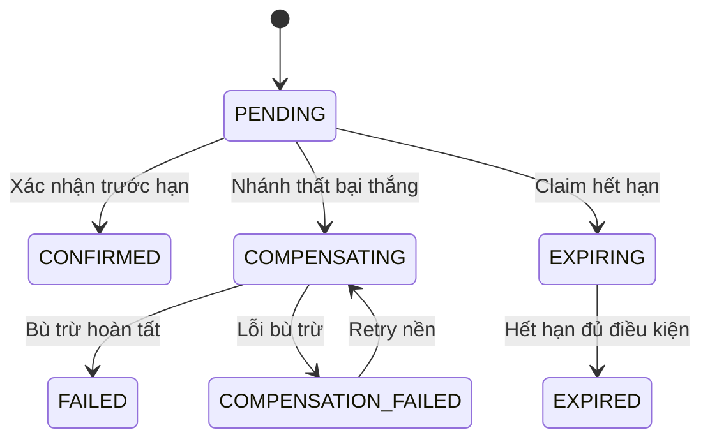
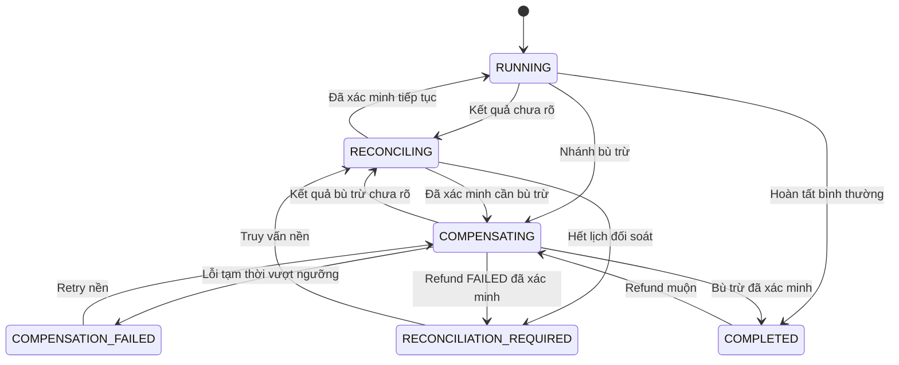
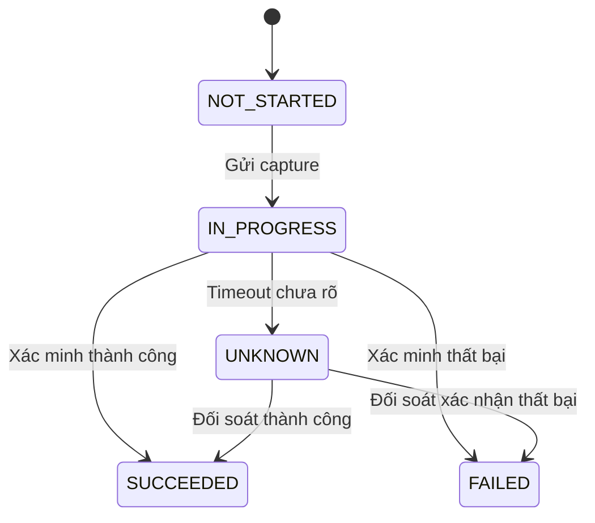

# 09. State Machine – Resilient Order Workflow

## 1. Mục đích, phạm vi và quy ước

Tài liệu mô tả trạng thái, chuyển trạng thái hợp lệ, điều kiện chuyển, xử lý lỗi và quy tắc phục hồi của luồng đặt hàng có khả năng chịu lỗi trong dự án APP-08 – Resilient Order Workflow.

Phạm vi bao gồm Order, Saga, Payment capture/refund, Reservation, Outbox và Notification.

Tên trạng thái, tên sự kiện, cấu trúc lưu trữ và trách nhiệm ghi dữ liệu là đề xuất của Người 1 – Business Analyst, chờ Người 2 xác nhận trước khi chốt thiết kế kỹ thuật.

### 1.1. Quy ước thời gian

- TTL mặc định của Order: 15 phút.
- `expireAt = createdAt + TTL`.
- TTL Worker quét Order hết hạn mỗi 5 giây.
- Lease của worker mặc định là 30 giây; gia hạn khi worker vẫn đang xử lý.
- Thời gian nghiệp vụ được tính theo đồng hồ DB UTC.
- `now() < expireAt` là điều kiện thời gian để xác nhận Order.
- `now() >= expireAt` là điều kiện thời gian để claim nhánh hết hạn.
- Không gia hạn `expireAt` vì timeout, lỗi hệ thống hoặc kết quả thanh toán chưa rõ.

### 1.2. Quy ước xử lý

- Các nhánh cạnh tranh từ Order `PENDING` dùng conditional update và kiểm tra số dòng bị tác động.
- Nếu conditional update tác động 0 dòng, worker phải đọc lại trạng thái; không ghi đè trạng thái mới.
- Trước mỗi lệnh tiến như reserve hoặc capture, orchestrator phải kiểm tra Order vẫn `PENDING`.
- Sau khi Order rời `PENDING`, không gửi lệnh tiến mới.
- Lệnh đã gửi trước khi Order rời `PENDING` có thể hoàn tất muộn; reservation đến muộn phải được vô hiệu hóa hoặc giải phóng, capture thành công muộn phải được refund theo nhánh nghiệp vụ.
- `UNKNOWN` có nghĩa là chưa xác minh được kết quả, không đồng nghĩa với `FAILED`.
- Mỗi lần retry cùng một hành động phải dùng cùng khóa idempotency.
- Điều kiện liên quan dữ liệu của service khác phải dựa trên kết quả đã xác minh và được lưu cục bộ; không truy vấn chéo DB giữa các service.

## 2. Tổng quan các loại trạng thái

| Đối tượng | Các trạng thái | Service sở hữu và ghi trạng thái |
|---|---|---|
| Order | `PENDING`, `CONFIRMED`, `COMPENSATING`, `COMPENSATION_FAILED`, `EXPIRING`, `FAILED`, `EXPIRED` | Order Service |
| Saga | `RUNNING`, `RECONCILING`, `RECONCILIATION_REQUIRED`, `COMPENSATING`, `COMPENSATION_FAILED`, `COMPLETED` | Order Service / Saga Orchestrator theo thiết kế cần Người 2 xác nhận |
| Payment capture | `NOT_STARTED`, `IN_PROGRESS`, `SUCCEEDED`, `FAILED`, `UNKNOWN` | Payment Service sở hữu kết quả; Order Service lưu bản kết quả đã xác minh |
| Payment refund | `NOT_REQUIRED`, `NOT_STARTED`, `IN_PROGRESS`, `SUCCEEDED`, `FAILED`, `UNKNOWN` | Payment Service sở hữu kết quả; Order Service lưu bản kết quả đã xác minh |
| Reservation | `NOT_CREATED`, `RESERVED`, `RELEASED`, `REJECTED`, `UNKNOWN` | Inventory Service sở hữu kết quả; Order Service lưu bản kết quả đã xác minh |
| Outbox | `NEW`, `PUBLISHED` | Service sở hữu transaction ghi domain event; Publisher cập nhật trạng thái publish |
| Notification | `PENDING`, `SENT`, `FAILED_RETRYING` | Notification Service |

Order Service không đọc trực tiếp bảng nội bộ của Inventory Service hoặc Payment Service. Các trạng thái cục bộ như `capture_status` và `reservation_status` là bản ghi kết quả đã xác minh được đồng bộ về Order Service qua phản hồi hoặc sự kiện.

## 3. State machine của Order

### 3.1. Định nghĩa trạng thái

Order có đúng 7 trạng thái.

| Trạng thái | Ý nghĩa | Loại |
|---|---|---|
| `PENDING` | Order được tạo và đang chờ hoàn tất các điều kiện xác nhận. | Ban đầu |
| `CONFIRMED` | Reservation đã được xác minh `RESERVED`, capture đã được xác minh `SUCCEEDED` và Order được xác nhận trước hạn. | Kết thúc |
| `COMPENSATING` | Nhánh thất bại đã thắng; hệ thống đang xử lý các hành động bù trừ bắt buộc. | Đang xử lý |
| `COMPENSATION_FAILED` | Nhánh bù trừ gặp lỗi tạm thời vượt ngưỡng retry. Chỉ chuyển đến từ `COMPENSATING`. | Lỗi có thể retry |
| `EXPIRING` | TTL Worker đã claim nhánh hết hạn; hệ thống đang xác minh và xử lý release/refund cần thiết. | Đang xử lý |
| `FAILED` | Nhánh thất bại đã hoàn tất các hành động bù trừ bắt buộc. | Kết thúc |
| `EXPIRED` | Nhánh hết hạn đã hoàn tất các điều kiện bắt buộc để kết thúc Order. | Kết thúc |

Các chuyển trạng thái Order hợp lệ:

- `PENDING → CONFIRMED`
- `PENDING → COMPENSATING`
- `PENDING → EXPIRING`
- `COMPENSATING → FAILED`
- `COMPENSATING → COMPENSATION_FAILED`
- `COMPENSATION_FAILED → COMPENSATING`
- `EXPIRING → EXPIRED`

Không có chuyển `EXPIRING → COMPENSATION_FAILED` hoặc `COMPENSATION_FAILED → EXPIRING`.

### 3.2. Sơ đồ trạng thái Order



Ba nhánh cạnh tranh từ `PENDING` là `CONFIRMED`, `COMPENSATING` và `EXPIRING`. Chỉ một nhánh được phép thắng thông qua conditional update; worker thua phải đọc lại trạng thái hiện tại.

### 3.3. Bảng chuyển trạng thái Order

| ID | Từ → Đến | Trigger | Điều kiện (guard) | Hành động ghi | Sự kiện Outbox | Bên thực hiện | Truy vết |
|---|---|---|---|---|---|---|---|
| T-01 | `PENDING → CONFIRMED` | Reservation và capture đã thành công. | Order vẫn `PENDING`; `now() < expireAt`; reservation `RESERVED` đã xác minh; capture `SUCCEEDED` đã xác minh; paymentId thuộc đúng Order; số tiền khớp nếu mô hình dữ liệu có giá. | Cập nhật Order `CONFIRMED`, ghi `confirmed_at`, cập nhật Saga `COMPLETED`, ghi Outbox trong cùng transaction. | `OrderConfirmed` | Order Service | UC-03; FR-05, FR-06, FR-09; BR-01, BR-03, BR-06, BR-07; EC-02, EC-03, EC-05; D-01.1; NFR-02 |
| T-02 | `PENDING → COMPENSATING` | Reserve bị từ chối. | Order vẫn `PENDING`; kết quả reserve `REJECTED` đã xác minh. | Claim nhánh thất bại; bắt đầu xác định các hành động bù trừ cần thiết. | Không phát domain event; có thể phát cảnh báo vận hành. | Order Service | UC-02, UC-03, UC-04; FR-03, FR-04, FR-07; BR-02, BR-04; EC-01, EC-02; D-01; NFR-02 |
| T-03 | `PENDING → COMPENSATING` | Capture thất bại. | Order vẫn `PENDING`; capture `FAILED` đã được Payment Service xác minh. | Claim nhánh thất bại trước khi release reservation hoặc thực hiện bù trừ khác. | Không phát domain event; có thể phát cảnh báo vận hành. | Order Service | UC-02, UC-03, UC-04; FR-03, FR-04, FR-07; BR-02, BR-04; EC-01, EC-02; D-01; NFR-02 |
| T-04 | `PENDING → EXPIRING` | TTL Worker phát hiện Order quá hạn. | DB UTC `now() >= expireAt`; capture khác `UNKNOWN`; Order vẫn `PENDING`. | Claim bằng conditional update; ghi `claimToken`, `claimedAt`, `leaseUntil`; lease mặc định 30 giây. | Không phát domain event; có thể phát cảnh báo vận hành. | TTL Worker | UC-06; FR-15; BR-07, BR-10, BR-13; EC-04, EC-06, EC-11; D-01.2, D-01.5, D-06; NFR-02, NFR-07 |
| T-05 | `COMPENSATING → FAILED` | Bù trừ hoàn tất. | Reservation đã release hoặc được xác minh không tồn tại; capture/refund đã đủ rõ; mọi bù trừ bắt buộc đã được xác minh. | Ghi Order `FAILED`; hoàn tất Saga; ghi domain event trong cùng transaction. | `OrderFailed` | Order Service | UC-04; FR-07, FR-08, FR-12; BR-04, BR-08; EC-02, EC-09; D-03, D-05; NFR-01 |
| T-06 | `COMPENSATING → COMPENSATION_FAILED` | Release/refund gặp lỗi tạm thời vượt ngưỡng gửi. | Đã gửi quá 5 lần; lỗi được xác định là tạm thời, không phải kết quả `UNKNOWN`. | Ghi trạng thái lỗi; Saga `COMPENSATION_FAILED`; phát cảnh báo và retry nền mỗi 60 giây. | Không phát domain event; có thể phát cảnh báo vận hành. | Order Service / Saga Orchestrator | UC-04, UC-08; FR-12, FR-13; BR-08, BR-10; EC-09; D-03.2; NFR-04, NFR-08 |
| T-07 | `COMPENSATION_FAILED → COMPENSATING` | Đến lịch retry nền. | Hành động bù trừ chưa hoàn tất; dùng cùng khóa idempotency. | Chuyển lại `COMPENSATING`; tiếp tục xử lý release/refund. | Không phát domain event; có thể phát cảnh báo vận hành. | Order Service / Saga Orchestrator | UC-04, UC-08; FR-12, FR-13; BR-08, BR-10; EC-09; D-03.2; NFR-04, NFR-08 |
| T-08 | `EXPIRING → EXPIRED` | Các điều kiện hết hạn đã được xác minh đầy đủ. | `claimToken` khớp; lease chưa hết hạn; capture/refund không phải `UNKNOWN` hoặc `IN_PROGRESS`; reservation `RELEASED` hoặc đã xác minh không tồn tại; nếu capture `SUCCEEDED` thì refund `SUCCEEDED`. | Ghi Order `EXPIRED`, Saga `COMPLETED`, Outbox trong cùng transaction. | `OrderExpired` | TTL Worker / Order Service | UC-06, UC-11; FR-08, FR-12, FR-15; BR-07, BR-08, BR-13; EC-11; D-05, D-06.2; NFR-07 |

Các điều kiện về Reservation và capture được kiểm tra trên bản đã xác minh do Order Service lưu trong DB của chính nó (ví dụ bản trạng thái trên bảng Saga), không truy vấn chéo DB của Inventory Service hoặc Payment Service. Người 2 xác nhận cấu trúc lưu trữ này.

### 3.4. Điều kiện chi tiết và pseudo-SQL

#### T-01 – PENDING → CONFIRMED

Điều kiện xác nhận phải được kiểm tra trong cùng câu lệnh cập nhật. Order Service dùng các cột cục bộ chứa kết quả đã xác minh.

```sql
BEGIN;

UPDATE orders
SET status = 'CONFIRMED',
    confirmed_at = db_now()
WHERE order_id = :orderId
  AND status = 'PENDING'
  AND expire_at > db_now()
  AND reservation_status = 'RESERVED'
  AND reservation_verified = TRUE
  AND capture_status = 'SUCCEEDED'
  AND capture_verified = TRUE
  AND payment_id = :paymentId
  AND captured_amount = total_amount;

-- Nếu tác động đúng 1 dòng:
-- 1. Cập nhật Saga COMPLETED (S-12).
-- 2. Ghi OrderConfirmed vào Outbox.
-- 3. Cả ba thao tác nằm trong cùng transaction.

-- Nếu tác động 0 dòng:
-- Không ghi OrderConfirmed.
-- Đọc lại Order và xử lý theo nhánh đã thắng.

COMMIT;
```

Tên cột là tên logic. `db_now()` là hàm thời gian tại thời điểm thực thi câu lệnh; Người 2 chọn hàm tương ứng với DB. Điều kiện `captured_amount = total_amount` chỉ áp dụng nếu mô hình dữ liệu có giá. Việc xác minh `paymentId` thuộc đúng Order và số tiền khớp tổng đơn cần Người 2 xác nhận.

#### T-04 – PENDING → EXPIRING

TTL Worker chỉ claim Order quá hạn khi capture khác `UNKNOWN`. Capture `IN_PROGRESS` không chặn claim. Reservation `UNKNOWN` không chặn claim, nhưng phải truy vấn theo khóa reserve ổn định trước khi release.

```sql
UPDATE orders
SET status = 'EXPIRING',
    claim_token = :claimToken,
    claimed_at = db_now(),
    lease_until = db_now() + INTERVAL '30 seconds'
WHERE order_id = :orderId
  AND status = 'PENDING'
  AND expire_at <= db_now()
  AND capture_status IS DISTINCT FROM 'UNKNOWN';
```

Nếu DB không hỗ trợ `IS DISTINCT FROM`, dùng cột `capture_status NOT NULL DEFAULT 'NOT_STARTED'` và điều kiện tương ứng.

Nếu cập nhật 0 dòng, worker đọc lại Order. Worker cũng phải quét Order `EXPIRING` có `lease_until < db_now()` để tiếp quản sau khi lease hết hạn. Gia hạn lease khi worker còn xử lý, không gia hạn `expireAt`.

#### T-08 – EXPIRING → EXPIRED

Cần đồng thời thỏa mãn:

1. `claimToken` khớp và `leaseUntil` chưa hết hạn tại thời điểm cập nhật.
2. Capture không phải `UNKNOWN` hoặc `IN_PROGRESS`.
3. Refund không phải `UNKNOWN` hoặc `IN_PROGRESS`.
4. Reservation đã `RELEASED` hoặc được xác minh không tồn tại (`NOT_CREATED`/`REJECTED`).
5. Nếu capture `SUCCEEDED`, refund phải được xác minh `SUCCEEDED`.
6. Cập nhật Order `EXPIRED`, Saga `COMPLETED` và ghi `OrderExpired` vào Outbox trong cùng transaction.

```sql
BEGIN;

UPDATE orders
SET status = 'EXPIRED',
    expired_at = db_now()
WHERE order_id = :orderId
  AND status = 'EXPIRING'
  AND claim_token = :claimToken
  AND lease_until > db_now()
  AND capture_status NOT IN ('UNKNOWN', 'IN_PROGRESS')
  AND refund_status NOT IN ('UNKNOWN', 'IN_PROGRESS')
  AND reservation_status IN ('RELEASED', 'NOT_CREATED', 'REJECTED')
  AND (
      capture_status <> 'SUCCEEDED'
      OR refund_status = 'SUCCEEDED'
  );

-- Nếu tác động đúng 1 dòng:
-- Cập nhật Saga COMPLETED và ghi OrderExpired trong cùng transaction.
-- Nếu tác động 0 dòng:
-- Không phát OrderExpired; đọc lại trạng thái và tiếp tục xử lý phù hợp.

COMMIT;
```

Điều kiện SQL phải được triển khai sao cho cột trạng thái không `NULL`, hoặc dùng biểu thức chống `NULL` phù hợp. Tên bảng, cột và hàm thời gian là tên logic cần Người 2 xác nhận.

### 3.5. Thanh toán hoàn tất trước hạn nhưng xác minh sau hạn

Theo đề xuất hiện tại, nếu capture thực tế hoàn tất trước `expireAt` nhưng chỉ được xác minh `SUCCEEDED` khi `now() >= expireAt`, Order không được `CONFIRMED`. TTL Worker xử lý nhánh `EXPIRING`; khoản đã capture phải được refund theo D-05 và UC-11.

Phương án xác nhận dựa trên thời điểm Payment Service thực sự hoàn tất chỉ áp dụng nếu Q-01 được chốt và Người 2 xác nhận A-04.

## 4. State machine của Saga

### 4.1. Định nghĩa trạng thái

| Trạng thái | Ý nghĩa | Loại |
|---|---|---|
| `RUNNING` | Đang thực hiện luồng đặt hàng bình thường. | Đang xử lý |
| `RECONCILING` | Đang tự động truy vấn để xác minh kết quả chưa rõ của reserve, capture, release hoặc refund. | Đang xử lý |
| `RECONCILIATION_REQUIRED` | Lịch đối soát tự động đã hết mà kết quả chưa được xác minh, hoặc refund đã được xác minh `FAILED` và không thể tự xử lý an toàn. | Chờ xử lý |
| `COMPENSATING` | Đang thực hiện các hành động bù trừ cần thiết. | Đang xử lý |
| `COMPENSATION_FAILED` | Hành động release/refund gặp lỗi tạm thời vượt ngưỡng gửi lại. | Lỗi có thể retry |
| `COMPLETED` | Saga đã hoàn tất các hành động cần thiết và thỏa điều kiện kết thúc tương ứng. | Kết thúc |

`RECONCILIATION_REQUIRED` có hai nguyên nhân: hết lịch đối soát tự động, hoặc refund `FAILED` đã xác minh cần can thiệp thủ công theo Q-08.

### 4.2. Sơ đồ trạng thái Saga



### 4.3. Bảng chuyển trạng thái Saga

| ID | Từ → Đến | Trigger | Điều kiện | Hành động tiếp theo | Truy vết |
|---|---|---|---|---|---|
| S-01 | `RUNNING → RECONCILING` | Reserve, capture, release hoặc refund trả về kết quả chưa rõ. | Trạng thái hành động là `UNKNOWN`. | Truy vấn kết quả theo khóa ổn định; không tạo hành động mới bằng khóa khác. | D-04; EC-03, EC-04, EC-05 |
| S-02 | `RUNNING → COMPENSATING` | Nhánh thất bại thắng hoặc nhánh hết hạn thắng và cần bù trừ. | Order đã claim `PENDING → COMPENSATING` hoặc `PENDING → EXPIRING`. | Xác định reservation, capture và refund cần xử lý; thực hiện bù trừ có idempotency. | D-01; D-02; D-05 |
| S-03 | `RECONCILING → RUNNING` | Kết quả hành động được xác minh và luồng bình thường còn được phép tiếp tục. | Order vẫn `PENDING`; không có kết quả nào buộc phải bù trừ. | Tiếp tục luồng theo điều kiện Order; kiểm tra trạng thái trước mỗi lệnh tiến. | D-01; D-04 |
| S-04 | `RECONCILING → COMPENSATING` | Đối soát xác nhận cần bù trừ. | Kết quả reserve/capture/release/refund đã đủ rõ để xác định hành động bù trừ. | Thực hiện release/refund cần thiết với khóa idempotency ổn định. | D-04; D-05 |
| S-05 | `RECONCILING → RECONCILIATION_REQUIRED` | Đã dùng hết lịch đối soát. | Đủ 30 lần truy vấn mà kết quả vẫn chưa xác minh. | Phát cảnh báo; tiếp tục truy vấn nền mỗi 5 phút; chờ xử lý theo Q-02. | D-04; Q-02; Q-03 |
| S-06 | `RECONCILIATION_REQUIRED → RECONCILING` | Đến chu kỳ truy vấn nền. | Kết quả hành động vẫn chưa được xác minh. | Truy vấn lại bằng khóa ổn định; không tự kết luận thành công/thất bại. | D-04; NFR-05 |
| S-07 | `COMPENSATING → COMPENSATION_FAILED` | Release/refund thất bại tạm thời quá ngưỡng gửi. | Đã gửi quá 5 lần; kết quả là lỗi xác định, không phải timeout chưa rõ. | Lưu lỗi và lên lịch retry nền mỗi 60 giây; phát cảnh báo vận hành. | D-03.2; EC-09; NFR-04 |
| S-08 | `COMPENSATION_FAILED → COMPENSATING` | Đến lịch retry nền. | Hành động bù trừ chưa hoàn tất; dùng lại khóa idempotency ban đầu. | Retry release/refund; xác minh kết quả trước khi hoàn tất Saga. | D-02; D-03.2; NFR-04 |
| S-09 | `COMPENSATING → RECONCILING` | Lệnh release/refund timeout hoặc kết quả chưa rõ. | Trạng thái hành động chuyển thành `UNKNOWN`. | Dừng gửi lệnh bù trừ mới cho đến khi đối soát; truy vấn theo khóa ổn định. | D-04; D-05 |
| S-10 | `COMPENSATING → COMPLETED` | Tất cả hành động bù trừ bắt buộc đã được xác minh. | Reservation đã release hoặc được xác minh không tồn tại; nếu capture thành công thì refund bắt buộc đã thành công. | Hoàn tất nhánh thất bại/hết hạn; ghi trạng thái Order và domain event theo transaction tương ứng. | D-05; D-06 |
| S-11 | `COMPLETED → COMPENSATING` | Phát hiện capture thành công muộn sau khi Order đã `EXPIRED`. | Chỉ áp dụng cho refund muộn; đề xuất chờ Người 2 xác nhận A-17, Q-07. | Xử lý refund với khóa idempotency ổn định; Order vẫn `EXPIRED`. | D-05.4; UC-11; A-17; Q-07 |
| S-12 | `RUNNING → COMPLETED` | T-01 thắng. | Order `CONFIRMED` đã commit. | Ghi Saga `COMPLETED` cùng transaction với T-01. | D-01.1; UC-03 |
| S-13 | `COMPENSATING → RECONCILIATION_REQUIRED` | Refund được xác minh `FAILED`. | Payment Service đã xác minh refund thất bại; cùng khóa idempotency không thể tạo một lần refund mới. | Không tự retry bằng cùng khóa; phát cảnh báo và chờ quyết định xử lý theo Q-02, Q-08. | D-02; Q-02; Q-08 |

### 4.4. Phân biệt lỗi tạm thời và kết quả chưa rõ

| Tình huống | Trạng thái hành động | Trạng thái Saga | Cách xử lý |
|---|---|---|---|
| Release/refund trả lỗi tạm thời xác định và đã gửi quá 5 lần. | Lỗi đã xác định, không phải `UNKNOWN`. | `COMPENSATION_FAILED` | Với lỗi kết nối, HTTP 5xx hoặc xung đột lock có thể thử lại (D-03.1), retry nền mỗi 60 giây và dùng cùng khóa idempotency. |
| Reserve/capture/release/refund timeout, không biết dịch vụ đích đã thực hiện hay chưa. | `UNKNOWN` | `RECONCILING` | Truy vấn kết quả theo khóa ổn định; không gửi hành động mới với khóa khác. |
| Đã thực hiện đủ lịch đối soát nhưng kết quả vẫn chưa rõ. | Giữ `UNKNOWN` | `RECONCILIATION_REQUIRED` | Cảnh báo, truy vấn nền mỗi 5 phút và xử lý theo Q-02. |
| Refund đã được xác minh `FAILED`. | `FAILED` | `RECONCILIATION_REQUIRED` | Không tự retry bằng cùng khóa đã lưu kết quả thất bại; cần quyết định xử lý thủ công hoặc cho phép khóa phiên bản mới theo Q-08. |

### 4.5. Lịch đối soát

Áp dụng một lịch thống nhất cho kết quả chưa rõ của reserve, capture, release và refund:

- 12 lần truy vấn, mỗi lần cách nhau 5 giây trong 60 giây đầu.
- Tiếp theo 18 lần truy vấn, mỗi lần cách nhau 30 giây, đến mốc 10 phút.
- Tổng cộng 30 lần truy vấn tự động.
- Khi hết lịch mà vẫn chưa rõ, chuyển Saga sang `RECONCILIATION_REQUIRED`, phát cảnh báo và tiếp tục truy vấn nền mỗi 5 phút.
- Không giải phóng reservation, không refund, không chốt Order `EXPIRED`, không tự đặt capture thành `FAILED` và không gia hạn `expireAt` chỉ vì kết quả chưa rõ.

Reservation `UNKNOWN` cũng dùng lịch trên; không sử dụng lịch đối soát riêng 30 giây.

### 4.6. Refund muộn khi Order đã EXPIRED

Nếu Payment Service xác minh capture đã thành công sau khi Order đã `EXPIRED`, Order vẫn giữ `EXPIRED`. Mô hình đề xuất là cho Saga chuyển `COMPLETED → COMPENSATING` chỉ để xử lý refund muộn, sau đó chuyển theo kết quả xác minh. Không tạo thêm mô hình tác vụ refund độc lập song song.

Đây là đề xuất cần Người 2 xác nhận tại A-17, Q-07. Trong thời gian chưa chốt, trường hợp này phải được đánh dấu là điểm cần xác nhận khi triển khai.

## 5. State machine của Payment

Capture và refund được theo dõi độc lập. `IN_PROGRESS` được dùng cho hành động đang thực hiện; không dùng `PENDING` để tránh nhầm với trạng thái Order.

### 5.1. Trạng thái capture

| Trạng thái | Ý nghĩa |
|---|---|
| `NOT_STARTED` | Chưa gửi lệnh capture. |
| `IN_PROGRESS` | Lệnh capture đã gửi và đang chờ kết quả. |
| `SUCCEEDED` | Payment Service đã xác minh capture thành công. |
| `FAILED` | Payment Service đã xác minh capture thất bại. |
| `UNKNOWN` | Chưa xác định được capture đã thực hiện hay chưa. |

### 5.2. Sơ đồ capture



### 5.3. Bảng chuyển trạng thái capture

| ID | Từ → Đến | Trigger | Điều kiện | Hành động | Truy vết |
|---|---|---|---|---|---|
| P-01 | `NOT_STARTED → IN_PROGRESS` | Orchestrator gửi lệnh capture. | Order vẫn `PENDING`; reservation đã `RESERVED`; khóa idempotency đúng. | Gửi capture bằng `payment:capture:{orderId}:v1`. | D-01; D-02; FR-05 |
| P-02 | `IN_PROGRESS → SUCCEEDED` | Payment Service trả kết quả thành công. | Kết quả được xác minh và gắn với đúng Order. | Lưu paymentId và kết quả capture; cho phép xét điều kiện xác nhận Order nếu còn trước hạn. | D-01.1; BR-01 |
| P-03 | `IN_PROGRESS → FAILED` | Payment Service xác minh capture thất bại. | Có kết quả thất bại xác định; không chỉ dựa vào timeout. | Kích hoạt nhánh thất bại; Order phải claim `PENDING → COMPENSATING` trước bù trừ. | D-01; D-03; EC-02 |
| P-04 | `IN_PROGRESS → UNKNOWN` | Lệnh capture timeout hoặc kết quả không nhận được. | Không đủ bằng chứng xác định thành công/thất bại. | Đưa Saga sang `RECONCILING`; không kết luận capture thất bại. | D-04; EC-03 |
| P-05 | `UNKNOWN → SUCCEEDED` | Đối soát xác nhận capture thành công. | Payment Service xác minh kết quả theo khóa capture ban đầu. | Lưu kết quả; nếu Order đã `EXPIRING` hoặc `EXPIRED`, xử lý theo nhánh refund tương ứng. | D-04; D-05; UC-11 |
| P-06 | `UNKNOWN → FAILED` | Đối soát xác nhận capture thất bại. | Payment Service xác minh thất bại bằng dữ liệu có thẩm quyền. | Lưu kết quả thất bại đã xác minh; tiếp tục nhánh nghiệp vụ phù hợp. | D-04; EC-03 |

Không chuyển capture từ `UNKNOWN` sang `FAILED` do timeout hoặc do hết 30 lần truy vấn. Không chuyển capture từ `SUCCEEDED` sang `FAILED` chỉ vì refund đang `UNKNOWN` hoặc thất bại.

### 5.4. Trạng thái refund

| Trạng thái | Ý nghĩa |
|---|---|
| `NOT_REQUIRED` | Không cần refund vì capture chưa thành công hoặc không phát sinh khoản cần hoàn. |
| `NOT_STARTED` | Cần refund nhưng chưa gửi lệnh. |
| `IN_PROGRESS` | Lệnh refund đã gửi và đang chờ kết quả. |
| `SUCCEEDED` | Payment Service đã xác minh refund thành công. |
| `FAILED` | Payment Service đã xác minh refund thất bại. |
| `UNKNOWN` | Chưa xác định được refund đã thực hiện hay chưa. |

### 5.5. Bảng chuyển trạng thái refund

| ID | Từ → Đến | Trigger | Điều kiện | Hành động | Truy vết |
|---|---|---|---|---|---|
| R-01 | `NOT_REQUIRED → NOT_STARTED` | Capture đã `SUCCEEDED` nhưng Order không thể `CONFIRMED`. | Đơn đã đi vào nhánh thất bại/hết hạn và khoản đã capture cần được hoàn. | Khởi tạo refund; gửi bằng khóa `payment:refund:{orderId}:{paymentId}:v1`. | D-05; UC-11 |
| R-02 | `NOT_STARTED → IN_PROGRESS` | Orchestrator gửi lệnh refund. | Capture đã được xác minh `SUCCEEDED`; nhánh nghiệp vụ yêu cầu refund. | Gửi refund với khóa `payment:refund:{orderId}:{paymentId}:v1`. | D-02; D-05 |
| R-03 | `IN_PROGRESS → SUCCEEDED` | Payment Service xác minh refund thành công. | Kết quả refund đã được xác minh. | Lưu kết quả; cho phép hoàn tất bù trừ nếu các điều kiện khác cũng đạt. | D-05; D-06 |
| R-04 | `IN_PROGRESS → FAILED` | Payment Service xác minh refund thất bại. | Có kết quả thất bại xác định. | Không tự retry bằng cùng khóa đã lưu kết quả thất bại. Saga chuyển `RECONCILIATION_REQUIRED`; xử lý thủ công theo đề xuất, khóa phiên bản mới chỉ được dùng khi có quyết định có chủ ý theo Q-08. | D-02; Q-02; Q-08 |
| R-05 | `IN_PROGRESS → UNKNOWN` | Refund timeout hoặc kết quả không rõ. | Chưa thể xác minh refund đã thực hiện hay chưa. | Saga chuyển `RECONCILING`; không gửi refund mới với khóa khác. | D-04; D-05 |
| R-06 | `UNKNOWN → SUCCEEDED` | Đối soát xác nhận refund thành công. | Payment Service xác minh bằng khóa refund ban đầu. | Lưu kết quả; tiếp tục điều kiện hoàn tất bù trừ. | D-04; D-06 |
| R-07 | `UNKNOWN → FAILED` | Đối soát xác nhận refund thất bại. | Payment Service xác minh thất bại bằng dữ liệu có thẩm quyền. | Không tự retry bằng cùng khóa đã lưu kết quả thất bại. Saga chuyển `RECONCILIATION_REQUIRED`; xử lý thủ công theo đề xuất, khóa phiên bản mới chỉ được dùng khi có quyết định có chủ ý theo Q-08. | D-04; Q-02; Q-08 |

Timeout hoặc hết lịch đối soát không đủ căn cứ để chuyển refund `UNKNOWN → SUCCEEDED` hay `UNKNOWN → FAILED`. Capture và refund là hai trạng thái độc lập; capture thành công không đồng nghĩa refund thành công.

## 6. State machine của Reservation

### 6.1. Định nghĩa trạng thái

| Trạng thái | Ý nghĩa |
|---|---|
| `NOT_CREATED` | Chưa có reservation cho Order. |
| `RESERVED` | Inventory Service xác minh hàng đã được giữ cho Order. |
| `RELEASED` | Inventory Service xác minh reservation đã được giải phóng. |
| `REJECTED` | Inventory Service xác minh không thể giữ hàng. |
| `UNKNOWN` | Chưa xác định được lệnh reserve/release đã có hiệu lực hay chưa. |

Khi trạng thái Reservation chuyển thành `UNKNOWN`, phải lưu thêm `unknownOperation` với giá trị `RESERVE` hoặc `RELEASE` để xác định hành động đang cần đối soát.

### 6.2. Bảng chuyển trạng thái Reservation

| ID | Từ → Đến | Trigger | Điều kiện | Hành động | Truy vết |
|---|---|---|---|---|---|
| V-01 | `NOT_CREATED → RESERVED` | Inventory Service xử lý lệnh reserve. | Order còn `PENDING`; khóa reserve ổn định; tồn kho đáp ứng yêu cầu. | Lưu reservationId và kết quả reserve. | D-01; D-02; BR-02, BR-05 |
| V-02 | `NOT_CREATED → REJECTED` | Inventory Service từ chối reserve. | Tồn kho không đáp ứng hoặc có lý do từ chối xác định. | Order claim `PENDING → COMPENSATING`, sau đó hoàn tất nhánh thất bại. | D-01; EC-01 |
| V-03 | `NOT_CREATED → UNKNOWN` | Lệnh reserve timeout. | Không biết Inventory Service đã tạo reservation hay chưa. | Lưu `unknownOperation = RESERVE`; Saga chuyển `RECONCILING`; truy vấn theo khóa reserve ổn định. | D-04; EC-04 |
| V-04 | `UNKNOWN → RESERVED` | Đối soát lệnh reserve xác nhận reservation tồn tại. | `unknownOperation = RESERVE`; Inventory Service xác minh bằng khóa reserve ban đầu. | Lưu reservationId; nếu Order đã rời `PENDING`, không gửi lệnh tiến mới và xét nhu cầu release. | D-01.5; D-04 |
| V-05 | `UNKNOWN → REJECTED` | Đối soát xác nhận reserve bị từ chối. | `unknownOperation = RESERVE`; Inventory Service xác minh kết quả từ chối. | Tiếp tục nhánh thất bại hoặc hết hạn theo trạng thái Order. | D-04; EC-04 |
| V-06 | `RESERVED → RELEASED` | Orchestrator gửi release. | Có reservation đã xác minh; nhánh thất bại/hết hạn yêu cầu release; khóa release ổn định. | Gửi `inventory:release:{orderId}:{reservationId}:v1`; xác minh kết quả. | D-02; D-05 |
| V-07 | `RESERVED → UNKNOWN` | Lệnh release timeout. | Chưa xác định được release đã có hiệu lực hay chưa. | Lưu `unknownOperation = RELEASE`; Saga chuyển `RECONCILING`; truy vấn theo khóa release ban đầu. | D-04; EC-09 |
| V-08 | `UNKNOWN → RELEASED` | Đối soát xác nhận release thành công. | `unknownOperation = RELEASE`; Inventory Service xác minh release đã có hiệu lực. | Lưu `RELEASED`; tiếp tục điều kiện hoàn tất bù trừ. | D-04; D-06 |
| V-09 | `UNKNOWN → RESERVED` | Đối soát xác minh release chưa có hiệu lực. | `unknownOperation = RELEASE`; Inventory Service xác minh reservation vẫn còn được giữ. | Giữ `RESERVED`; tiếp tục retry release bằng khóa cũ `inventory:release:{orderId}:{reservationId}:v1`. | D-02; D-04; D-05 |

Không được chuyển Reservation từ `UNKNOWN` sang `RELEASED` chỉ vì timeout hoặc hết lịch đối soát. Khi Reservation là `UNKNOWN`, phải truy vấn theo khóa reserve/release tương ứng trước khi quyết định hành động tiếp theo. Không tạo reservation thứ hai bằng khóa khác để thay cho lệnh chưa rõ kết quả.

Nếu reserve đến muộn sau khi Order đã rời `PENDING` hoặc reservation đã được release, Inventory Service phải vô hiệu hóa hoặc giải phóng reservation đến muộn của cùng `orderId`. Quy tắc này nhằm ngăn reservation mồ côi theo D-01.5 và A-13.

## 7. State machine của Outbox và Notification

### 7.1. Outbox

Outbox lưu domain event trong cùng transaction với thay đổi trạng thái Order tương ứng. Publisher gửi event theo cơ chế at-least-once; event có thể được phát lại nên consumer phải chống xử lý trùng.

#### 7.1.1. Trạng thái Outbox

| Trạng thái | Ý nghĩa |
|---|---|
| `NEW` | Event đã được lưu nhưng chưa xác nhận publish thành công. |
| `PUBLISHED` | Publisher đã xác nhận publish thành công. |

#### 7.1.2. Bảng chuyển trạng thái Outbox

| ID | Từ → Đến | Trigger | Điều kiện | Hành động | Truy vết |
|---|---|---|---|---|---|
| O-01 | `NEW → PUBLISHED` | Publisher gửi event thành công. | Broker xác nhận publish thành công. | Đánh dấu `PUBLISHED`; giữ nguyên `eventId`. | D-02; BR-09; NFR-06 |
| O-02 | `NEW → NEW` | Publish thất bại hoặc publisher chưa nhận được xác nhận. | Chưa có bằng chứng publish thành công. | Giữ event; retry theo backoff; không xóa event và không tạo `eventId` mới. | D-02; EC-08; NFR-06 |

#### 7.1.3. Chính sách retry và chống trùng

- Các mốc backoff ban đầu: 1, 2, 4, 8, 16, 32 và 60 giây; sau đó retry mỗi 60 giây.
- Chính sách gửi ban đầu có tối đa 8 lần thử theo cấu hình; nếu vẫn thất bại, tiếp tục retry nền mỗi 60 giây.
- Event được phát lại phải giữ nguyên `eventId`.
- Consumer lưu khóa duy nhất `UNIQUE(consumerName, eventId)` để ngăn tác động nghiệp vụ bị thực hiện trùng.
- Không xóa event chỉ vì publish thất bại.
- Không tuyên bố giao nhận exactly-once; yêu cầu là at-least-once cùng cơ chế chống trùng ở consumer.

Các domain event gồm `OrderConfirmed`, `OrderFailed`, `OrderExpired`. Các cảnh báo vận hành như `CompensationFailed`, `PaymentReconciliationRequired` và `RefundRequired` phải được phân biệt với domain event.

### 7.2. Notification

#### 7.2.1. Trạng thái Notification

| Trạng thái | Ý nghĩa |
|---|---|
| `PENDING` | Thông báo đang chờ gửi. |
| `SENT` | Dịch vụ thông báo xác nhận gửi thành công. |
| `FAILED_RETRYING` | Gửi thông báo thất bại; đang chờ retry nền. |

Không có trạng thái `DEAD_LETTER` trong mô hình này.

#### 7.2.2. Bảng chuyển trạng thái Notification

| ID | Từ → Đến | Trigger | Điều kiện | Hành động | Truy vết |
|---|---|---|---|---|---|
| N-01 | `PENDING → SENT` | Notification Service gửi thông báo thành công. | Kênh gửi xác nhận thành công. | Lưu kết quả gửi; không thay đổi trạng thái Order. | D-02; BR-12; NFR-06 |
| N-02 | `PENDING → FAILED_RETRYING` | Gửi thông báo thất bại. | Chưa có xác nhận gửi thành công. | Lưu lỗi; lên lịch retry nền mỗi 60 giây. | D-03; EC-10; NFR-08 |
| N-03 | `FAILED_RETRYING → SENT` | Retry gửi thành công. | Kết quả gửi được xác minh. | Lưu kết quả thành công; kết thúc retry. | D-03; NFR-06 |
| N-04 | `FAILED_RETRYING → FAILED_RETRYING` | Retry tiếp tục thất bại. | Chưa có xác nhận gửi thành công. | Tiếp tục retry nền mỗi 60 giây theo backoff; giữ định danh thông báo. | D-03; EC-10; NFR-08 |

Khóa idempotency của thông báo:

`notification:{eventId}:{notificationType}:{channel}`

Lỗi Notification Service không được làm thay đổi trạng thái Order. Notification có thể được gửi lại; consumer và dịch vụ thông báo cần dùng định danh ổn định để hạn chế thông báo trùng.

## 8. Ánh xạ trạng thái Order và Saga

Không suy ra trạng thái Order chỉ từ tên trạng thái Saga.

| Trạng thái Order | Trạng thái Saga được phép | Giải thích |
|---|---|---|
| `PENDING` | `RUNNING`, `RECONCILING`, `RECONCILIATION_REQUIRED` | Luồng đặt hàng đang chạy hoặc kết quả hành động chưa rõ, kể cả khi đã quá `expireAt`. Nếu capture là `UNKNOWN`, giữ Order `PENDING` và không claim sang `EXPIRING`. |
| `COMPENSATING` | `COMPENSATING`, `RECONCILING`, `RECONCILIATION_REQUIRED` | Đang xử lý nhánh thất bại hoặc đối soát kết quả bù trừ. |
| `COMPENSATION_FAILED` | `COMPENSATION_FAILED` | Nhánh bù trừ thất bại tạm thời và đang chờ retry nền. |
| `EXPIRING` | `COMPENSATING`, `RECONCILING`, `RECONCILIATION_REQUIRED`, `COMPENSATION_FAILED` | Đang xử lý nhánh hết hạn. Nếu capture/refund chưa rõ, Saga đối soát; nếu release/refund lỗi tạm thời vượt ngưỡng, Saga là `COMPENSATION_FAILED` nhưng Order vẫn `EXPIRING`. |
| `CONFIRMED` | `COMPLETED` | Đơn đã được xác nhận với reservation và capture thành công đã xác minh. |
| `FAILED` | `COMPLETED` | Nhánh thất bại đã hoàn tất các hành động bù trừ bắt buộc. |
| `EXPIRED` | `COMPLETED` | Nhánh hết hạn đã hoàn tất các hành động bắt buộc. |
| `EXPIRED` | `COMPENSATING`, `RECONCILING`, `RECONCILIATION_REQUIRED`, `COMPENSATION_FAILED` | Ngoại lệ refund muộn: Order giữ `EXPIRED`, Saga xử lý refund capture được xác minh muộn. Nếu refund `UNKNOWN` quá lịch đối soát, Saga ở `RECONCILIATION_REQUIRED`. Mô hình này chờ Người 2 xác nhận A-17, Q-07. |

## 9. Các chuyển trạng thái bị cấm

| ID | Chuyển trạng thái bị cấm | Lý do | Tham chiếu |
|---|---|---|---|
| F-01 | `CONFIRMED → EXPIRED` | Đơn đã xác nhận không được chuyển thành hết hạn. | D-01.1; INV-05 |
| F-02 | `EXPIRED → PENDING` | Không khởi động lại đơn đã hết hạn. | D-01; INV-05 |
| F-03 | `EXPIRED → CONFIRMED` | Không xác nhận đơn sau khi đã hết hạn. | D-01.1; D-01.4 |
| F-04 | `FAILED → CONFIRMED` | Đơn thất bại không được xác nhận lại. | D-01; INV-05 |
| F-05 | `FAILED → COMPENSATING` | Nhánh thất bại đã kết thúc; không mở lại Order để bù trừ. | D-01; D-03 |
| F-06 | `EXPIRING → CONFIRMED` | Nhánh hết hạn đã thắng; nếu capture thành công được phát hiện thì phải xử lý refund theo D-05. | D-01.2; D-05 |
| F-07 | `EXPIRING → COMPENSATION_FAILED` | Order ở nhánh hết hạn phải giữ `EXPIRING` khi release/refund lỗi tạm thời vượt ngưỡng; Saga mới là `COMPENSATION_FAILED`. | D-03.2 |
| F-08 | `COMPENSATION_FAILED → EXPIRING` | Không có chuyển ngược từ nhánh thất bại bù trừ sang nhánh hết hạn. | D-01; D-03.2 |
| F-09 | `COMPENSATION_FAILED → CONFIRMED` | Không xác nhận đơn sau khi bù trừ đã thất bại. | D-01; INV-05 |
| F-10 | Capture `UNKNOWN → FAILED` do timeout hoặc hết lịch đối soát | Timeout không chứng minh capture thất bại. Chỉ Payment Service được xác minh kết quả thất bại. | D-04; P-06 |
| F-11 | Refund `UNKNOWN → SUCCEEDED` do timeout | Chưa có bằng chứng refund thành công. | D-04; R-06 |
| F-12 | Reservation `UNKNOWN → RELEASED` do timeout | Chưa xác minh Inventory Service đã giải phóng reservation. | D-01.5; D-04; V-08 |
| F-13 | Capture `SUCCEEDED → FAILED` vì refund chưa rõ | Capture và refund là hai trạng thái độc lập. | D-05; INV-08 |
| F-14 | Outbox `PUBLISHED → NEW` vì consumer chậm | Publish đã thành công; consumer phải chống trùng bằng `eventId`, không làm phát lại bằng cách đảo trạng thái Outbox. | D-02; NFR-06 |
| F-15 | Order `EXPIRED → COMPENSATING` hoặc `EXPIRED → EXPIRING` | Refund muộn chỉ làm thay đổi Saga; Order giữ nguyên `EXPIRED`. | D-05.4; A-17 |
| F-16 | Saga `COMPLETED →` bất kỳ trạng thái nào, trừ `COMPENSATING` cho refund muộn | Saga hoàn tất không chạy lại hành động, ngoại trừ trường hợp refund muộn được đề xuất. | S-11; D-05.4; A-17 |

Các chuyển trạng thái khác ngoài danh sách chuyển hợp lệ trong mục 3–8 không được tự triển khai. Trường hợp cần thêm chuyển trạng thái phải được Người 2 xác nhận trước khi chốt thiết kế và bộ kiểm thử.

## 10. Các bất biến hệ thống

| ID | Bất biến | Cách kiểm tra gợi ý cho Người 3 | Truy vết |
|---|---|---|---|
| INV-01 | Một Order không thể vừa `CONFIRMED` vừa `EXPIRED`. | Kiểm tra lịch sử chuyển trạng thái và chạy test cạnh tranh giữa xác nhận và hết hạn; chỉ một cập nhật từ `PENDING` được thắng. | D-01; NFR-02 |
| INV-02 | Order `CONFIRMED` phải có Reservation `RESERVED` đã xác minh và capture `SUCCEEDED` đã xác minh. | Tạo dữ liệu capture `UNKNOWN` hoặc reservation `UNKNOWN`; xác nhận rằng cập nhật sang `CONFIRMED` bị từ chối. | UC-03; FR-09; BR-01; D-01.1; NFR-02 |
| INV-03 | Không release, refund hoặc chốt `EXPIRED` khi kết quả capture/refund liên quan vẫn `UNKNOWN`. | Giả lập timeout và xác nhận hệ thống chuyển sang `RECONCILING`, không thực hiện hành động phụ thuộc vào kết quả chưa rõ. | D-01.3; D-04; D-06.2 |
| INV-04 | `expireAt` không được gia hạn do capture `UNKNOWN`, lỗi hệ thống hoặc đối soát kéo dài. | Ghi nhận `expireAt` trước và sau timeout, retry, phục hồi worker; giá trị phải không đổi. | D-01.2; D-04; D-08.4 |
| INV-05 | Order ở trạng thái kết thúc không chuyển sang trạng thái khác. Refund muộn chỉ làm thay đổi Saga; Order giữ nguyên `EXPIRED`. | Thử các chuyển `CONFIRMED → EXPIRED`, `FAILED → CONFIRMED`, `EXPIRED → PENDING`; tất cả phải bị từ chối. | D-01; F-01–F-09 |
| INV-06 | Các nhánh cạnh tranh từ `PENDING` dùng conditional update và kiểm tra số dòng bị tác động. | Chạy đồng thời worker xác nhận, worker thất bại và TTL Worker; tối đa một cập nhật từ `PENDING` thành công. Nếu 0 dòng, đọc lại trạng thái. | D-01.1; D-01.2 |
| INV-07 | Retry cùng hành động phải dùng cùng khóa idempotency; consumer chống trùng bằng khóa duy nhất. | Gửi lại nhiều lần cùng một lệnh và xác minh chỉ có một tác động nghiệp vụ hiệu lực. | D-02; BR-03; BR-08; BR-11 |
| INV-08 | Capture và refund có trạng thái độc lập. | Cho capture `SUCCEEDED`, refund `UNKNOWN`; xác nhận capture vẫn `SUCCEEDED` và Order chưa được chốt `EXPIRED` khi refund bắt buộc chưa rõ. | D-05; P-02; R-05 |
| INV-09 | Order chỉ kết thúc sau khi các hành động bù trừ bắt buộc đã được xác minh. | Giả lập release/refund `UNKNOWN`; xác nhận Order không chuyển sang trạng thái kết thúc trước khi đối soát đạt điều kiện. | D-05; D-06.2 |
| INV-10 | Thay đổi trạng thái Order và ghi domain event tương ứng phải nằm trong cùng transaction. | Gây lỗi giữa lúc ghi Order và Outbox; sau rollback không được tồn tại trạng thái Order đã đổi nhưng domain event tương ứng không có. | BR-09; BR-12; D-02; NFR-06 |

### 10.1. Khóa idempotency bắt buộc

| Hành động | Khóa |
|---|---|
| Reserve | `reserve:{orderId}:v1` |
| Capture | `payment:capture:{orderId}:v1` |
| Release | `inventory:release:{orderId}:{reservationId}:v1` |
| Refund | `payment:refund:{orderId}:{paymentId}:v1` |
| Notification | `notification:{eventId}:{notificationType}:{channel}` |
| Chống trùng tại consumer | `UNIQUE(consumerName, eventId)` |

Các khóa trên là đề xuất thiết kế cần Người 2 xác nhận. Khi retry một hành động, phải giữ nguyên khóa đã dùng lần đầu; không tạo khóa mới chỉ vì timeout hoặc chưa nhận được phản hồi. Việc tạo khóa phiên bản mới cho refund đã xác minh `FAILED` cần quyết định có chủ ý theo Q-08.

### 10.2. Quy tắc xác định Reservation mồ côi

- **Vi phạm ngay:** Order `FAILED` hoặc `EXPIRED` nhưng reservation vẫn `RESERVED`. Order `CONFIRMED` có reservation `RESERVED` là trạng thái đúng, không phải mồ côi.
- **Order không tồn tại:** nếu reservation không có Order tương ứng, chỉ đánh dấu vi phạm khi đã qua 5 phút kể từ thời điểm kết thúc chèn lỗi kiểm thử.
- **Không tính là mồ côi trong thời gian xử lý:** reservation thuộc Order `EXPIRING`, `COMPENSATING`, `COMPENSATION_FAILED` hoặc đang chờ đối soát kết quả `UNKNOWN`.
- **Yêu cầu theo dõi:** các trường hợp đang xử lý phải có tiến triển Saga hoặc cảnh báo vận hành theo NFR-08; không được bỏ mặc reservation không có dấu vết xử lý.

## 11. Quy tắc thời gian và cấu hình

| Tham số | Giá trị đề xuất | Quy tắc |
|---|---|---|
| TTL của Order | 15 phút | `expireAt = createdAt + TTL`. |
| Đồng hồ nghiệp vụ | DB UTC | Dùng đồng hồ cơ sở dữ liệu để so sánh thời gian. |
| Chu kỳ quét hết hạn | 5 giây | TTL Worker tìm Order quá hạn đủ điều kiện claim. |
| Lease của worker | 30 giây | Claim ghi `claimToken`, `claimedAt`, `leaseUntil` trong cùng câu lệnh. |
| Gia hạn lease | Khi worker vẫn xử lý | Gia hạn lease khi còn xử lý; worker khác có thể tiếp quản khi lease hết hạn. |
| Đối soát | 30 lần trong 10 phút | 12 lần mỗi 5 giây, sau đó 18 lần mỗi 30 giây; tiếp tục truy vấn nền mỗi 5 phút nếu cần. |
| Retry release/refund khi lỗi tạm thời | Backoff 1, 2, 4, 8 giây; vượt ngưỡng thì retry nền mỗi 60 giây | Không dùng `RECONCILIATION_REQUIRED` cho lỗi tạm thời đã xác định. |
| Retry Outbox/Notification | Backoff 1, 2, 4, 8, 16, 32, 60 giây; sau đó mỗi 60 giây | Giữ định danh ổn định; không bỏ event hoặc thông báo chỉ vì lỗi gửi. |

### 11.1. Lưu ý kỹ thuật cho Người 2

- Các điều kiện dạng `capture_status <> 'UNKNOWN'` sẽ không đạt khi cột là `NULL` theo logic SQL ba giá trị. Đặt cột trạng thái `NOT NULL DEFAULT 'NOT_STARTED'` hoặc dùng biểu thức phù hợp như `IS DISTINCT FROM` nếu DB hỗ trợ.
- Một số DB, bao gồm PostgreSQL, trả `CURRENT_TIMESTAMP` theo thời điểm bắt đầu transaction. So sánh `expireAt` và `leaseUntil` cần giờ tại thời điểm thực thi câu lệnh; Người 2 chọn hàm thời gian phù hợp với DB, ví dụ `clock_timestamp()` trên PostgreSQL. Pseudo-SQL dùng tên logic `db_now()`.
- Cần thống nhất các bản trạng thái cục bộ của Order Service với kết quả đã xác minh từ Inventory Service và Payment Service; không dùng truy vấn xuyên DB để kiểm tra điều kiện chuyển trạng thái.
- Cho phép cấu hình hoặc điều khiển bằng fake clock đối với TTL, chu kỳ quét, lease, backoff và lịch đối soát để kiểm thử không phải chờ thời gian thực.

Không gia hạn `expireAt` vì capture `UNKNOWN`, lỗi dịch vụ hoặc hệ thống ngừng hoạt động. Nếu Order đã quá hạn và capture `UNKNOWN`, giữ Order `PENDING` cho đến khi kết quả đủ rõ để quyết định; không claim `EXPIRING` trong khi capture còn `UNKNOWN`.

Các tham số trên là đề xuất cần Người 2 xác nhận theo D-08.4 và NFR-13.

## 12. Bộ kiểm thử state machine

Mỗi kiểm thử phải ghi lại trạng thái Order, Saga, Payment và Reservation trước/sau, đồng thời xác minh không vi phạm bất biến. Các trường hợp liên quan đến Q-01 và Q-07 được đánh dấu là hành vi đề xuất chờ xác nhận.

| ID | Tình huống | Điều kiện đầu | Kết quả mong đợi (Order, Saga, Payment, Reservation) | Chuyển hoặc bất biến kiểm | UC, NFR |
|---|---|---|---|---|---|
| SM-01 | Reserve và capture thành công trước hạn | Order `PENDING`, trước `expireAt`; tồn kho đủ. | `CONFIRMED`; Saga `COMPLETED`; capture `SUCCEEDED`; reservation `RESERVED`. | T-01; INV-01, INV-02, INV-10 | UC-03; NFR-02 |
| SM-02 | Hết hàng khi reserve | Order `PENDING`; Inventory Service từ chối reserve. | `COMPENSATING → FAILED`; Saga `COMPLETED`; capture `NOT_STARTED`; reservation `REJECTED`. | T-02, T-05; INV-09 | UC-02, UC-04 |
| SM-03 | Capture thất bại đã xác minh sau khi giữ hàng | Reservation `RESERVED`; capture `FAILED` đã xác minh. | Order claim `COMPENSATING`, release được xác minh, sau đó `FAILED`; Saga `COMPLETED`. | T-03, T-05; INV-09 | UC-03, UC-04; NFR-01 |
| SM-04 | Capture timeout | Capture `IN_PROGRESS`, sau đó timeout. | Order vẫn `PENDING`; Saga `RECONCILING`; capture `UNKNOWN`; reservation giữ trạng thái đã xác minh gần nhất. | P-04; S-01; INV-03 | UC-07; NFR-05 |
| SM-05 | Hết 30 lần đối soát mà capture vẫn chưa rõ | Capture `UNKNOWN`; đã chạy đủ lịch. | Order vẫn `PENDING`; Saga `RECONCILIATION_REQUIRED`; capture `UNKNOWN`; không release/refund/chốt hết hạn. | S-05; INV-03, INV-04 | UC-07; NFR-05 |
| SM-06 | Order quá hạn nhưng capture `UNKNOWN` | Order `PENDING`; `now() >= expireAt`; capture `UNKNOWN`. | Order vẫn `PENDING`; Saga `RECONCILING` hoặc `RECONCILIATION_REQUIRED`; không claim `EXPIRING`. | D-04.3; INV-03, INV-04 | UC-06; NFR-07 |
| SM-07 | Capture `IN_PROGRESS` tại thời điểm hết hạn | Order `PENDING`; `now() >= expireAt`; capture chưa timeout. | TTL Worker được claim `EXPIRING`; không gửi lệnh tiến mới; kết quả capture được đối soát theo nhánh hết hạn. | T-04; INV-06 | UC-06; NFR-07 |
| SM-08 | Xác nhận và hết hạn xảy ra đồng thời | Order `PENDING`, worker xác nhận và TTL Worker chạy gần `expireAt`. | Chỉ một conditional update thắng; Order không thể vừa `CONFIRMED` vừa `EXPIRING`/`EXPIRED`. | T-01, T-04; INV-01, INV-06 | UC-03, UC-06; NFR-02 |
| SM-09 | Reservation `UNKNOWN` trong nhánh hết hạn | Order đã claim `EXPIRING`; kết quả reserve chưa rõ. | Saga `RECONCILING`; tra cứu theo khóa reserve trước khi release; chưa chốt `EXPIRED` nếu điều kiện chưa đạt. | V-03, V-04; INV-03 | UC-06, UC-07; NFR-05 |
| SM-10 | Release/refund lỗi tạm thời vượt 5 lần ở nhánh thất bại | Order `COMPENSATING`; release/refund trả lỗi tạm thời đã xác định. | Order `COMPENSATION_FAILED`; Saga `COMPENSATION_FAILED`; retry nền mỗi 60 giây. | T-06, S-07, S-08; INV-09 | UC-04, UC-08; NFR-04 |
| SM-11 | Release/refund lỗi tạm thời vượt 5 lần ở nhánh hết hạn | Order `EXPIRING`; release/refund lỗi tạm thời đã xác định. | Order vẫn `EXPIRING`; Saga `COMPENSATION_FAILED`; retry nền mỗi 60 giây. | D-03.2; INV-09 | UC-06, UC-08; NFR-04 |
| SM-12 | Refund timeout | Capture `SUCCEEDED`; refund `IN_PROGRESS`, sau đó timeout. | Refund `UNKNOWN`; Saga `RECONCILING`; không chốt `EXPIRED` khi refund bắt buộc chưa rõ. | R-05; S-09; INV-03, INV-08 | UC-07, UC-11; NFR-05 |
| SM-13 | Refund vẫn `UNKNOWN` sau lịch đối soát | Refund `UNKNOWN`; đã chạy đủ 30 lần truy vấn. | Saga `RECONCILIATION_REQUIRED`; refund vẫn `UNKNOWN`; không gửi refund với khóa mới. | S-05; INV-03, INV-07 | UC-07; NFR-05 |
| SM-14 | Hai worker cùng claim một Order | Order `PENDING`, đã quá hạn; hai TTL Worker chạy đồng thời. | Chỉ một conditional update thành công; worker còn lại nhận 0 dòng và đọc lại trạng thái. | T-04; INV-06 | UC-06; NFR-02 |
| SM-15 | Worker crash sau claim, trước release | Order `EXPIRING`; worker crash tại `AFTER_CLAIM_BEFORE_RELEASE`. | Sau khi lease hết hạn, worker khác tiếp quản; không tạo release trùng tác động nhờ khóa idempotency. | T-04; INV-06, INV-07 | UC-08, UC-10; NFR-03, NFR-04 |
| SM-16 | Capture thành công nhưng refund chưa rõ | Capture `SUCCEEDED`; refund `UNKNOWN`. | Capture giữ `SUCCEEDED`; Saga `RECONCILING`; không chốt `EXPIRED` nếu refund là bắt buộc. | INV-03, INV-08, INV-09 | UC-07, UC-11; NFR-05 |
| SM-17 | Gửi capture ít nhất 10 lần với cùng khóa | Nhiều lần retry cùng `orderId` và cùng khóa capture. | Chỉ một tác động capture có hiệu lực; kết quả truy vấn được gắn với cùng hành động. | INV-07; P-01 | UC-08, UC-10; NFR-03 |
| SM-18 | Capture chuyển `UNKNOWN` khi Order đang `EXPIRING` | Order `EXPIRING`; capture chưa rõ. | Không release, không refund và không chốt `EXPIRED`; Saga `RECONCILING`. | D-01.3; INV-03 | UC-06, UC-07; NFR-05 |
| SM-19 | Phát hiện capture thành công khi Order `EXPIRING` | Order `EXPIRING`; đối soát xác minh capture `SUCCEEDED`. | Order giữ `EXPIRING`; thực hiện refund nếu cần; chỉ chốt `EXPIRED` sau khi refund thành công đã xác minh và các điều kiện khác đạt. | T-08; INV-03, INV-09 | UC-06, UC-11; NFR-07 |
| SM-20 | Phát hiện capture thành công sau khi Order `EXPIRED` | Order `EXPIRED`, Saga `COMPLETED`; capture được xác minh thành công muộn. | Order vẫn `EXPIRED`; Saga chuyển `COMPLETED → COMPENSATING` để refund theo đề xuất chờ Q-07. | S-11; INV-05, INV-08 | UC-11; Q-07 |
| SM-21 | Capture hoàn tất trước hạn nhưng xác minh sau hạn | Capture thực tế hoàn tất trước `expireAt`, nhưng chỉ được xác minh `SUCCEEDED` khi `now() >= expireAt`. | Theo đề xuất hiện tại, Order không `CONFIRMED`; TTL Worker xử lý nhánh `EXPIRING`, tiền được refund. Chờ Q-01 và Người 2 xác nhận A-04. | D-01.4; INV-01, INV-04 | UC-06, UC-11; Q-01 |
| SM-22 | Reserve đến muộn sau release | Order đã rời `PENDING` hoặc reservation đã release; phản hồi reserve đến muộn. | Inventory Service vô hiệu hóa hoặc giải phóng reservation đến muộn cùng `orderId`; không tạo reservation mồ côi. | D-01.5; A-13; INV-09 | UC-08, UC-10; NFR-09a |
| SM-23 | Notification Service ngừng hoạt động | Order đã có domain event; gửi thông báo thất bại. | Order không đổi; Notification `FAILED_RETRYING`; retry nền mỗi 60 giây. | N-02, N-04; INV-10 | UC-05; NFR-06, NFR-08 |
| SM-24 | Publisher publish thành công rồi crash trước khi đánh dấu | Event đã tới broker nhưng Outbox vẫn `NEW` do publisher crash trước khi ghi nhận. | Event được publish lại; `eventId` giữ nguyên; consumer dedupe bằng `UNIQUE(consumerName, eventId)` và không lặp tác động nghiệp vụ. | O-01, O-02; INV-07, INV-10 | UC-05; NFR-06 |
| SM-25 | paymentId không thuộc Order hoặc số tiền không khớp | Order `PENDING`; Reservation `RESERVED`; capture `SUCCEEDED` nhưng paymentId không thuộc Order hoặc số tiền không khớp tổng đơn. | Conditional update trả 0 dòng; Order không chuyển `CONFIRMED`; ghi nhận lý do kiểm tra thất bại để điều tra. | T-01; INV-02, INV-06 | UC-03; FR-09; D-01.1; NFR-02 |
| SM-26 | Refund `FAILED` đã xác minh | Capture `SUCCEEDED`; refund đã được Payment Service xác minh `FAILED`. | Saga `RECONCILIATION_REQUIRED`; không gửi refund lại bằng cùng khóa idempotency; phát cảnh báo và chờ quyết định theo Q-02, Q-08. | R-04, R-07, S-13; INV-07, INV-08 | UC-07, UC-11; Q-02; Q-08 |

## 13. Bảng truy vết

| Nhóm chuyển trạng thái / bất biến | UC | FR | BR | EC | Quyết định / NFR |
|---|---|---|---|---|---|
| T-01 | UC-03 | FR-05, FR-06, FR-09 | BR-01, BR-03, BR-06, BR-07 | EC-02, EC-03, EC-05 | D-01.1; NFR-02 |
| T-02, T-03 | UC-02, UC-03, UC-04 | FR-03, FR-04, FR-07 | BR-02, BR-04 | EC-01, EC-02 | D-01; NFR-02 |
| T-04 | UC-06 | FR-15 | BR-07, BR-10, BR-13 | EC-04, EC-06, EC-11 | D-01.2, D-01.5, D-06; NFR-02, NFR-07 |
| T-05 | UC-04 | FR-07, FR-08, FR-12 | BR-04, BR-08 | EC-02, EC-09 | D-03, D-05; NFR-01 |
| T-06, T-07 | UC-04, UC-08 | FR-12, FR-13 | BR-08, BR-10 | EC-09 | D-03.2; NFR-04, NFR-08 |
| T-08 | UC-06, UC-11 | FR-08, FR-12, FR-15 | BR-07, BR-08, BR-13 | EC-11 | D-05, D-06.2; NFR-07 |
| Saga `RECONCILING`, `RECONCILIATION_REQUIRED` | UC-07 | FR-05, FR-11, FR-14 | BR-07, BR-10 | EC-03, EC-04, EC-05 | D-04; NFR-05; Q-02, Q-03 |
| Idempotency và phục hồi | UC-08, UC-10 | FR-06, FR-13 | BR-03, BR-08, BR-11 | EC-06, EC-07 | D-02, D-06, D-08; NFR-03, NFR-04 |
| Outbox và Notification | UC-05 | FR-10 | BR-09, BR-12 | EC-07, EC-08, EC-10 | D-02, D-03; NFR-06, NFR-08 |
| Reservation (V-01..V-09) | UC-02, UC-06, UC-07 | FR-03, FR-04, FR-07 | BR-02, BR-04, BR-05 | EC-01, EC-04 | D-01.5, D-02, D-04; NFR-09a |
| Refund (R-01..R-07) | UC-04, UC-11 | FR-08 | BR-07, BR-08 | EC-09, EC-11 | D-02, D-05; Q-08 |
| INV-02 | UC-03 | FR-09 | BR-01 | — | D-01.1; NFR-02 |
| INV-07 | UC-08, UC-10 | FR-06, FR-13 | BR-03, BR-08, BR-11 | EC-06, EC-07 | D-02; NFR-03, NFR-04 |
| INV-10 | UC-05 | FR-10 | BR-09, BR-12 | EC-07, EC-08 | D-02; NFR-06 |

Tên tài liệu liên quan:

- `01-business-requirements.md`
- `02-functional-requirements.md`
- `03-business-rules.md`
- `04-failure-scenarios.md`
- `05-use-cases.md`
- `06-design-decisions.md`
- `07-non-functional-requirements.md`
- `08-detailed-use-cases.md`
- `10-saga-workflow-and-compensation.md`
- `11-sequence-diagrams.md`
- `12-acceptance-criteria.md`

Các tài liệu `10-saga-workflow-and-compensation.md`, `11-sequence-diagrams.md` và `12-acceptance-criteria.md` nằm trong `docs/architecture/`. Các tham chiếu FR, BR, EC, UC, D, A, Q và NFR cần được đối chiếu với nội dung tương ứng trước khi chốt thiết kế.

## 14. Tiêu chí bàn giao và điểm cần xác nhận

### 14.1. Danh sách kiểm bàn giao

- [ ] Order có đúng 7 trạng thái: `PENDING`, `CONFIRMED`, `COMPENSATING`, `COMPENSATION_FAILED`, `EXPIRING`, `FAILED`, `EXPIRED`.
- [ ] Chỉ triển khai các chuyển trạng thái Order được liệt kê trong mục 3; không có `EXPIRING → COMPENSATION_FAILED` hoặc `COMPENSATION_FAILED → EXPIRING`.
- [ ] Ba nhánh cạnh tranh từ `PENDING` dùng conditional update và kiểm tra số dòng bị tác động.
- [ ] Điều kiện xác nhận Order được kiểm tra trong cùng câu lệnh cập nhật; Order, Saga và domain event được ghi trong cùng transaction theo đề xuất T-01.
- [ ] TTL Worker sử dụng đồng hồ DB UTC, `expireAt`, `claimToken`, `claimedAt`, `leaseUntil` và cơ chế tiếp quản worker hết lease.
- [ ] Không gửi lệnh tiến mới sau khi Order rời `PENDING`; xử lý được lệnh đang bay hoàn tất muộn.
- [ ] Capture và refund có trạng thái riêng; `UNKNOWN` không bị coi là thất bại.
- [ ] Reservation `UNKNOWN` được truy vấn theo khóa reserve/release ổn định trước khi quyết định hành động tiếp theo.
- [ ] Lịch đối soát dùng chung cho reserve, capture, release và refund.
- [ ] Lỗi tạm thời release/refund vượt ngưỡng chuyển Saga sang `COMPENSATION_FAILED`; Order giữ `EXPIRING` trong nhánh hết hạn.
- [ ] Refund `FAILED` đã xác minh không tự retry bằng cùng khóa; xử lý theo Q-08.
- [ ] Outbox giữ event khi publish thất bại; eventId ổn định; consumer có cơ chế chống trùng.
- [ ] Notification retry không làm thay đổi trạng thái Order và không có `DEAD_LETTER`.
- [ ] Bộ kiểm thử có đủ các trường hợp SM-01 đến SM-26, bao gồm cạnh tranh worker, crash, timeout, lệnh đến muộn và phục hồi.
- [ ] Kiểm thử xác minh các bất biến INV-01 đến INV-10 và quy tắc Reservation mồ côi.
- [ ] Các điểm chưa xác nhận được đánh dấu rõ, không tự coi là quyết định đã chốt.

### 14.2. Các điểm cần xác nhận

| ID | Nội dung cần xác nhận | Căn cứ | Người quyết định | Trạng thái |
|---|---|---|---|---|
| Q-01 | Khi capture thực tế hoàn tất trước `expireAt` nhưng chỉ được xác minh sau hạn, tiêu chí xác nhận Order dựa trên thời điểm hoàn tất thực tế hay thời điểm xác minh. Phương án hiện tại không xác nhận Order sau hạn và thực hiện refund. | D-01.4; A-04 | Nhóm; có thể hỏi giảng viên | Chờ xác nhận |
| Q-02 | Quy trình can thiệp thủ công khi Saga ở `RECONCILIATION_REQUIRED`, gồm người chịu trách nhiệm và điều kiện kết thúc xử lý. | D-04 | Người 2 và Người 1 | Chờ xác nhận |
| Q-03 | Chính sách giữ reservation khi kết quả thanh toán chưa rõ và Saga đã ở `RECONCILIATION_REQUIRED`. | D-04; NFR-05 | Nhóm | Chờ xác nhận |
| Q-07 | Cho phép Saga chuyển `COMPLETED → COMPENSATING` chỉ để xử lý refund muộn khi Order vẫn `EXPIRED`. | D-05.4; A-17 | Người 2 và Người 1 | Chờ xác nhận |
| Q-08 | Refund bị xác minh thất bại thì xử lý thế nào: chuyển thủ công, hay cho phép phát lệnh với khóa phiên bản mới (`v2`)? | R-04; R-07; D-02 | Người 2 và Người 1 | Chờ xác nhận |
| — | Tên trạng thái, tên event, cấu trúc lưu trữ và trách nhiệm ghi dữ liệu của từng service. | Mục 1–7 | Người 2 | Chờ xác nhận |
| — | Mô hình lưu riêng capture/refund status và cách lưu Reservation `UNKNOWN`, gồm `unknownOperation`. | Mục 5–6 | Người 2 | Chờ xác nhận |
| — | Cách lưu `claimToken`, `claimedAt`, `leaseUntil`, gia hạn lease và tiếp quản khi worker chết. | T-04; D-06 | Người 2 | Chờ xác nhận |
| — | Việc kiểm tra `paymentId` thuộc đúng Order và số tiền capture khớp tổng đơn; điều kiện số tiền chỉ áp dụng nếu mô hình dữ liệu có giá. | T-01; D-01.1 | Người 2 | Chờ xác nhận |
| — | Bản kết quả đã xác minh của Reservation và capture lưu trong DB Order Service để kiểm tra T-01, T-04, T-08 mà không truy vấn chéo DB. | T-01; D-02 | Người 2 | Chờ xác nhận |
| — | Hàm thời gian phù hợp với DB để so sánh `expireAt` và `leaseUntil` tại thời điểm thực thi. | Mục 11.1 | Người 2 | Chờ xác nhận |
