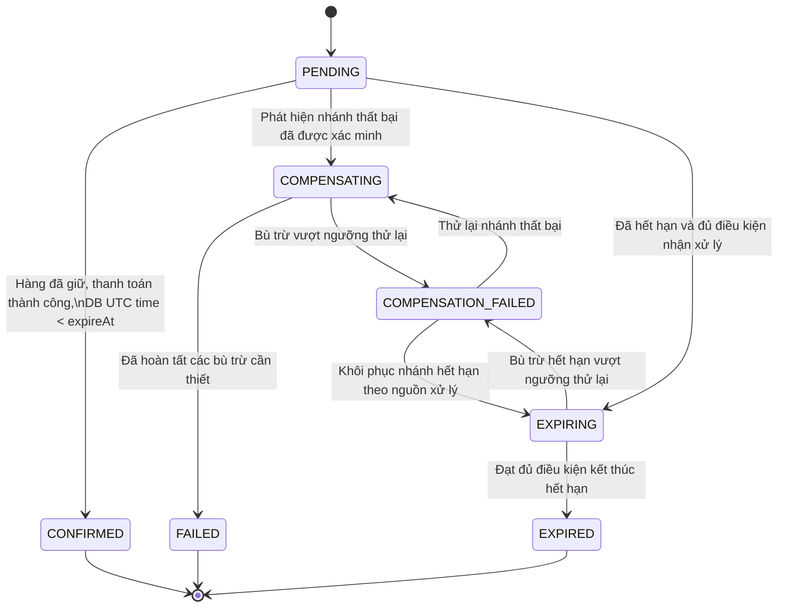

# 09. State Machine – Resilient Order Workflow

## 1. Mục đích

Tài liệu xác định các trạng thái của đơn hàng, điều kiện chuyển trạng thái và cách xử lý khi xảy ra lỗi trong quy trình đặt hàng.

State machine là cơ sở để:
- Người 2 triển khai logic chuyển trạng thái và kiểm soát tính nhất quán.
- Người 3 xây dựng test cho luồng thành công, thất bại, timeout và thử lại.
- Đảm bảo một đơn hàng không đồng thời được xác nhận và hết hạn.
- Ngăn việc xử lý trùng gây thanh toán hai lần hoặc giải phóng hàng nhiều lần.

## 2. Phạm vi trạng thái

Hệ thống sử dụng các trạng thái riêng biệt cho Order, Saga, Payment và Reservation. Không dùng trạng thái của một thành phần để thay thế trạng thái của thành phần khác.

### 2.1. Trạng thái Order

| Trạng thái | Ý nghĩa | Tính chất |
|---|---|---|
| `PENDING` | Đơn hàng đang chờ hoàn thành các bước nghiệp vụ | Trạng thái ban đầu |
| `CONFIRMED` | Đơn hàng đã được xác nhận | Trạng thái kết thúc thành công |
| `COMPENSATING` | Đang xử lý nhánh thất bại và bù trừ | Đang xử lý |
| `COMPENSATION_FAILED` | Bù trừ chưa hoàn tất sau khi vượt ngưỡng thử lại | Cần thử lại nền |
| `EXPIRING` | Worker đã nhận xử lý đơn hết hạn | Đang xử lý |
| `FAILED` | Đơn hàng thất bại sau khi hoàn thành các bước xử lý cần thiết | Trạng thái kết thúc thất bại |
| `EXPIRED` | Đơn hàng hết hạn sau khi hoàn thành các điều kiện hủy | Trạng thái kết thúc hết hạn |

`COMPENSATION_FAILED` không đồng nghĩa với việc đơn hàng đã thất bại hoàn toàn. Hệ thống phải tiếp tục thử lại cho đến khi xác minh được kết quả bù trừ.

### 2.2. State machine của Order

**Quy tắc:** sơ đồ trên biểu diễn các trạng thái logic. Khi `COMPENSATION_FAILED` được khôi phục, hệ thống phải lưu lại nguồn xử lý ban đầu để quay về đúng nhánh `COMPENSATING` hoặc `EXPIRING`. Không được tự chọn nhánh dựa trên suy đoán.

## 3. Điều kiện chuyển trạng thái Order

### 3.1. Từ PENDING sang CONFIRMED

Chỉ chuyển sang `CONFIRMED` khi đồng thời thỏa mãn:

1. Reservation đã được xác minh ở trạng thái `RESERVED`.
2. Kết quả capture thanh toán được xác minh là `SUCCEEDED`.
3. Thời gian DB UTC hiện tại nhỏ hơn `expireAt`.
4. Đơn hàng vẫn ở trạng thái `PENDING`.
5. Không có nhánh xử lý cạnh tranh nào đã nhận quyền xử lý đơn.

Việc chuyển trạng thái phải dùng cập nhật có điều kiện. Nếu một worker khác đã chuyển đơn sang `EXPIRING` hoặc `COMPENSATING`, thao tác xác nhận phải thất bại và đi vào bước đối soát phù hợp.

### 3.2. Từ PENDING sang COMPENSATING

Chuyển sang `COMPENSATING` khi hệ thống đã xác minh một điều kiện thất bại, chẳng hạn:

- Inventory Service từ chối giữ hàng.
- Thanh toán được xác minh là `FAILED`.
- Một bước nghiệp vụ thất bại và cần hoàn tác những bước trước đó đã thành công.

Nhánh thất bại phải giành quyền chuyển `PENDING -> COMPENSATING` trước khi xử lý bù trừ, kể cả khi không có hành động bù trừ nào cần thực hiện.

Chỉ chuyển `COMPENSATING -> FAILED` khi đã hoàn thành tất cả hành động bù trừ cần thiết và xác minh được trạng thái cuối cùng.

### 3.3. Từ PENDING sang EXPIRING

TTL Worker quét đơn đã quá hạn theo DB UTC và nhận xử lý bằng cập nhật có điều kiện.

Điều kiện nhận xử lý:

- Order đang ở `PENDING`.
- `expireAt` đã đến hoặc đã qua.
- Kết quả thanh toán không còn ở trạng thái chưa xác định cần đối soát.
- Chưa có nhánh khác nhận quyền xử lý đơn.

Trong cùng thao tác nhận xử lý, hệ thống lưu `claimToken`, `claimedAt` và `leaseUntil`.

Worker cũng phải quét các đơn `EXPIRING` có lease đã hết hạn để tiếp quản công việc bị gián đoạn.

### 3.4. Từ EXPIRING sang EXPIRED

Không được chuyển sang `EXPIRED` chỉ vì đã vượt `expireAt`.

Chỉ được hoàn tất khi thỏa mãn tất cả điều kiện:

1. Nhánh hết hạn vẫn có quyền xử lý hợp lệ.
2. Không còn giao dịch capture hoặc kết quả thanh toán chưa được giải quyết.
3. Reservation đã được xác minh là không tồn tại hoặc đã `RELEASED`.
4. Nếu tiền đã được capture, việc refund đã được xác minh hoàn tất.
5. Việc cập nhật Order thành `EXPIRED`, hoàn tất Saga và ghi sự kiện `OrderExpired` vào Outbox được thực hiện trong cùng một transaction DB.

Nếu Reservation chưa được xác minh, hệ thống phải truy vấn bằng idempotency key ổn định trước khi thực hiện release. Nếu Payment chuyển sang `UNKNOWN`, không được release, refund hoặc hoàn tất `EXPIRED` dựa trên giả định; chuyển sang quy trình đối soát.

### 3.5. Quy tắc trạng thái kết thúc

- `CONFIRMED`, `FAILED` và `EXPIRED` là các trạng thái kết thúc của Order.
- Order không được vừa `CONFIRMED` vừa `EXPIRED`.
- Không chuyển Order từ `EXPIRED` hoặc `FAILED` trở lại `CONFIRMED`.
- Không chuyển từ `CONFIRMED` sang `EXPIRED`.
- Việc phát hiện thanh toán đến muộn phải được xử lý theo quy trình đối soát/refund; không được mở lại đơn hàng đã kết thúc.

## 4. Trạng thái Saga

Saga là thành phần điều phối tiến trình nghiệp vụ. Trạng thái Saga không đồng nhất với trạng thái Order.

| Trạng thái Saga | Ý nghĩa | Hành động tiếp theo |
|---|---|---|
| `RUNNING` | Các bước nghiệp vụ đang được thực hiện | Tiếp tục bước tiếp theo |
| `RECONCILING` | Đang tự động đối soát kết quả chưa rõ | Tiếp tục truy vấn theo lịch đối soát |
| `RECONCILIATION_REQUIRED` | Đã hết lịch truy vấn tự động chính | Tiếp tục polling nền mỗi 5 phút và yêu cầu xử lý thủ công khi cần |
| `COMPENSATING` | Đang thực hiện release/refund hoặc hành động bù trừ khác | Tiếp tục bù trừ |
| `COMPENSATION_FAILED` | Bù trừ vượt ngưỡng thử lại | Thử lại nền mỗi 60 giây |
| `COMPLETED` | Quy trình Saga đã hoàn tất | Không khởi chạy lại các hành động nghiệp vụ đã hoàn tất |

### 4.1. Phân biệt hai loại lỗi

**Kết quả thanh toán chưa rõ:**
- Chuyển Saga sang `RECONCILING`.
- Thực hiện tối đa 30 lần truy vấn trong lịch đối soát chính kéo dài khoảng 10 phút.
- Nếu hết lịch mà chưa có kết quả, chuyển sang `RECONCILIATION_REQUIRED`.
- Sau đó tiếp tục polling nền mỗi 5 phút.
- Không tự chuyển Payment sang `FAILED`, không release/refund dựa trên giả định, không chuyển Order sang `EXPIRED` và không gia hạn `expireAt`.

**Bù trừ thất bại:**
- Khi release hoặc refund vượt 5 lần gửi, đánh dấu `COMPENSATION_FAILED`.
- Thử lại nền mỗi 60 giây.
- Không dùng `RECONCILIATION_REQUIRED` để thay thế trạng thái lỗi bù trừ.

## 5. Trạng thái Payment

### 5.1. Capture status

| Trạng thái | Ý nghĩa |
|---|---|
| `NOT_STARTED` | Chưa bắt đầu capture |
| `PENDING` | Đang xử lý capture |
| `SUCCEEDED` | Đã xác minh capture thành công |
| `FAILED` | Đã xác minh capture thất bại |
| `UNKNOWN` | Chưa xác định được kết quả capture |

`UNKNOWN` không đồng nghĩa với `FAILED`. Timeout hoặc mất phản hồi không đủ để kết luận giao dịch thất bại.

### 5.2. Refund status

| Trạng thái | Ý nghĩa |
|---|---|
| `NOT_REQUIRED` | Không cần refund |
| `NOT_STARTED` | Chưa bắt đầu refund |
| `PENDING` | Đang xử lý refund |
| `SUCCEEDED` | Đã xác minh refund hoàn tất |
| `FAILED` | Đã xác minh refund thất bại |
| `UNKNOWN` | Chưa xác định được kết quả refund |

Capture status và refund status phải được lưu độc lập. Ví dụ, capture có thể là `SUCCEEDED` trong khi refund là `UNKNOWN`; không được đổi capture thành `FAILED` chỉ vì refund chưa rõ.

## 6. Trạng thái Reservation

| Trạng thái | Ý nghĩa |
|---|---|
| `NOT_CREATED` | Chưa tạo reservation |
| `RESERVED` | Hàng đã được giữ |
| `RELEASED` | Reservation đã được giải phóng |
| `REJECTED` | Không thể giữ hàng |
| `UNKNOWN` | Chưa xác định được kết quả giữ hoặc giải phóng hàng |

Nếu kết quả reserve chưa rõ, hệ thống phải truy vấn bằng khóa idempotency ổn định trước khi gửi yêu cầu mới hoặc thực hiện release.

## 7. Quy tắc thời gian và TTL

- TTL mặc định: 15 phút.
- `expireAt = createdAt + TTL`.
- TTL Worker quét mỗi 5 giây.
- Lease mặc định: 30 giây.
- Mọi phép so sánh thời gian nghiệp vụ sử dụng đồng hồ DB UTC.
- Không gia hạn `expireAt` chỉ vì Payment đang `UNKNOWN`, hệ thống lỗi hoặc cần đối soát.
- Worker phải tiếp quản `EXPIRING` có lease hết hạn để tránh công việc bị bỏ dở.

### 7.1. Thanh toán hoàn tất trước hạn nhưng được xác minh sau hạn

Theo đề xuất D-01.4 đang chờ giải quyết Q-01:

- Nếu giao dịch hoàn tất trước `expireAt` nhưng hệ thống chỉ xác minh được sau thời điểm này, không xác nhận Order thành `CONFIRMED`.
- TTL Worker nhận nhánh `EXPIRING` nếu nhánh này giành quyền xử lý trước.
- Nếu đã capture tiền, xử lý refund thông qua UC-11.
- Không được giả định refund thành công trước khi xác minh kết quả.

## 8. Tính nhất quán và chống xử lý trùng

Các thao tác có tác động nghiệp vụ phải sử dụng idempotency key:

| Hành động | Idempotency key |
|---|---|
| Reserve hàng | `reserve:{orderId}:v1` |
| Capture thanh toán | `payment:capture:{orderId}:v1` |
| Release hàng | `inventory:release:{orderId}:{reservationId}:v1` |
| Refund | `payment:refund:{orderId}:{paymentId}:v1` |

Consumer xử lý sự kiện phải bảo đảm không xử lý lặp cùng một `eventId` bằng ràng buộc duy nhất `UNIQUE(consumerName, eventId)`.

Khi cập nhật trạng thái Order và ghi sự kiện nghiệp vụ vào Outbox, hai thao tác phải nằm trong cùng transaction DB nếu thuộc cùng một bước commit.

## 9. Các trường hợp kiểm thử tối thiểu

| ID | Tình huống | Kết quả mong đợi |
|---|---|---|
| SM-01 | Giữ hàng và capture thành công trước hạn | Order thành `CONFIRMED` |
| SM-02 | Không đủ hàng | Nhánh `COMPENSATING`, sau đó `FAILED` |
| SM-03 | Capture được xác minh thất bại | Nhánh `COMPENSATING`, sau đó `FAILED` |
| SM-04 | Payment timeout, kết quả chưa rõ | Saga `RECONCILING`; không kết luận Payment thất bại |
| SM-05 | Order hết hạn, không có giao dịch chưa rõ | Có thể nhận `EXPIRING` và hoàn tất `EXPIRED` khi đủ điều kiện |
| SM-06 | Reservation chưa được xác minh khi hết hạn | Truy vấn Reservation trước khi release |
| SM-07 | Payment chuyển sang `UNKNOWN` trong lúc `EXPIRING` | Không release/refund/finalize dựa trên giả định |
| SM-08 | Release/refund vượt ngưỡng thử lại | `COMPENSATION_FAILED`, thử lại nền mỗi 60 giây |
| SM-09 | Hai worker đồng thời nhận một Order | Chỉ một nhánh chuyển trạng thái thành công |
| SM-10 | Worker chết sau khi nhận lease | Worker khác tiếp quản sau khi lease hết hạn |
| SM-11 | Capture thành công nhưng refund chưa rõ | Capture vẫn `SUCCEEDED`, refund status là `UNKNOWN` |
| SM-12 | Gửi lại cùng yêu cầu capture ít nhất 10 lần | Chỉ một lần capture có hiệu lực |
| SM-13 | Payment hoàn tất trước hạn nhưng xác minh sau hạn | Theo đề xuất Q-01: không xác nhận Order; xử lý theo nhánh hết hạn và refund nếu cần |

## 10. Tiêu chí bàn giao

- Mỗi trạng thái có định nghĩa và điều kiện chuyển trạng thái.
- Không có đường chuyển trạng thái cho phép Order vừa `CONFIRMED` vừa `EXPIRED`.
- `UNKNOWN` được phân biệt với `FAILED`.
- Capture status được phân biệt với refund status.
- Worker có thể khôi phục xử lý từ trạng thái đã lưu sau khi khởi động lại.
- Các quy tắc và tình huống kiểm thử có thể truy vết đến Use Case, Business Rule, Functional Requirement và Non-functional Requirement trong tài liệu yêu cầu.
