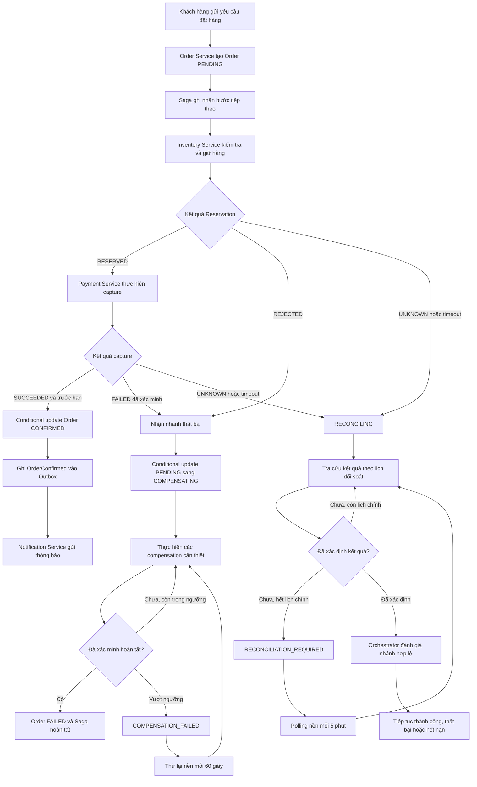
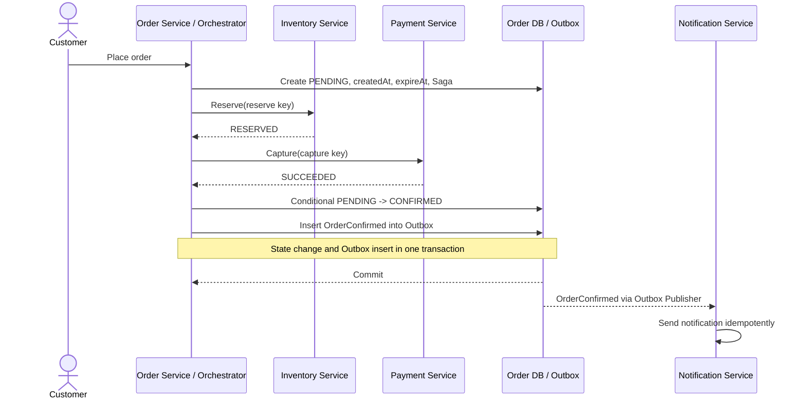
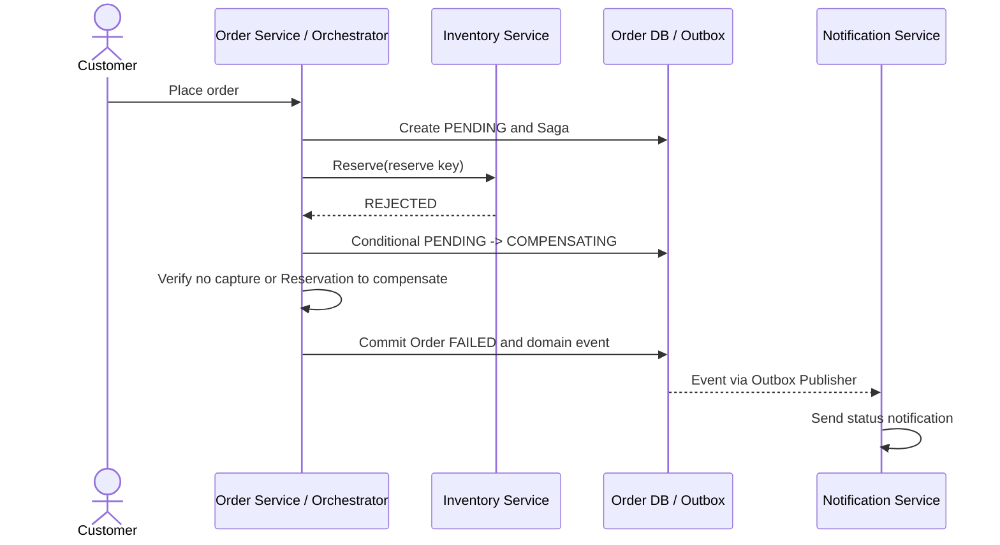
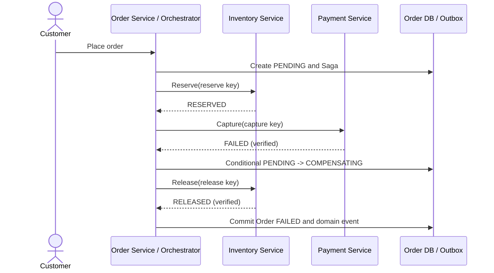
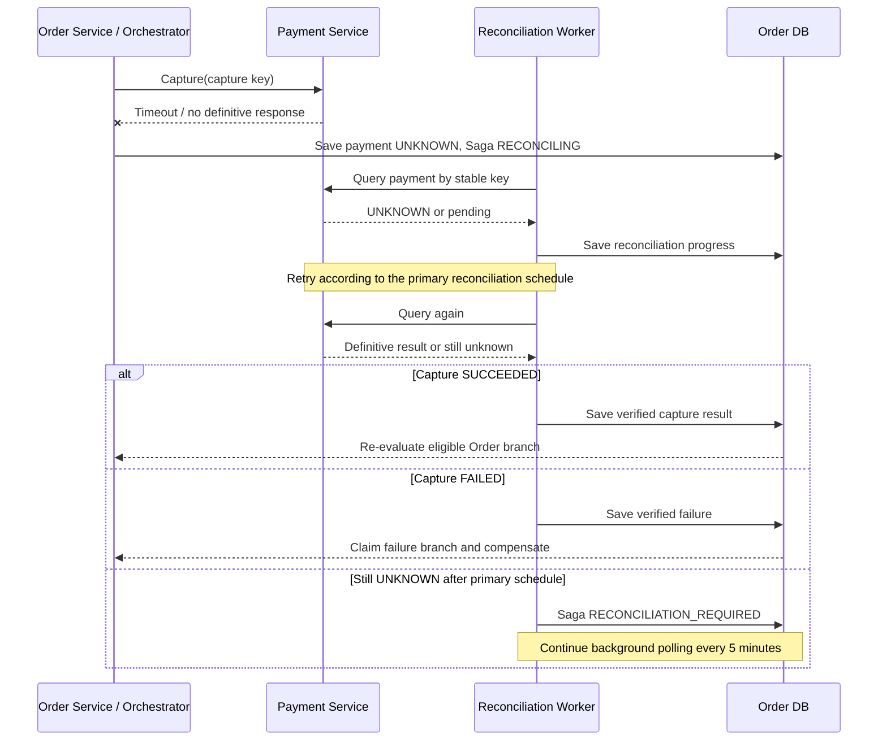

# 10. Saga Workflow and Compensation – Resilient Order Workflow

## 1. Mục đích

Tài liệu mô tả quy trình Saga theo mô hình **Orchestration**, trong đó Order Service đóng vai trò điều phối trung tâm, quyết định bước nghiệp vụ tiếp theo dựa trên kết quả đã xác minh từ các service.

Mục tiêu:
- Xác định rõ thứ tự thực hiện các bước trong quy trình đặt hàng.
- Xác định hành động bù trừ tương ứng với từng bước đã thực hiện thành công.
- Xử lý lỗi, timeout, thử lại và kết quả chưa xác định.
- Ngăn thanh toán trùng, giải phóng hàng trùng và trạng thái đơn hàng mâu thuẫn.
- Cho phép tiếp tục xử lý sau khi service hoặc worker khởi động lại.

Phạm vi bao gồm:
- Order Service.
- Inventory Service.
- Payment Service (mô phỏng thanh toán).
- Notification Service.
- Saga Orchestrator và TTL Worker.
- Outbox và cơ chế đối soát.

## 2. Nguyên tắc thiết kế

### 2.1. Orchestration

Order Service điều phối tiến trình nghiệp vụ và lưu trạng thái Saga. Các service thực hiện nghiệp vụ thuộc phạm vi của mình, trả về kết quả hoặc phát sự kiện để Order Service quyết định bước tiếp theo.

Order Service không trực tiếp sửa dữ liệu nội bộ của Inventory Service hoặc Payment Service.

### 2.2. Saga không phải transaction phân tán

Các bước của Saga có thể được commit ở những service khác nhau. Nếu một bước sau thất bại, hệ thống thực hiện các hành động bù trừ để đưa nghiệp vụ về trạng thái nhất quán.

Bù trừ không có nghĩa là xóa lịch sử giao dịch. Ví dụ, refund là một giao dịch riêng, không xóa giao dịch capture ban đầu.

### 2.3. Chỉ xử lý dựa trên kết quả đã xác minh

- Không coi timeout là thất bại chắc chắn.
- Không release Reservation khi kết quả reserve còn `UNKNOWN`.
- Không refund khi chưa xác minh capture đã thành công.
- Không chuyển Order thành `EXPIRED` khi chưa hoàn thành các điều kiện hết hạn.
- Không đánh dấu Saga hoàn tất khi còn hành động bù trừ bắt buộc chưa được xác minh.

### 2.4. Idempotency và khả năng khôi phục

Mỗi hành động có tác động nghiệp vụ phải có khóa idempotency ổn định. Thử lại cùng một hành động không được tạo thêm tác động nghiệp vụ.

Saga phải lưu đủ thông tin để khôi phục sau sự cố, gồm trạng thái hiện tại, kết quả các bước, thông tin cần thiết để bù trừ và các lần thử lại.

### 2.5. Phân biệt trạng thái Order và Saga

Order và Saga là hai đối tượng có vòng đời riêng. Không sử dụng trạng thái của Saga để thay thế trực tiếp trạng thái Order.

| Tình huống | Order.status | Saga.status |
|---|---|---|
| Đang xử lý đặt hàng | `PENDING` | `RUNNING` |
| Đang bù trừ nhánh thất bại thông thường | `COMPENSATING` | `COMPENSATING` |
| Bù trừ nhánh thất bại thông thường vượt ngưỡng retry | `COMPENSATING` | `COMPENSATION_FAILED` |
| Đang xử lý hết hạn | `EXPIRING` | `COMPENSATING` hoặc trạng thái xử lý tương ứng đã lưu |
| Bù trừ nhánh hết hạn vượt ngưỡng retry | `EXPIRING` | `COMPENSATION_FAILED` |
| Đang đối soát kết quả thanh toán chưa rõ | Giữ trạng thái Order hiện tại phù hợp với nhánh đã nhận quyền xử lý | `RECONCILING` hoặc `RECONCILIATION_REQUIRED` |
| Các hành động bắt buộc đã hoàn tất và Order thất bại | `FAILED` | `COMPLETED` |
| Các điều kiện hết hạn đã được xác minh và hoàn tất | `EXPIRED` | `COMPLETED` |

Quy tắc:

- `COMPENSATION_FAILED` là trạng thái xử lý của Saga khi hành động bù trừ vượt ngưỡng retry. Với nhánh hết hạn, Order tiếp tục giữ `EXPIRING` cho đến khi đủ điều kiện chuyển trạng thái cuối.
- Với nhánh thất bại thông thường, Order giữ `COMPENSATING` trong thời gian còn hành động bù trừ bắt buộc chưa hoàn tất.
- Sau khi retry thành công, Saga tiếp tục từ tiến trình đã lưu; không khởi tạo lại Saga hoặc lặp lại các tác động nghiệp vụ đã thành công.
- Chỉ chuyển Saga sang `COMPLETED` khi mọi hành động bắt buộc của nhánh đã được xác minh.
- Chỉ chuyển Order sang `FAILED` hoặc `EXPIRED` khi đáp ứng đầy đủ điều kiện của State Machine.
- Các cập nhật phải có điều kiện và không được ghi đè nhánh đã nhận quyền xử lý.

## 3. Các thành phần tham gia

| Thành phần | Trách nhiệm |
|---|---|
| Order Service / Saga Orchestrator | Tạo Order, điều phối Saga, kiểm tra điều kiện chuyển trạng thái và quyết định bước tiếp theo |
| Inventory Service | Kiểm tra tồn kho, giữ hàng và giải phóng Reservation |
| Payment Service | Thực hiện capture mô phỏng, tra cứu kết quả thanh toán và refund |
| Notification Service | Gửi thông báo dựa trên trạng thái nghiệp vụ đã được commit |
| TTL Worker | Phát hiện Order hết hạn, nhận quyền xử lý và thực hiện quy trình hết hạn |
| Outbox Publisher | Phát các sự kiện đã được ghi bền vững trong Outbox |
| Reconciliation Worker | Tra cứu các kết quả chưa xác định và tiếp tục xử lý khi có kết quả mới |

## 4. Luồng Saga tổng quát

Sơ đồ mô tả các nhánh chính. Quyền chuyển trạng thái thực tế vẫn phải được kiểm soát bằng cập nhật có điều kiện và trạng thái đã lưu.

## 5. Luồng thành công

### 5.1. Trình tự nghiệp vụ

1. Khách hàng gửi yêu cầu đặt hàng.
2. Order Service tạo Order ở trạng thái `PENDING`, lưu `createdAt` và `expireAt`.
3. Saga lưu tiến trình để có thể khôi phục.
4. Order Service yêu cầu Inventory Service giữ hàng.
5. Inventory Service xác minh tồn kho và tạo Reservation.
6. Nếu Reservation là `RESERVED`, Order Service yêu cầu Payment Service thực hiện capture.
7. Nếu capture được xác minh là `SUCCEEDED`, Order Service kiểm tra điều kiện xác nhận đơn.
8. Nếu Order vẫn `PENDING` và thời gian DB UTC nhỏ hơn `expireAt`, Order Service chuyển Order sang `CONFIRMED` bằng cập nhật có điều kiện.
9. Trong cùng transaction với cập nhật Order, ghi `OrderConfirmed` vào Outbox.
10. Outbox Publisher phát sự kiện; Notification Service gửi thông báo dựa trên trạng thái đã commit.

### 5.2. Điều kiện thành công

Order chỉ được xác nhận khi:
- Reservation đã được xác minh là `RESERVED`.
- Capture đã được xác minh là `SUCCEEDED`.
- DB UTC time nhỏ hơn `expireAt`.
- Order vẫn `PENDING`.
- Không có nhánh cạnh tranh nào đã nhận quyền xử lý Order.

Nếu cập nhật xác nhận thất bại vì một worker khác đã nhận nhánh hết hạn hoặc thất bại, Saga phải đánh giá kết quả hiện tại và xử lý theo nhánh hợp lệ. Không được ghi đè trạng thái đã chuyển.

## 6. Luồng thất bại và bù trừ

### 6.1. Không đủ hàng

1. Inventory Service trả về `REJECTED`.
2. Order Service nhận nhánh thất bại bằng cập nhật có điều kiện `PENDING -> COMPENSATING`.
3. Saga kiểm tra những bước trước đó đã thực hiện thành công.
4. Nếu chưa tạo Reservation và chưa capture tiền, không cần release hoặc refund.
5. Khi xác minh không còn hành động bù trừ cần thực hiện, Order chuyển sang `FAILED`.
6. Ghi sự kiện nghiệp vụ tương ứng vào Outbox trong cùng transaction với thay đổi trạng thái.

Dù không cần compensation, nhánh thất bại vẫn phải đi qua `COMPENSATING` trước khi chuyển sang `FAILED`.

### 6.2. Thanh toán thất bại đã xác minh

1. Reservation đã được xác minh là `RESERVED`.
2. Payment Service trả về kết quả capture `FAILED` đã xác minh.
3. Order Service nhận nhánh thất bại bằng cập nhật `PENDING -> COMPENSATING`.
4. Saga yêu cầu Inventory Service release Reservation.
5. Nếu release thành công và được xác minh, Order chuyển sang `FAILED`.
6. Nếu release chưa thành công, Saga thử lại theo chính sách retry.
7. Nếu vượt ngưỡng gửi, đánh dấu `COMPENSATION_FAILED` và tiếp tục thử lại nền mỗi 60 giây.

Không thực hiện refund nếu capture chưa từng thành công.

### 6.3. Timeout khi thanh toán

Timeout chỉ cho biết hệ thống chưa nhận được kết quả đúng hạn; nó không chứng minh giao dịch đã thất bại.

1. Payment Service không trả về kết quả rõ ràng.
2. Saga chuyển sang `RECONCILING`.
3. Hệ thống tra cứu giao dịch bằng khóa capture ổn định.
4. Nếu xác minh capture thành công và các điều kiện xác nhận vẫn hợp lệ, Orchestrator có thể tiếp tục nhánh thành công.
5. Nếu xác minh capture thất bại, Orchestrator nhận nhánh thất bại và thực hiện compensation cần thiết.
6. Nếu kết quả vẫn chưa rõ sau lịch đối soát chính, Saga chuyển sang `RECONCILIATION_REQUIRED` và tiếp tục polling nền mỗi 5 phút.

Trong thời gian kết quả thanh toán chưa rõ, không được release Reservation hoặc refund dựa trên giả định. Cũng không được chuyển Order sang `EXPIRED` nếu điều kiện an toàn của nhánh hết hạn chưa được thỏa mãn.

### 6.4. Order hết hạn

1. TTL Worker quét các Order `PENDING` có `expireAt` đã đến hoặc đã qua.
2. Worker kiểm tra kết quả Payment và các điều kiện cần thiết để nhận xử lý.
3. Nếu đủ điều kiện, Worker dùng cập nhật có điều kiện để chuyển `PENDING -> EXPIRING`.
4. Trong cùng thao tác nhận xử lý, lưu `claimToken`, `claimedAt` và `leaseUntil`.
5. Worker kiểm tra trạng thái Reservation. Nếu kết quả reserve chưa rõ, truy vấn theo khóa reserve ổn định trước khi release.
6. Nếu Reservation đang `RESERVED`, Worker yêu cầu release và xác minh kết quả.
7. Nếu capture đã thành công, Worker phải xác minh refund hoàn tất trước khi kết thúc Order.
8. Chỉ khi đáp ứng đầy đủ các điều kiện trong tài liệu State Machine, hệ thống mới chuyển Order sang `EXPIRED`, hoàn tất Saga và ghi `OrderExpired` vào Outbox trong cùng transaction.

Nếu Payment chuyển sang `UNKNOWN` trong khi Order đang `EXPIRING`, phải dừng các hành động có thể gây mất nhất quán và đưa kết quả về quy trình đối soát. Không hoàn tất `EXPIRED` cho đến khi các điều kiện bắt buộc được xác minh.

### 6.5. Thử lại sau lỗi

Mọi lần thử lại phải:
- Sử dụng cùng idempotency key cho cùng một hành động nghiệp vụ.
- Không tạo thêm Reservation, capture hoặc refund ngoài ý muốn.
- Ghi nhận kết quả và số lần gửi.
- Phân biệt lỗi tạm thời, kết quả chưa xác định và thất bại đã xác minh.
- Không thay đổi `expireAt` chỉ để tránh hết hạn.
- Cho phép worker khác tiếp quản khi lease hết hạn.

## 7. Bảng Compensation

| Bước nghiệp vụ | Điều kiện đã xảy ra | Compensation hoặc hành động khắc phục | Điều kiện hoàn tất |
|---|---|---|---|
| Tạo Order | Order đã tạo nhưng nhánh thất bại được nhận | Chuyển Order qua `COMPENSATING`; không xóa lịch sử Order | Trạng thái cuối được commit |
| Reserve hàng | Reservation đã `RESERVED`, thanh toán thất bại | Inventory Service release Reservation | Xác minh Reservation `RELEASED` |
| Reserve hàng | Kết quả reserve là `UNKNOWN` | Tra cứu bằng `reserve:{orderId}:v1` | Xác minh Reservation tồn tại hoặc không tồn tại |
| Capture thanh toán | Capture được xác minh `FAILED` | Không refund; tiếp tục compensation các bước đã thành công khác | Không còn hành động bù trừ bắt buộc |
| Capture thanh toán | Capture là `UNKNOWN` | Đối soát; không tự coi là `FAILED` | Có kết quả đủ tin cậy để chọn nhánh |
| Capture thanh toán | Capture `SUCCEEDED` nhưng Order không thể xác nhận và phải kết thúc | Yêu cầu refund qua Payment Service | Refund được xác minh `SUCCEEDED` |
| Release Reservation | Kết quả release chưa rõ | Truy vấn hoặc gửi lại cùng idempotency key | Reservation được xác minh `RELEASED` hoặc không tồn tại |
| Refund | Kết quả refund chưa rõ | Đối soát refund; không giả định đã hoàn tiền | Refund được xác minh `SUCCEEDED` |
| Refund | Refund được xác minh `FAILED` | Ghi nhận lỗi bù trừ, nguyên nhân và trạng thái giao dịch; thực hiện chính sách xử lý đã được phê duyệt | Chỉ hoàn tất nhánh khi refund được xác minh `SUCCEEDED` hoặc có quyết định xử lý ngoại lệ được ghi nhận rõ ràng |
| Gửi thông báo | Outbox đã commit nhưng gửi thất bại | Publisher thử gửi lại sự kiện | Sự kiện được xử lý theo cơ chế chống trùng |
| Worker xử lý hết hạn | Worker chết sau khi nhận lease | Worker khác tiếp quản khi lease hết hạn | Quy trình tiếp tục từ trạng thái đã lưu |

**Lưu ý:** Không phải mọi bước đều có compensation theo nghĩa hoàn tác. Ví dụ, tạo Order thường không bị xóa; hệ thống chuyển Order sang trạng thái kết thúc phù hợp để bảo toàn lịch sử.

## 8. Idempotency key

Các khóa phải ổn định qua mọi lần retry của cùng một hành động.

| Hành động | Idempotency key |
|---|---|
| Reserve hàng | `reserve:{orderId}:v1` |
| Capture thanh toán | `payment:capture:{orderId}:v1` |
| Release hàng | `inventory:release:{orderId}:{reservationId}:v1` |
| Refund | `payment:refund:{orderId}:{paymentId}:v1` |
| Xử lý sự kiện tại consumer | `UNIQUE(consumerName, eventId)` |
| Gửi thông báo | `notification:{eventId}:{notificationType}:{channel}` |

Quy tắc:
- Retry một hành động phải dùng lại khóa của hành động đó.
- Mỗi lần thực hiện một hành động nghiệp vụ mới phải có khóa tương ứng với hành động mới.
- Không dùng chung khóa release cho hai Reservation khác nhau.
- Không dùng khóa capture để thay thế khóa refund.
- Cơ chế idempotency phải được bảo đảm tại phía thực hiện hành động, không chỉ ở phía Orchestrator.

## 9. Chính sách retry và đối soát

### 9.1. Compensation retry

- Release và refund sử dụng chính sách retry đã thống nhất trong D-03.
- Mỗi hành động retry sử dụng lại idempotency key của chính hành động đó.
- Khi vượt 5 lần gửi, Saga chuyển sang `COMPENSATION_FAILED` và ghi nhận nguyên nhân, số lần gửi, thời điểm thử gần nhất cùng hành động đang chờ.
- Saga tiếp tục thử lại nền mỗi 60 giây, trừ khi có quy tắc vận hành khác được thống nhất trong D-03.
- `COMPENSATION_FAILED` không có nghĩa là hành động bù trừ đã hoàn tất.
- Với nhánh thất bại thông thường, Order tiếp tục ở `COMPENSATING` cho đến khi các compensation bắt buộc hoàn tất.
- Với nhánh hết hạn, Order tiếp tục ở `EXPIRING` cho đến khi các điều kiện chuyển sang `EXPIRED` được xác minh.
- Nếu kết quả release hoặc refund là `UNKNOWN`, hệ thống phải tra cứu hoặc đối soát trước khi kết luận thành công hay thất bại.
- Nếu release/refund thất bại đã xác minh, hệ thống không được coi hành động đó là thành công chỉ vì đã gửi đủ số lần retry.
- Sau khi compensation hoàn tất, Orchestrator đọc trạng thái Order hiện tại và tiếp tục đúng nhánh đã nhận quyền xử lý. Không được ghi đè `CONFIRMED`, `FAILED` hoặc `EXPIRED` đã commit.

### 9.1.1. Refund thất bại đã xác minh

- Phân biệt refund `FAILED` đã xác minh với refund `UNKNOWN`.
- Với `UNKNOWN`, tra cứu giao dịch theo khóa refund ổn định; không tự tạo một refund mới.
- Với `FAILED` đã xác minh, ghi nhận kết quả, nguyên nhân và trạng thái của giao dịch refund.
- Không đổi trạng thái capture thành `FAILED` chỉ vì refund thất bại.
- Không tạo refund mới với idempotency key khác để né kết quả của refund trước đó.
- Việc tạo một tác vụ refund mới chỉ được phép khi có quy tắc nghiệp vụ được phê duyệt và bảo đảm không thể hoàn tiền trùng.
- Trong khi chưa giải quyết xong khoản tiền cần hoàn, Saga không được đánh dấu `COMPLETED`; Order không được chuyển sang trạng thái cuối yêu cầu refund đã hoàn tất.
- Nếu cần xử lý thủ công, ghi nhận yêu cầu can thiệp và giữ lại đầy đủ dấu vết giao dịch.

### 9.2. Payment reconciliation

- Trong khoảng 60 giây đầu, truy vấn mỗi 5 giây, tối đa 12 lần.
- Sau đó truy vấn mỗi 30 giây cho đến mốc 10 phút, tối đa thêm 18 lần.
- Tổng lịch truy vấn chính tối đa 30 lần.
- Nếu vẫn chưa có kết quả, chuyển Saga sang `RECONCILIATION_REQUIRED`.
- Sau đó tiếp tục polling nền mỗi 5 phút.
- Không tự kết luận Payment `FAILED`, không release/refund hoặc hoàn tất hết hạn khi kết quả vẫn chưa rõ.

### 9.3. Phân biệt trạng thái xử lý

| Tình huống | Trạng thái phù hợp |
|---|---|
| Kết quả capture chưa xác định, lịch đối soát chính vẫn còn | `RECONCILING` |
| Kết quả capture chưa xác định, lịch đối soát chính đã hết | `RECONCILIATION_REQUIRED` |
| Release/refund vượt ngưỡng gửi | `COMPENSATION_FAILED` |
| Các hành động nghiệp vụ và bù trừ bắt buộc đã hoàn tất | `COMPLETED` |

Các trạng thái trên thuộc tiến trình Saga; chúng không tự động thay thế trạng thái Order hoặc capture/refund.

## 10. Outbox và thông báo

### 10.1. Ghi sự kiện

Khi một bước nghiệp vụ yêu cầu thay đổi trạng thái Order và phát sự kiện tương ứng, cập nhật Order và ghi sự kiện vào Outbox phải nằm trong cùng transaction DB.

Các sự kiện nghiệp vụ tối thiểu có thể gồm:
- `OrderConfirmed`
- `OrderFailed`
- `OrderExpired`

Không tạo sự kiện nghiệp vụ mới cho mỗi lần retry kỹ thuật. Các cảnh báo vận hành, lỗi retry và yêu cầu can thiệp thủ công phải được phân biệt với domain event.

### 10.2. Phát và tiêu thụ sự kiện

- Outbox Publisher phát lại các sự kiện chưa được đánh dấu đã gửi.
- Nếu Publisher gặp sự cố sau khi phát nhưng trước khi đánh dấu, sự kiện có thể được phát lại.
- Consumer phải chống xử lý trùng bằng `eventId`.
- Notification Service chỉ gửi thông báo dựa trên trạng thái Order đã được commit.
- Gửi thông báo theo cơ chế at-least-once; không tuyên bố bảo đảm exactly-once tuyệt đối đối với hệ thống bên ngoài.

## 11. Khôi phục sau sự cố

Sau khi service, Publisher hoặc TTL Worker khởi động lại:
- Tiếp tục các Saga chưa hoàn tất.
- Phát lại Outbox chưa được đánh dấu đã gửi.
- Xử lý các Order hết hạn chưa được nhận xử lý.
- Tiếp quản các Order `EXPIRING` có lease hết hạn.
- Tiếp tục lịch đối soát Payment và polling nền.
- Thử lại các compensation đang chờ hoặc đã đánh dấu `COMPENSATION_FAILED`.

Mục tiêu phục hồi:
- Service, Publisher và TTL Worker tiếp tục xử lý trong vòng không quá 30 giây sau khi khởi động lại.
- Khi worker chết sau điểm nhận lease nhưng trước khi release, worker khác tiếp quản trong vòng không quá 45 giây, theo cấu hình lease 30 giây, scan 5 giây và phần dự phòng.

Không được khởi động lại Saga bằng cách tạo mới một chuỗi hành động từ đầu nếu điều đó có thể lặp lại capture hoặc Reservation. Phải phục hồi dựa trên trạng thái đã lưu và idempotency key.

## 12. Sequence diagram

### 12.1. Luồng thành công

### 12.2. Luồng thất bại: hết hàng

### 12.3. Luồng thất bại: thanh toán thất bại

### 12.4. Luồng thất bại: timeout và kết quả chưa rõ

## 13. Hợp đồng phối hợp với Người 2 và Người 3

### 13.1. Nội dung cần thống nhất với Người 2

- API reserve, capture, release, refund và query trạng thái.
- Cấu trúc request/response và cách biểu diễn `UNKNOWN`.
- Cơ chế truyền và kiểm tra idempotency key.
- Các sự kiện Outbox và định dạng `eventId`.
- Cách lưu trạng thái Saga, claim token và lease.
- Transaction boundary cho cập nhật Order và ghi Outbox.
- Cách phục hồi các bước chưa hoàn tất sau khi service khởi động lại.

### 13.2. Nội dung cần thống nhất với Người 3

- Điều kiện xác nhận Order.
- Điều kiện chuyển Order sang `FAILED` hoặc `EXPIRED`.
- Phân biệt timeout với thất bại đã xác minh.
- Điều kiện release/refund và xác minh kết quả.
- Hành vi khi retry, sự kiện trùng và worker chết.
- Mục tiêu khôi phục và tiêu chí không có double payment, overselling hoặc trạng thái kết thúc mâu thuẫn.

## 14. Tiêu chí nghiệm thu workflow

| ID | Điều kiện nghiệm thu | Kết quả mong đợi |
|---|---|---|
| SW-01 | Reserve và capture thành công trước hạn | Order được xác nhận đúng một lần |
| SW-02 | Inventory từ chối reserve | Order đi qua `COMPENSATING` rồi `FAILED` |
| SW-03 | Capture thất bại đã xác minh sau khi reserve thành công | Reservation được release và xác minh trước khi kết thúc nhánh thất bại |
| SW-04 | Capture timeout và kết quả chưa rõ | Không tự kết luận thất bại hoặc release hàng |
| SW-05 | Release vượt 5 lần gửi | Saga `COMPENSATION_FAILED`, retry nền mỗi 60 giây |
| SW-06 | Lịch đối soát chính hết nhưng Payment vẫn UNKNOWN | Saga `RECONCILIATION_REQUIRED`, polling nền mỗi 5 phút |
| SW-07 | Order hết hạn có Reservation đã xác minh | Release và xác minh trước khi kết thúc `EXPIRED` |
| SW-08 | Order hết hạn nhưng capture chưa rõ | Không hoàn tất `EXPIRED` khi điều kiện an toàn chưa đạt |
| SW-09 | Refund chưa rõ | Capture status không bị ghi đè thành `FAILED` |
| SW-10 | Publisher phát lại cùng sự kiện | Consumer không tạo tác động nghiệp vụ trùng |
| SW-11 | Worker chết sau khi nhận lease | Worker khác tiếp quản và tiếp tục từ trạng thái đã lưu |
| SW-12 | Gửi lại cùng yêu cầu capture ít nhất 10 lần | Chỉ một lần capture có hiệu lực |
| SW-13 | Hai nhánh xử lý cạnh tranh cùng một Order | Chỉ một nhánh nhận quyền chuyển trạng thái thành công |
| SW-14 | Khởi động lại service hoặc worker | Tiếp tục xử lý trong mục tiêu phục hồi đã xác định |

## 15. Tài liệu liên quan

- `docs/requirements/01-business-requirements.md`
- `docs/requirements/02-functional-requirements.md`
- `docs/requirements/03-business-rules.md`
- `docs/requirements/06-design-decisions.md`
- `docs/requirements/07-non-functional-requirements.md`
- `docs/requirements/08-detailed-use-cases.md`
- `docs/architecture/09-state-machine.md`

## 16. Điều kiện bàn giao

Tài liệu được coi là đủ để bàn giao khi:
- Luồng thành công và các nhánh thất bại chính đã được mô tả.
- Mỗi bước có điều kiện thực hiện và kết quả cần xác minh.
- Compensation được xác định theo các bước đã thành công.
- Timeout, retry, idempotency và phục hồi có quy tắc rõ ràng.
- Người 2 có thể xác định API/event cần triển khai từ các hợp đồng đã thống nhất.
- Người 3 có thể tạo test case từ các luồng và tiêu chí nghiệm thu mà không phải tự suy đoán hành vi nghiệp vụ.
