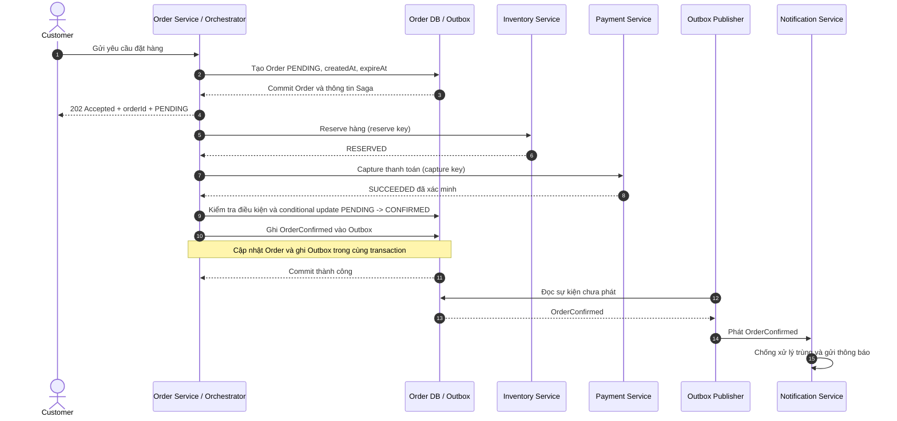
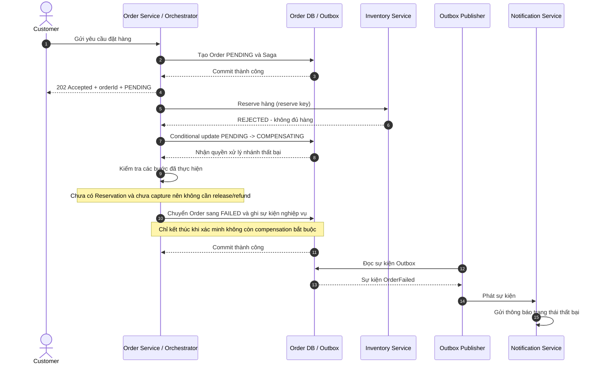
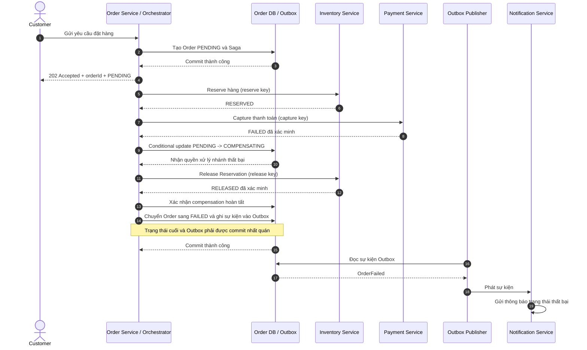
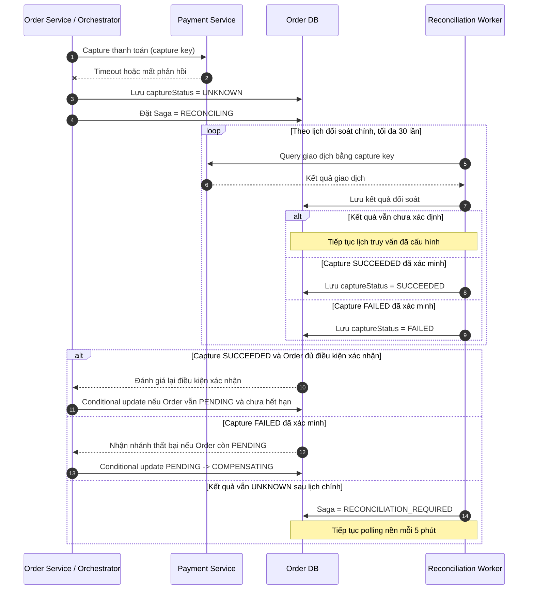
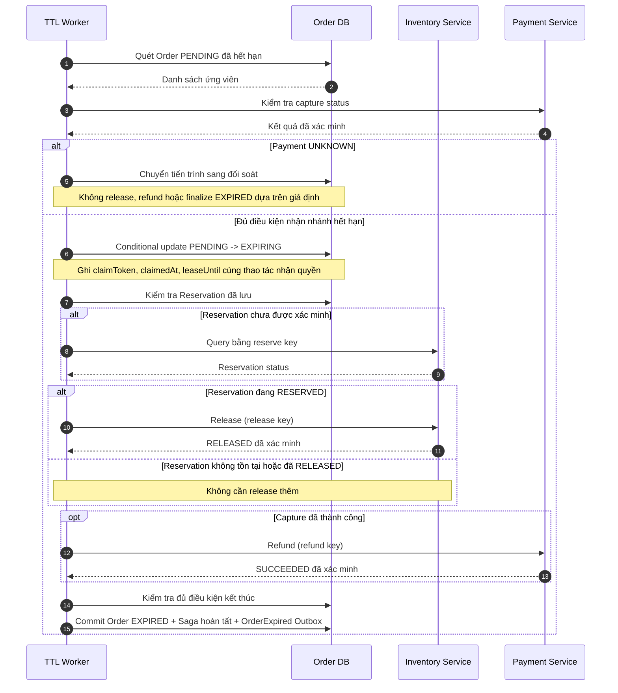
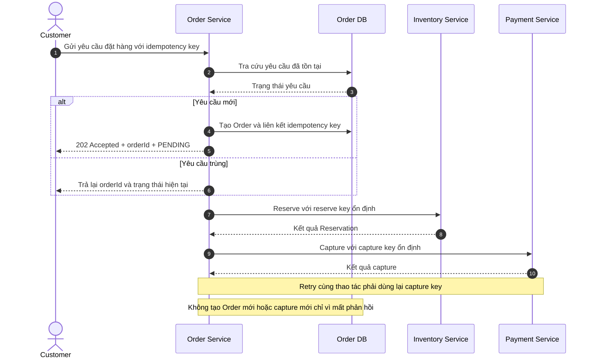

# 11. Sequence Diagrams – Resilient Order Workflow

## 1. Mục đích

Tài liệu mô tả trình tự tương tác giữa các thành phần trong quy trình đặt hàng, từ khi khách hàng gửi yêu cầu đến khi đơn hàng được xác nhận hoặc xử lý thất bại.

Các sơ đồ được xây dựng từ Use Case, State Machine và Saga Workflow, phục vụ hai mục tiêu:
- Người 2 hiểu thứ tự gọi service, điều kiện xử lý và kết quả cần trả về.
- Người 3 xác định các điểm kiểm thử, kết quả mong đợi và cách hệ thống xử lý khi xảy ra lỗi.

## 2. Thành phần tham gia

| Thành phần | Trách nhiệm |
|---|---|
| Customer | Gửi yêu cầu đặt hàng và nhận trạng thái đơn |
| Order Service / Saga Orchestrator | Điều phối quy trình, quản lý trạng thái Order và quyết định bước tiếp theo |
| Inventory Service | Kiểm tra tồn kho, tạo và giải phóng Reservation |
| Payment Service | Thực hiện capture, tra cứu kết quả thanh toán và refund |
| Order DB / Outbox | Lưu trạng thái nghiệp vụ và các sự kiện cần phát |
| TTL Worker | Quét đơn hết hạn và tiếp quản xử lý khi cần |
| Reconciliation Worker | Đối soát kết quả thanh toán chưa xác định |
| Outbox Publisher | Phát các sự kiện đã được ghi bền vững |
| Notification Service | Gửi thông báo dựa trên trạng thái nghiệp vụ đã commit |

## 3. Luồng 1 – Đặt hàng thành công

**Use Case:** UC-01

### Điều kiện trước

- Yêu cầu đặt hàng hợp lệ.
- Sản phẩm còn đủ hàng.
- Dịch vụ thanh toán hoạt động bình thường.
- Order chưa hết hạn trong lúc xác nhận.

### Kết quả mong đợi

- Order được tạo và trả về `orderId`.
- Reservation được xác minh là `RESERVED`.
- Capture được xác minh là `SUCCEEDED`.
- Order chuyển sang `CONFIRMED` nếu DB UTC time vẫn nhỏ hơn `expireAt` và Order còn `PENDING`.
- Sự kiện `OrderConfirmed` được ghi vào Outbox cùng transaction với thay đổi trạng thái.
- Thông báo được gửi dựa trên trạng thái đã commit.

## 4. Luồng 2 – Hết hàng

**Use Case:** UC-02

### Điều kiện trước

- Khách hàng gửi yêu cầu đặt hàng hợp lệ.
- Inventory Service xác định không đủ tồn kho để tạo Reservation.

### Kết quả mong đợi

- Order đi qua `PENDING -> COMPENSATING -> FAILED`.
- Không thực hiện capture thanh toán.
- Không yêu cầu release nếu đã xác minh không có Reservation.
- Thông báo phản ánh trạng thái Order đã commit.
- Nếu việc cập nhật trạng thái thất bại do nhánh khác đã nhận quyền xử lý, Orchestrator phải đọc lại trạng thái và không ghi đè.

## 5. Luồng 3 – Thanh toán thất bại sau khi giữ hàng

**Use Case:** UC-03

### Điều kiện trước

- Order đang `PENDING`.
- Inventory Service đã tạo Reservation thành công.
- Payment Service trả về kết quả capture `FAILED` đã xác minh.

### Kết quả mong đợi

- Order không được xác nhận thành công.
- Reservation được release và xác minh trước khi kết thúc nhánh thất bại.
- Không refund vì capture đã được xác minh là thất bại.
- Nếu release lỗi hoặc kết quả chưa rõ, không chuyển Order sang `FAILED` cho đến khi xử lý thỏa mãn điều kiện nghiệp vụ.
- Nếu release vượt 5 lần gửi, Saga chuyển sang `COMPENSATION_FAILED` và thử lại nền mỗi 60 giây.

## 6. Luồng 4 – Timeout khi thanh toán

**Use Case:** UC-03, UC-07

### Điều kiện trước

- Reservation đã được xác minh là `RESERVED`.
- Payment Service không trả về kết quả capture rõ ràng.
- Không thể kết luận giao dịch thành công hay thất bại chỉ từ timeout.

### Kết quả mong đợi

- Timeout không tự động làm Payment chuyển thành `FAILED`.
- Trong lúc kết quả chưa rõ, không được release Reservation hoặc refund dựa trên giả định.
- Lịch đối soát chính tối đa 30 lần trong khoảng 10 phút; khi hết lịch, Saga chuyển sang `RECONCILIATION_REQUIRED`.
- Polling nền tiếp tục mỗi 5 phút.
- Nếu kết quả được xác minh, Orchestrator đánh giá nhánh hợp lệ dựa trên trạng thái Order hiện tại.
- Nếu nhánh hết hạn đã nhận quyền xử lý, không được chuyển Order trở lại `CONFIRMED`.

## 7. Luồng 5 – Order hết hạn

**Use Case:** UC-06, UC-07

### Điều kiện trước

- Order vẫn ở `PENDING`.
- DB UTC time đã đến hoặc vượt `expireAt`.
- Không còn kết quả thanh toán chưa xác định cần được giải quyết trước khi nhận nhánh hết hạn.

### Kết quả mong đợi

- TTL Worker quét mỗi 5 giây theo cấu hình.
- Chỉ một worker nhận được quyền chuyển Order từ `PENDING` sang `EXPIRING`.
- `claimToken`, `claimedAt` và `leaseUntil` được ghi trong cùng thao tác nhận quyền xử lý.
- Reservation chưa được xác minh phải được truy vấn trước khi release.
- Nếu capture thành công, phải xác minh refund hoàn tất.
- Chỉ hoàn tất `EXPIRED` khi đủ tất cả điều kiện của State Machine.
- Nếu worker chết và lease hết hạn, worker khác có thể tiếp quản.

## 8. Luồng 6 – Gửi lại yêu cầu và xử lý trùng

**Use Case:** UC-10

### Điều kiện trước

- Khách hàng hoặc hệ thống gửi lại yêu cầu do timeout hoặc chưa nhận được phản hồi.
- Yêu cầu gửi lại thuộc cùng một thao tác nghiệp vụ.

### Kết quả mong đợi

- Gửi lại cùng yêu cầu không tạo thêm Order cho cùng một thao tác logic.
- API trả lại cùng `orderId` khi xác định đó là yêu cầu trùng.
- Gửi capture lặp ít nhất 10 lần với cùng khóa không tạo nhiều lần capture có hiệu lực.
- Kết quả chưa rõ phải được đối soát thay vì tạo một thao tác thanh toán mới.
- Cơ chế idempotency phải được kiểm soát cả ở service thực hiện hành động.

## 9. Quy tắc chung áp dụng cho các sơ đồ

### 9.1. Conditional update

Các bước cạnh tranh như xác nhận Order, nhận nhánh thất bại và nhận nhánh hết hạn phải dùng cập nhật có điều kiện dựa trên trạng thái hiện tại.

Chỉ một nhánh được quyền chuyển từ `PENDING` sang một trong các trạng thái:
- `CONFIRMED`
- `COMPENSATING`
- `EXPIRING`

Nếu cập nhật thất bại, thành phần xử lý phải đọc trạng thái hiện tại và tiếp tục theo nhánh hợp lệ, không ghi đè trạng thái đã được nhận.

### 9.2. Capture và refund

Capture status và refund status là hai thông tin riêng biệt. Refund `UNKNOWN` không làm capture trở thành `FAILED`.

Không refund khi chưa xác minh capture thành công. Không coi timeout là bằng chứng đủ để kết luận giao dịch thất bại.

### 9.3. Outbox và Notification

- Thay đổi trạng thái Order và ghi domain event tương ứng phải nhất quán trong cùng transaction.
- Publisher có thể phát lại sự kiện nếu gặp lỗi sau khi publish nhưng trước khi đánh dấu đã gửi.
- Consumer cần chống xử lý trùng bằng `UNIQUE(consumerName, eventId)`.
- Notification Service gửi thông báo dựa trên trạng thái nghiệp vụ đã commit.
- Sự kiện nghiệp vụ không nên được tạo mới cho từng lần retry kỹ thuật.

### 9.4. Thời gian và lease

- TTL mặc định là 15 phút.
- TTL Worker quét mỗi 5 giây.
- Lease mặc định là 30 giây.
- So sánh thời gian sử dụng DB UTC.
- Không gia hạn `expireAt` chỉ vì hệ thống timeout hoặc đang đối soát.
- Worker phải quét cả Order `PENDING` đã hết hạn và Order `EXPIRING` có lease hết hạn.

## 10. Liên kết với tài liệu yêu cầu

| Sơ đồ | Use Case liên quan | Trọng tâm kiểm thử |
|---|---|---|
| Luồng 1 – Thành công | UC-01 | Xác nhận Order, Outbox và thông báo |
| Luồng 2 – Hết hàng | UC-02 | Nhánh thất bại không cần compensation |
| Luồng 3 – Thanh toán thất bại | UC-03 | Release Reservation và hoàn tất nhánh thất bại |
| Luồng 4 – Timeout | UC-03, UC-07 | `UNKNOWN`, đối soát và retry |
| Luồng 5 – Hết hạn | UC-06, UC-07 | Claim, release/refund và điều kiện `EXPIRED` |
| Luồng 6 – Gửi lại | UC-10 | Idempotency và chống double payment |

Tài liệu liên quan:
- `docs/requirements/02-functional-requirements.md`
- `docs/requirements/03-business-rules.md`
- `docs/requirements/06-design-decisions.md`
- `docs/requirements/07-non-functional-requirements.md`
- `docs/requirements/08-detailed-use-cases.md`
- `docs/architecture/09-state-machine.md`
- `docs/architecture/10-saga-workflow-and-compensation.md`

## 11. Tiêu chí hoàn thành

- Có sơ đồ cho luồng thành công và ít nhất hai luồng thất bại.
- Mỗi sơ đồ thể hiện rõ thành phần gửi, thành phần nhận, phản hồi và điều kiện rẽ nhánh.
- Các luồng thống nhất với State Machine và Saga Workflow.
- Có thể xác định các điểm kiểm thử mà không phải suy đoán quy tắc nghiệp vụ.
- Các hợp đồng API/event chi tiết được phối hợp với Người 2 trước khi triển khai.
