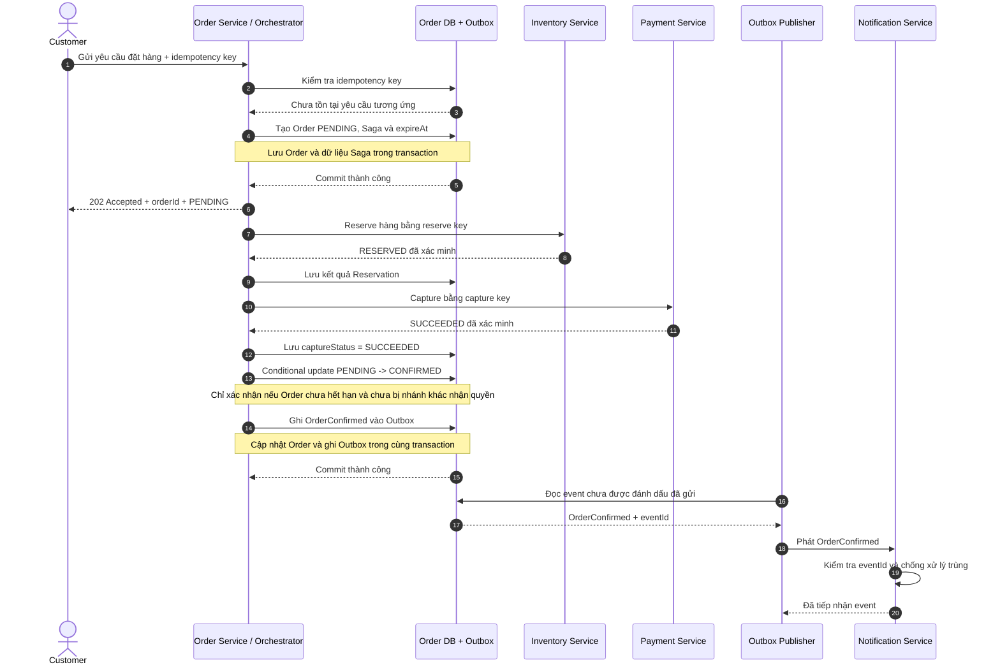
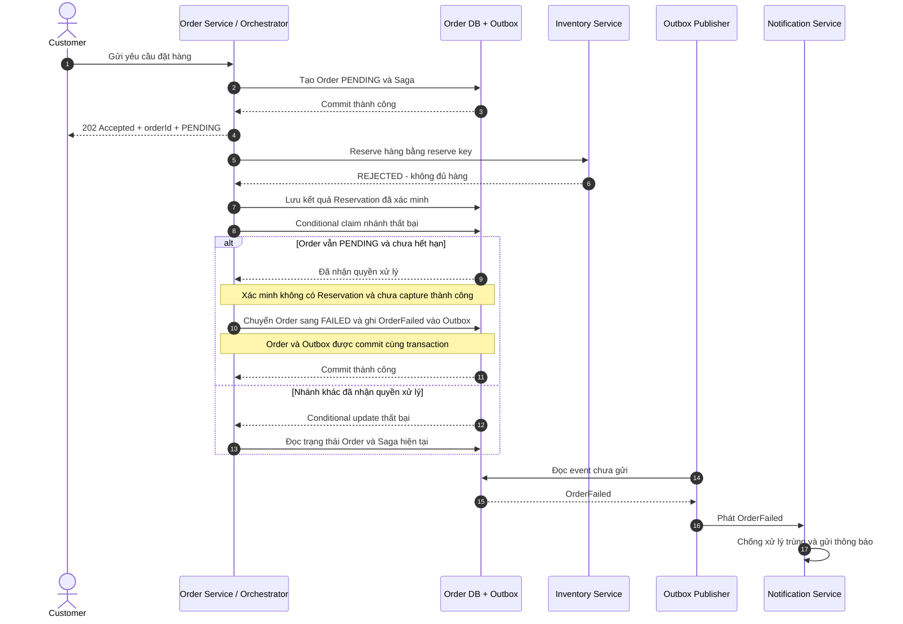
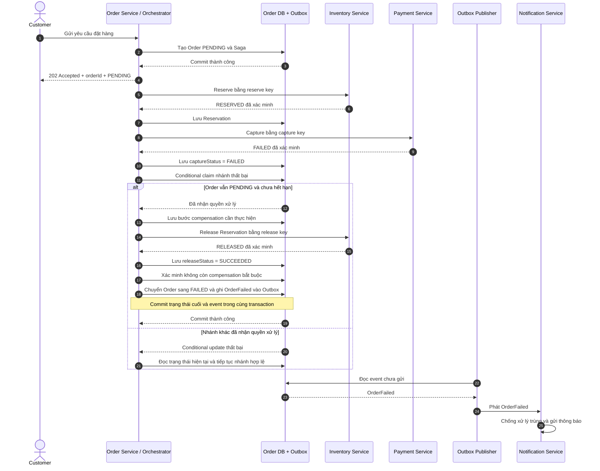
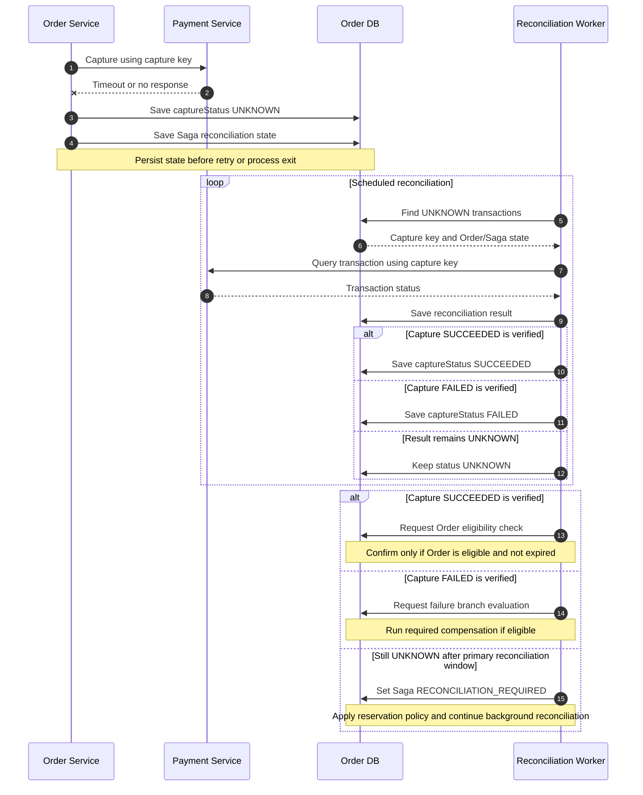
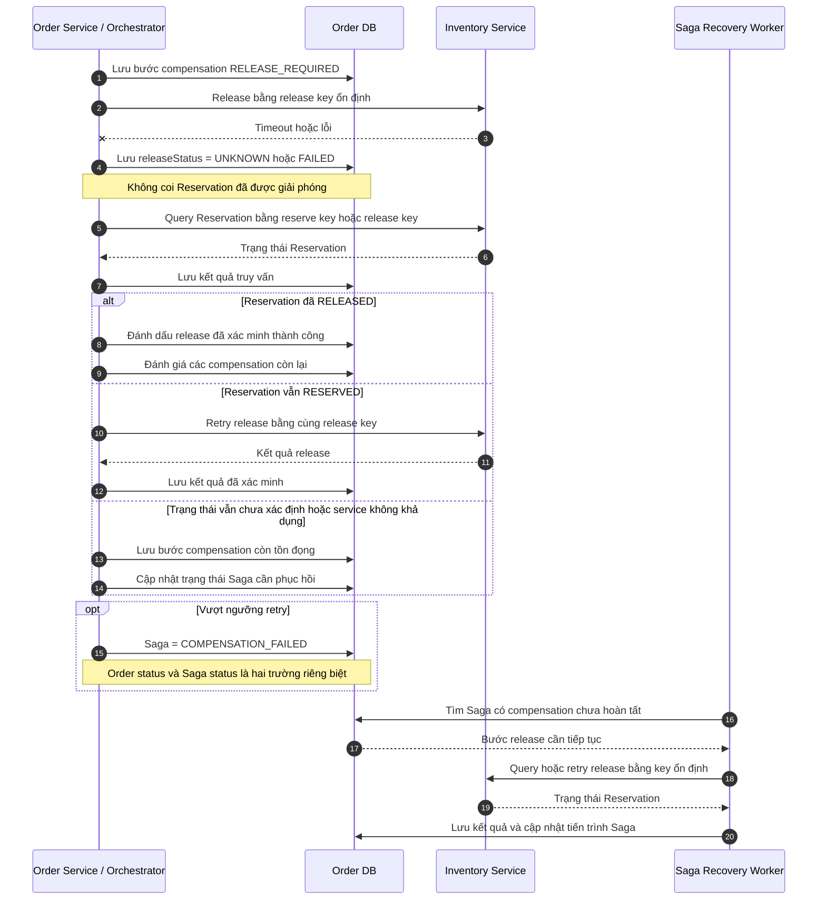
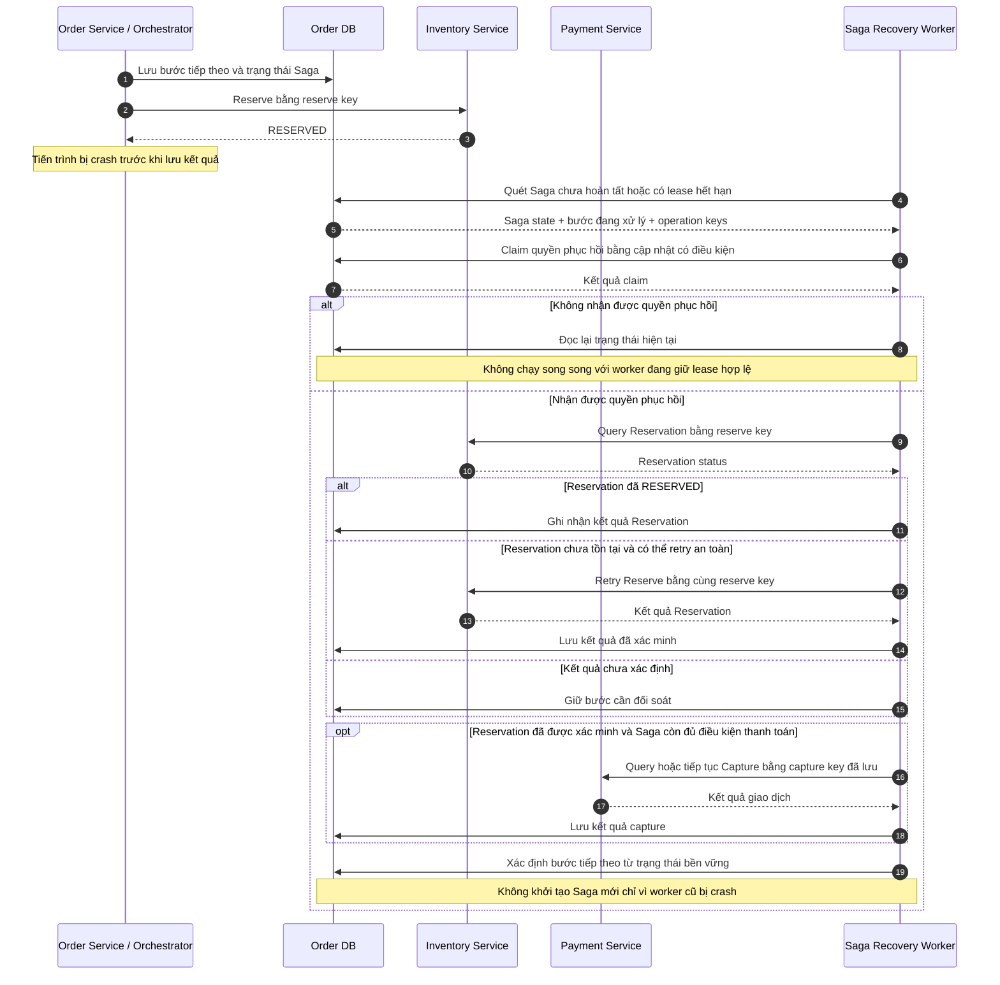

# 11. Sequence Diagrams – Resilient Order Workflow

## 1. Mục đích

Tài liệu mô tả trình tự tương tác giữa các thành phần trong quy trình đặt hàng, từ khi khách hàng gửi yêu cầu đến khi đơn hàng được xác nhận hoặc được xử lý theo nhánh thất bại, hết hạn hay cần phục hồi.

Các sơ đồ được xây dựng dựa trên Use Case, State Machine và Saga Workflow, nhằm:

- Giúp thống nhất thứ tự gọi service, API và event contract trước khi triển khai.
- Xác định điểm kiểm thử, điều kiện rẽ nhánh và kết quả mong đợi.
- Làm rõ cách hệ thống xử lý timeout, retry, compensation, sự kiện trùng và lỗi khi tiến trình bị gián đoạn.
- Bảo đảm thay đổi trạng thái Order nhất quán với các nghiệp vụ đã thực hiện và các sự kiện được ghi vào Outbox.

> **Quy ước:** Các sơ đồ mô tả luồng logic. Tên API, payload, mã lỗi, tên event và cấu trúc bảng cần được thống nhất trong hợp đồng giao tiếp trước khi triển khai.

## 2. Thành phần tham gia

| Thành phần | Trách nhiệm |
|---|---|
| Customer | Gửi yêu cầu đặt hàng và truy vấn trạng thái Order |
| Order Service / Saga Orchestrator | Tạo Order, điều phối Saga, kiểm tra điều kiện chuyển trạng thái |
| Order DB | Lưu Order, trạng thái Saga, thông tin Reservation, capture/refund và dữ liệu phục hồi |
| Outbox | Lưu domain event trong cùng transaction với thay đổi trạng thái nghiệp vụ |
| Inventory Service | Tạo, truy vấn và giải phóng Reservation |
| Payment Service | Capture, truy vấn kết quả giao dịch và refund |
| TTL Worker | Phát hiện Order hết hạn và nhận quyền xử lý nhánh hết hạn |
| Reconciliation Worker | Đối soát giao dịch thanh toán chưa xác định |
| Saga Recovery Worker | Tìm Saga bị gián đoạn và tiếp tục xử lý từ trạng thái đã lưu |
| Outbox Publisher | Phát các event chưa được đánh dấu đã gửi |
| Notification Service | Nhận event nghiệp vụ và gửi thông báo |
| Consumer Inbox / Idempotency Store | Ghi nhận event hoặc yêu cầu đã xử lý để chống xử lý trùng |

## 3. Luồng 1 – Đặt hàng thành công

**Use Case:** UC-01

### Điều kiện trước

- Yêu cầu đặt hàng hợp lệ.
- Sản phẩm còn đủ hàng.
- Thanh toán được xác minh thành công.
- Order chưa hết hạn và vẫn đủ điều kiện xác nhận.



### Kết quả mong đợi

- API trả về `orderId`; trạng thái ban đầu là `PENDING`.
- Reservation được xác minh là `RESERVED`.
- Capture được xác minh là `SUCCEEDED`.
- Order chỉ chuyển sang `CONFIRMED` khi thỏa mãn điều kiện của State Machine.
- Thay đổi trạng thái và ghi `OrderConfirmed` vào Outbox phải nằm trong cùng transaction.
- Nếu publisher phát lại event, consumer không được gửi thông báo hoặc thực hiện tác dụng nghiệp vụ trùng ngoài chính sách đã định.
- Nếu điều kiện chuyển trạng thái không còn hợp lệ, Orchestrator phải đọc trạng thái hiện tại và xử lý theo nhánh đã thắng, không ghi đè.

## 4. Luồng 2 – Hết hàng

**Use Case:** UC-02

### Điều kiện trước

- Yêu cầu đặt hàng hợp lệ.
- Inventory Service xác định không đủ tồn kho để tạo Reservation.



### Kết quả mong đợi

- Nếu nhánh hết hàng được nhận quyền xử lý, Order chuyển theo luồng `PENDING -> COMPENSATING -> FAILED` hoặc theo trạng thái trung gian đã được quy định trong State Machine.
- Không thực hiện capture khi chưa có Reservation hợp lệ.
- Không yêu cầu release nếu đã xác minh không có Reservation cần giải phóng.
- Nếu kết quả reserve chưa rõ, phải truy vấn lại bằng cùng `reserve key`; không giả định rằng Reservation không tồn tại.
- Nếu một nhánh khác đã nhận quyền xử lý Order, Orchestrator không được ghi đè trạng thái hiện tại.

## 5. Luồng 3 – Thanh toán thất bại sau khi giữ hàng

**Use Case:** UC-03

### Điều kiện trước

- Order đang `PENDING`.
- Reservation đã được xác minh là `RESERVED`.
- Payment Service trả về `FAILED` đã xác minh.



### Kết quả mong đợi

- Order không được xác nhận thành công khi capture đã được xác minh thất bại.
- Reservation phải được giải phóng và kết quả release được xác minh trước khi hoàn tất nhánh thất bại.
- Không refund khi capture đã được xác minh là `FAILED`.
- Nếu release timeout hoặc trả kết quả chưa rõ, truy vấn Reservation bằng cùng `release key` trước khi quyết định retry.
- Nếu release thất bại, Saga không được coi compensation đã hoàn tất.
- Nếu vượt ngưỡng retry, Saga có thể chuyển sang `COMPENSATION_FAILED` theo file `10-saga-workflow-and-compensation.md`; tiến trình phục hồi phải tiếp tục xử lý sau đó.
- Không phát `OrderFailed` như trạng thái kết thúc nghiệp vụ nếu các compensation bắt buộc vẫn chưa được xử lý theo chính sách.

## 6. Luồng 4 – Timeout khi thanh toán và đối soát

**Use Case:** UC-03, UC-07

### Điều kiện trước

- Reservation đã được xác minh là `RESERVED`.
- Capture được gửi đi nhưng Order Service không nhận được kết quả rõ ràng.
- Timeout không đủ để kết luận giao dịch đã thất bại.



### Kết quả mong đợi

- Timeout không tự động chuyển `captureStatus` thành `FAILED`.
- Khi capture còn `UNKNOWN`, không được release Reservation hoặc refund chỉ dựa trên giả định giao dịch thất bại/thành công.
- Retry capture phải dùng lại cùng `capture key`; không tạo giao dịch capture mới chỉ vì mất phản hồi.
- Lịch đối soát và số lần truy vấn tuân theo file Saga Workflow.
- Khi có kết quả xác minh, hệ thống phải đọc lại trạng thái Order trước khi quyết định xác nhận, thất bại hay xử lý hết hạn.
- Không chuyển Order trở lại `CONFIRMED` nếu nhánh hết hạn hoặc nhánh khác đã nhận quyền xử lý hợp lệ.

## 7. Luồng 5 – Order hết hạn (TTL)

**Use Case:** UC-06, UC-07

### Điều kiện trước

- DB UTC time đã đến hoặc vượt `expireAt`.
- Order còn thuộc trạng thái cho phép nhận nhánh hết hạn.
- Kết quả capture và Reservation được xác minh hoặc được đưa vào tiến trình xử lý chưa xác định theo State Machine.

```mermaid
sequenceDiagram
autonumber
participant T as TTL Worker
participant DB as Order DB
participant I as Inventory Service
participant P as Payment Service
T->>DB: Quét Order PENDING đã hết hạn và EXPIRING có lease hết hạn
DB-->>T: Danh sách ứng viên
T->>DB: Đọc captureStatus và trạng thái Saga
DB-->>T: Trạng thái hiện tại
alt Capture đang UNKNOWN
    T->>DB: Giữ nhánh đối soát hoặc RECONCILIATION_REQUIRED
    Note over T,DB: Không tự ý refund, release hoặc kết thúc EXPIRED khi kết quả thanh toán chưa rõ
else Chưa có capture thành công và đủ điều kiện hết hạn
    T->>DB: Conditional claim PENDING -> EXPIRING
    Note over T,DB: Ghi claimToken, claimedAt và leaseUntil cùng thao tác claim
    DB-->>T: Claim thành công hoặc thất bại
    alt Claim thất bại
        T->>DB: Đọc trạng thái hiện tại
        Note over T,DB: Không xử lý song song nếu worker khác đã nhận quyền
    else Claim thành công
        T->>DB: Đọc trạng thái Reservation
        alt Reservation chưa được xác minh
            T->>I: Query bằng reserve key
            I-->>T: Reservation status
            T->>DB: Lưu kết quả truy vấn
        end
        alt Reservation đang RESERVED
            T->>I: Release bằng release key
            I-->>T: Kết quả release
            T->>DB: Lưu kết quả release
        else Reservation không tồn tại hoặc đã RELEASED
            Note over T,I: Không tạo release không cần thiết
        end
        T->>DB: Kiểm tra đủ điều kiện kết thúc
        T->>DB: Commit Order EXPIRED + Saga hoàn tất + OrderExpired Outbox
    end
else Capture SUCCEEDED đã xác minh
    T->>DB: Conditional claim nhánh hết hạn nếu Order vẫn đủ điều kiện
    DB-->>T: Kết quả claim
    alt Claim thành công
        T->>P: Refund bằng refund key
        P-->>T: Kết quả refund
        T->>DB: Lưu refundStatus và trạng thái Saga
        alt Refund SUCCEEDED đã xác minh
            T->>DB: Kiểm tra Reservation và release nếu còn cần
            T->>I: Query/Release bằng key ổn định khi cần
            I-->>T: Kết quả đã xác minh
            T->>DB: Kiểm tra mọi điều kiện kết thúc
            T->>DB: Commit Order EXPIRED + Saga hoàn tất + OrderExpired Outbox
        else Refund UNKNOWN hoặc FAILED
            T->>DB: Giữ nhánh xử lý chưa hoàn tất
            Note over T,DB: Không đánh dấu Saga hoàn tất; xử lý theo chính sách refund
        end
    else Claim thất bại
        T->>DB: Đọc trạng thái hiện tại
    end
end
```

### Kết quả mong đợi

- TTL mặc định là 15 phút; việc quét và lease tuân theo cấu hình dự án.
- Điều kiện hết hạn được đánh giá bằng DB UTC time.
- Chỉ một worker được quyền nhận nhánh hết hạn tại một thời điểm.
- Thao tác claim phải được thực hiện có điều kiện; `claimToken`, `claimedAt` và `leaseUntil` được lưu nhất quán.
- Reservation chưa được xác minh phải được truy vấn bằng `reserve key` trước khi quyết định release.
- Nếu capture đã thành công, phải xử lý refund theo chính sách đã thống nhất và chỉ coi refund hoàn tất khi được xác minh.
- Nếu refund hoặc release còn `UNKNOWN`/`FAILED`, không được đánh dấu Saga hoàn tất.
- Worker khác chỉ tiếp quản khi lease hết hạn và phải đọc lại trạng thái trước khi thực hiện hành động.
- Nếu nhánh khác đã nhận quyền xử lý Order, TTL Worker không được ghi đè trạng thái của nhánh đó.
- Chỉ chuyển sang `EXPIRED` khi thỏa mãn đầy đủ điều kiện trong State Machine và Saga Workflow.

## 8. Luồng 6 – Release thất bại hoặc kết quả release chưa rõ

**Use Case:** UC-03, UC-06, UC-07

### Điều kiện trước

- Saga cần giải phóng Reservation do thanh toán thất bại hoặc Order hết hạn.
- Inventory Service trả về lỗi, timeout hoặc kết quả chưa đủ để xác nhận Reservation đã được giải phóng.



### Kết quả mong đợi

- Timeout khi release không đồng nghĩa với release thất bại; phải truy vấn trạng thái trước khi quyết định retry.
- Retry phải dùng cùng `release key`, bảo đảm không tạo tác dụng nghiệp vụ trùng.
- Chỉ đánh dấu release hoàn tất khi kết quả đã được xác minh hoặc Reservation được xác minh không còn tồn tại/đã giải phóng.
- Nếu vượt ngưỡng retry, Saga có thể chuyển sang `COMPENSATION_FAILED` và phải được theo dõi, phục hồi.
- `COMPENSATION_FAILED` là trạng thái tiến trình Saga; không tự động đồng nghĩa với một trạng thái Order cùng tên.
- Không phát sự kiện kết thúc nghiệp vụ nếu các compensation bắt buộc vẫn chưa đáp ứng điều kiện kết thúc đã quy định.

## 9. Luồng 7 – Saga bị crash và phục hồi

**Use Case:** UC-07

### Điều kiện trước

- Order và Saga đã được lưu bền vững.
- Orchestrator hoặc worker bị dừng giữa các bước xử lý.
- Có thể có bước đã được service đích thực hiện nhưng kết quả chưa được ghi vào Order DB.



### Kết quả mong đợi

- Recovery Worker tiếp tục Saga từ trạng thái bền vững, không tạo Order hoặc Saga mới cho cùng thao tác nghiệp vụ.
- Trước khi retry một hành động, phải kiểm tra trạng thái service đích nếu lần thực hiện trước có thể đã thành công.
- Sử dụng lại operation key đã lưu cho reserve, capture, release và refund.
- Lease và cơ chế claim ngăn nhiều worker cùng điều phối một Saga tại cùng thời điểm.
- Nếu kết quả giao dịch chưa xác định, chuyển sang đối soát thay vì giả định thất bại.
- Các bước compensation chưa hoàn tất phải được tiếp tục phục hồi.
- Sau khi phục hồi, trạng thái Order và Saga phải tiếp tục tuân thủ State Machine và Saga Workflow.

## 10. Luồng 8 – Gửi lại yêu cầu, event trùng và idempotency

**Use Case:** UC-10

### Điều kiện trước

- Khách hàng gửi lại yêu cầu do timeout hoặc không nhận được phản hồi.
- Publisher phát lại event hoặc consumer nhận cùng event nhiều lần.
- Một thao tác nghiệp vụ có thể được retry sau khi mất phản hồi.

```mermaid
sequenceDiagram
autonumber
actor C as Customer
participant O as Order Service
participant DB as Order DB + Outbox
participant I as Inventory Service
participant P as Payment Service
participant PUB as Outbox Publisher
participant N as Notification Service
participant IN as Consumer Inbox
C->>O: Gửi yêu cầu + idempotency key
O->>DB: Tra cứu idempotency key
DB-->>O: Kết quả tra cứu
alt Yêu cầu mới
    O->>DB: Tạo Order + liên kết idempotency key
    Note over O,DB: Commit Order và dữ liệu cần phục hồi
    DB-->>O: Commit thành công
    O-->>C: 202 Accepted + orderId + PENDING
else Yêu cầu trùng
    O-->>C: Trả lại orderId và trạng thái hiện tại
end
Note over O,I: Chỉ tiếp tục workflow khi cần; không tạo Reservation trùng
O->>I: Reserve bằng reserve key ổn định
I-->>O: Kết quả Reservation
opt Order đủ điều kiện thanh toán
    O->>P: Capture bằng capture key ổn định
    P-->>O: Kết quả capture
end
O->>DB: Ghi trạng thái nghiệp vụ và event vào Outbox trong cùng transaction
PUB->>DB: Đọc event chưa được đánh dấu đã gửi
DB-->>PUB: Event + eventId
PUB->>N: Phát event
N->>IN: Kiểm tra và ghi nhận consumerName + eventId
alt Event đã xử lý
    IN-->>N: Đã tồn tại
    N-->>PUB: Bỏ qua tác dụng nghiệp vụ trùng
else Event mới
    IN-->>N: Chưa tồn tại
    N->>N: Xử lý event và gửi thông báo theo chính sách
    N->>IN: Hoàn tất ghi nhận xử lý
    N-->>PUB: Đã tiếp nhận event
end
```

### Kết quả mong đợi

- Gửi lại cùng yêu cầu không tạo Order thứ hai cho cùng một thao tác logic.
- API trả lại `orderId` đã được liên kết với idempotency key.
- Idempotency key cần được ràng buộc với nội dung yêu cầu phù hợp; tái sử dụng key cho nội dung khác phải được xử lý theo hợp đồng API.
- Retry reserve, capture, release và refund phải dùng operation key ổn định.
- Capture lặp lại với cùng key không được tạo nhiều lần capture có hiệu lực nếu Payment Service hỗ trợ idempotency theo hợp đồng.
- Publisher có thể phát lại event sau lỗi; consumer phải chống xử lý trùng bằng định danh event, ví dụ `UNIQUE(consumerName, eventId)`.
- Ghi nhận event đã xử lý phải nhất quán với tác dụng nghiệp vụ của consumer để tránh đánh dấu thành công khi tác dụng chưa được commit.
- Không tạo domain event mới chỉ vì retry kỹ thuật; chỉ phát event phù hợp với thay đổi nghiệp vụ đã commit.

## 11. Quy tắc chung áp dụng cho các sơ đồ

### 11.1. Conditional update và quyền xử lý

- Các bước cạnh tranh như xác nhận Order, nhận nhánh thất bại và nhận nhánh hết hạn phải sử dụng cập nhật có điều kiện dựa trên trạng thái hiện tại.
- Chỉ một nhánh được quyền nhận xử lý từ `PENDING` theo các chuyển trạng thái được cho phép trong State Machine.
- Nhánh hết hạn có thể sử dụng `EXPIRING` cùng claim token và lease để quản lý việc tiếp quản.
- Nếu conditional update thất bại, thành phần xử lý phải đọc lại trạng thái Order và Saga, sau đó tiếp tục theo nhánh hợp lệ.
- Không ghi đè trạng thái chỉ vì worker hiện tại đã có dữ liệu cũ.

### 11.2. Phân biệt Order status và Saga status

- `Order.status` phản ánh trạng thái nghiệp vụ của đơn hàng.
- `Saga.status` phản ánh tiến trình điều phối và các bước compensation.
- `COMPENSATION_FAILED` và `RECONCILIATION_REQUIRED` phải được hiểu theo mô hình trạng thái của Saga Workflow; không tự động gán chúng thành trạng thái Order.
- Trạng thái Order cuối chỉ được ghi khi thỏa mãn các điều kiện nghiệp vụ trong State Machine.
- Khi Saga còn bước compensation hoặc đối soát chưa hoàn tất, không được coi toàn bộ quy trình đã hoàn tất.

### 11.3. Capture, refund và trạng thái UNKNOWN

- Capture status và refund status là hai thông tin riêng biệt.
- Timeout không chứng minh capture hoặc refund đã thất bại.
- Khi capture là `UNKNOWN`, cần đối soát bằng cùng capture key trước khi quyết định bước tiếp theo.
- Không refund khi chưa xác minh capture thành công.
- Khi refund là `UNKNOWN`, phải truy vấn giao dịch refund trước khi retry.
- Khi refund được xác minh `FAILED`, ghi nhận lỗi và xử lý theo chính sách đã phê duyệt; không tự động tạo một refund mới nếu chưa bảo đảm chống hoàn tiền trùng.
- Không kết thúc nhánh hết hạn hoặc compensation khi các bước bắt buộc còn kết quả chưa xác định.

### 11.4. Transaction và Outbox

- Thay đổi trạng thái nghiệp vụ và ghi domain event tương ứng phải được commit trong cùng transaction DB.
- Không gọi service ngoài như Inventory hoặc Payment trong một transaction DB kéo dài để chờ phản hồi mạng.
- Kết quả của từng bước gọi service phải được lưu bền vững để Saga có thể phục hồi sau crash.
- Outbox Publisher đọc các event chưa gửi và đánh dấu trạng thái phát theo cơ chế được triển khai.
- Nếu publisher crash sau khi phát nhưng trước khi đánh dấu đã gửi, event có thể được phát lại.
- Consumer phải idempotent để xử lý an toàn việc phát lại.
- Notification Service chỉ gửi thông báo dựa trên event nghiệp vụ hợp lệ đã được commit.

### 11.5. Retry và phục hồi

- Retry phải dùng lại operation key của cùng thao tác logic.
- Trước khi retry hành động có thể đã thành công nhưng mất phản hồi, cần query trạng thái hoặc dùng cơ chế idempotency của service đích.
- Giới hạn retry, khoảng cách giữa các lần retry và điều kiện chuyển sang trạng thái cần phục hồi phải thống nhất với file Saga Workflow.
- Worker phục hồi phải sử dụng claim/lease hoặc cơ chế tương đương để tránh nhiều worker cùng điều phối một Saga.
- Không coi việc hết retry kỹ thuật là bằng chứng rằng nghiệp vụ đã thất bại.
- Mọi bước chưa hoàn tất phải được lưu đủ thông tin để tiếp tục sau khi tiến trình bị dừng.

### 11.6. TTL, thời gian và lease

- TTL mặc định: 15 phút.
- TTL Worker quét theo cấu hình, mặc định mỗi 5 giây.
- Lease mặc định: 30 giây, nếu phù hợp với cấu hình triển khai.
- So sánh thời gian hết hạn bằng DB UTC time.
- Không gia hạn `expireAt` chỉ vì hệ thống timeout hoặc đang đối soát.
- Worker phải phát hiện cả Order `PENDING` đã hết hạn và Order `EXPIRING` có lease hết hạn.
- Worker tiếp quản phải đọc lại trạng thái Order, Saga, Reservation và thanh toán trước khi tiếp tục.

## 12. Liên kết với tài liệu yêu cầu

| Sơ đồ | Use Case liên quan | Trọng tâm kiểm thử |
|---|---|---|
| Luồng 1 – Thành công | UC-01 | Xác nhận Order, transaction và Outbox |
| Luồng 2 – Hết hàng | UC-02 | Không capture, không release khi đã xác minh không có Reservation |
| Luồng 3 – Thanh toán thất bại | UC-03 | Release Reservation và hoàn tất compensation |
| Luồng 4 – Timeout thanh toán | UC-03, UC-07 | `UNKNOWN`, đối soát và retry an toàn |
| Luồng 5 – Hết hạn TTL | UC-06, UC-07 | Claim, release/refund và điều kiện `EXPIRED` |
| Luồng 6 – Release thất bại | UC-03, UC-06, UC-07 | Retry release, trạng thái chưa rõ và phục hồi compensation |
| Luồng 7 – Saga crash/recovery | UC-07 | Phục hồi từ trạng thái bền vững, không tạo tác vụ trùng |
| Luồng 8 – Idempotency | UC-10 | Yêu cầu trùng, event trùng và chống double payment |

Tài liệu liên quan:

- `docs/requirements/02-functional-requirements.md`
- `docs/requirements/03-business-rules.md`
- `docs/requirements/06-design-decisions.md`
- `docs/requirements/07-non-functional-requirements.md`
- `docs/requirements/08-detailed-use-cases.md`
- `docs/architecture/09-state-machine.md`
- `docs/architecture/10-saga-workflow-and-compensation.md`
- `docs/architecture/12-acceptance-criteria.md`

## 13. Tiêu chí hoàn thành

- [ ] Tất cả sơ đồ sử dụng khối Mermaid hợp lệ và được đặt trong code fence.
- [ ] Có luồng thành công và nhiều luồng thất bại hoặc phục hồi.
- [ ] Thể hiện rõ thành phần gửi, thành phần nhận, phản hồi và điều kiện rẽ nhánh.
- [ ] Có luồng hết hàng, thanh toán thất bại, timeout/UNKNOWN, TTL, release thất bại, crash/recovery và idempotency.
- [ ] Thể hiện việc cập nhật trạng thái nghiệp vụ và ghi Outbox trong cùng transaction.
- [ ] Có xử lý publisher phát lại event và consumer chống xử lý trùng.
- [ ] Không coi timeout là bằng chứng giao dịch thất bại.
- [ ] Không hoàn tất Order hoặc Saga khi các compensation bắt buộc chưa đáp ứng điều kiện kết thúc.
- [ ] Trạng thái và chuyển trạng thái thống nhất với `09-state-machine.md`.
- [ ] Retry, compensation và phục hồi thống nhất với `10-saga-workflow-and-compensation.md`.
- [ ] Các API, event, operation key, ngưỡng retry và điều kiện kết thúc được thống nhất với các thành viên phụ trách trước khi triển khai.
