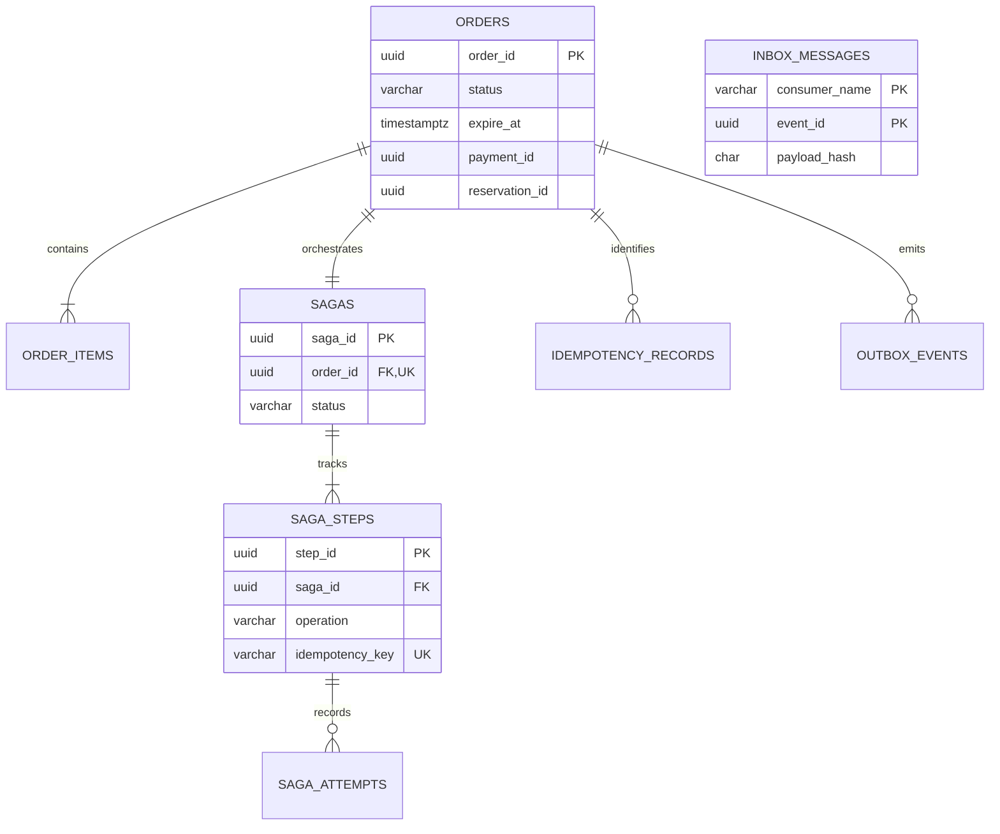
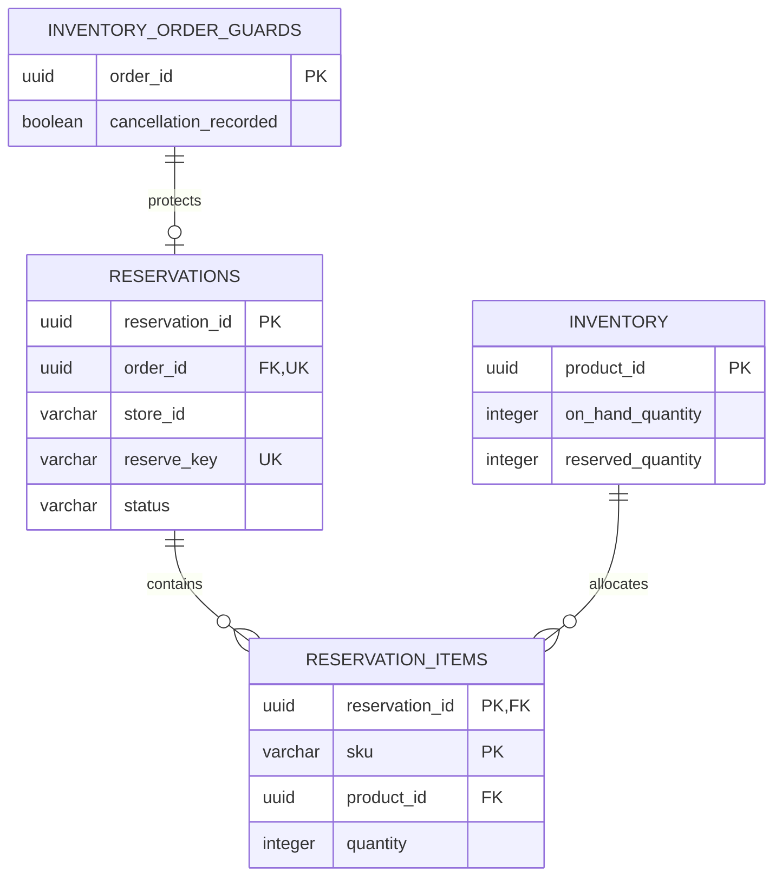
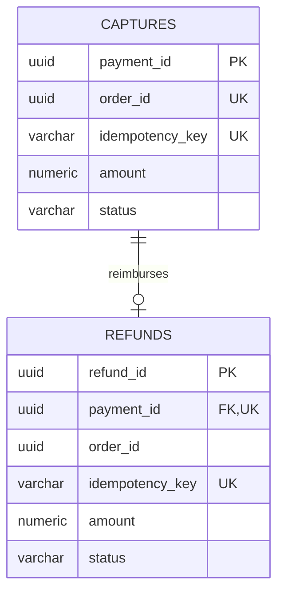

# 15. Database Design – Resilient Order Workflow

## 1. Mục đích và phạm vi

Tài liệu thiết kế dữ liệu PostgreSQL cho Order Service, Inventory Service và Payment Service. Schema bảo đảm lưu bền vững tiến trình Saga, chống tác dụng nghiệp vụ trùng, không giữ vượt tồn kho và hỗ trợ phục hồi sau sự cố.

Phạm vi gồm ERD, Data Dictionary, khóa và ràng buộc, index, transaction, lịch retry/đối soát, retention và quy ước migration. Migration SQL và Repository được triển khai trong các issue xây dựng service.

## 2. Nguyên tắc và quy ước

- Mỗi service sở hữu một database: `order_db`, `inventory_db`, `payment_db`. Chỉ service sở hữu được ghi dữ liệu của mình.
- Không tạo Foreign Key, JOIN hoặc transaction xuyên database. Các ID liên service là tham chiếu logic, được kiểm tra qua API/command/event.
- Order Service lưu bản kết quả đã xác minh từ Inventory và Payment để kiểm tra chuyển trạng thái trong transaction cục bộ.
- Tên bảng/cột dùng `snake_case`; ID nghiệp vụ dùng `uuid`. Khóa idempotency dùng `varchar(255)`; payload hash dùng `char(64)` chứa SHA-256 của payload nghiệp vụ đã chuẩn hóa.
- Timestamp dùng `timestamptz`; kết nối DB đặt timezone UTC. So sánh hạn và lease bằng `clock_timestamp()` tại DB, không dùng đồng hồ của từng tiến trình. `CURRENT_TIMESTAMP` không dùng để phân xử hết hạn trong transaction kéo dài.
- Số lượng dùng `integer`; số tiền dùng `numeric(19,2)`, không dùng số thực. Currency dùng `varchar(3)` và thống nhất giữa Order, Capture, Refund.
- Trạng thái dùng `varchar(32) NOT NULL` với `CHECK` giới hạn giá trị. Chuyển trạng thái phải có guard; CHECK danh sách giá trị không tự bảo vệ thứ tự chuyển.
- Timeout không làm mất kết quả đã commit và không chứng minh nghiệp vụ thất bại. Retry giữ nguyên khóa; `EXPIRED` không có nghĩa là xóa Order.
- Payload/response JSON dùng `jsonb`; các trường truy vấn, liên kết và ràng buộc chính phải có cột riêng.

## 3. Tổng quan quyền sở hữu

| Database | Bảng | Trách nhiệm |
|---|---|---|
| `order_db` | `orders`, `order_items` | Đơn và các dòng sản phẩm |
| `order_db` | `sagas`, `saga_steps`, `saga_attempts` | Điều phối, retry, đối soát và lịch sử xử lý |
| `order_db` | `idempotency_records`, `outbox_events`, `inbox_messages` | Chống trùng và phát/nhận event bền vững |
| `inventory_db` | `inventory`, `inventory_order_guards` | Tồn kho và bảo vệ trước lệnh đến muộn |
| `inventory_db` | `reservations`, `reservation_items`, `idempotency_records` | Giữ/giải phóng hàng và kết quả lệnh |
| `payment_db` | `captures`, `refunds`, `idempotency_records` | Thu tiền/hoàn tiền giả lập và kết quả lệnh |

Một Order có nhiều dòng sản phẩm và một Reservation logic. Capture thực hiện một lần cho tổng đơn; Refund hoàn toàn bộ khoản Capture. Không triển khai hoàn tiền một phần. Notification sở hữu dữ liệu giao nhận của riêng mình, ngoài phạm vi ba database này.

## 4. Order Database

### 4.1. ERD



Inbox không có FK tới Order vì có thể tiếp nhận event sai tham chiếu cần cách ly. ERD chỉ thể hiện quan hệ trong `order_db`.

### 4.2. Bảng `orders`

| Cột | Kiểu | Ràng buộc / mặc định | Ý nghĩa |
|---|---|---|---|
| `order_id` | `uuid` | PK | Định danh Order |
| `client_id` | `varchar(128)` | NOT NULL | Phạm vi khóa tạo đơn; định danh client, không thay thế xác thực |
| `status` | `varchar(32)` | NOT NULL, default `PENDING`, CHECK | Trạng thái Order |
| `total_amount` | `numeric(19,2)` | NOT NULL, CHECK > 0 | Tổng tiền từ các dòng đơn |
| `currency` | `varchar(3)` | NOT NULL | Loại tiền |
| `reservation_id` | `uuid` | NULL cho đến khi nhận kết quả | Tham chiếu logic Inventory |
| `reservation_status` | `varchar(32)` | NOT NULL, default `NOT_CREATED`, CHECK | Bản trạng thái Reservation cục bộ |
| `reservation_verified` | `boolean` | NOT NULL, default false | Kết quả đã được Inventory xác minh |
| `unknown_operation` | `varchar(16)` | NULL hoặc `RESERVE`/`RELEASE` | Thao tác Reservation cần đối soát |
| `payment_id` | `uuid` | NULL cho đến khi nhận kết quả | Tham chiếu Capture |
| `capture_status` | `varchar(32)` | NOT NULL, default `NOT_STARTED`, CHECK | Bản trạng thái Capture cục bộ |
| `capture_verified` | `boolean` | NOT NULL, default false | Kết quả Capture đã xác minh |
| `captured_amount` | `numeric(19,2)` | NULL hoặc > 0 | Số tiền Capture đã xác minh |
| `captured_currency` | `varchar(3)` | NULL trước khi xác minh | Currency Capture |
| `refund_id` | `uuid` | NULL trước khi cần Refund | Tham chiếu logic Refund |
| `refund_status` | `varchar(32)` | NOT NULL, default `NOT_REQUIRED`, CHECK | Trạng thái Refund độc lập |
| `refund_verified` | `boolean` | NOT NULL, default false | Refund đã được xác minh |
| `claim_token` | `uuid` | NULL khi chưa có claim | Quyền xử lý nhánh hết hạn |
| `claimed_at` | `timestamptz` | NULL khi chưa có claim | Thời điểm claim |
| `lease_until` | `timestamptz` | NULL khi chưa có claim | Hạn quyền xử lý |
| `created_at`, `updated_at` | `timestamptz` | NOT NULL | Thời điểm tạo/cập nhật |
| `expire_at` | `timestamptz` | NOT NULL, CHECK > `created_at` | Hạn thanh toán cố định |
| `confirmed_at`, `failed_at`, `expired_at` | `timestamptz` | NULL trước khi kết thúc | Thời điểm kết thúc theo nhánh |
| `terminal_at` | `timestamptz` | NULL trước khi kết thúc | Mốc lưu giữ Order |
| `version` | `bigint` | NOT NULL, default 0, CHECK >= 0 | Chống cập nhật từ bản đọc cũ |

Order có đúng 7 trạng thái: `PENDING`, `CONFIRMED`, `COMPENSATING`, `COMPENSATION_FAILED`, `EXPIRING`, `FAILED`, `EXPIRED`.

Reservation cục bộ: `NOT_CREATED`, `RESERVED`, `RELEASED`, `REJECTED`, `UNKNOWN`. Nếu là `UNKNOWN`, bắt buộc có `unknown_operation`; khi đã rõ phải xóa trường này. Trước khi gửi Reserve, đặt `reservation_verified = false`; không dùng `NOT_CREATED` ban đầu làm bằng chứng không có lệnh đang xử lý.

Capture: `NOT_STARTED`, `IN_PROGRESS`, `SUCCEEDED`, `FAILED`, `UNKNOWN`. Refund: `NOT_REQUIRED`, `NOT_STARTED`, `IN_PROGRESS`, `SUCCEEDED`, `FAILED`, `UNKNOWN`. Các bản kết quả phải được kiểm tra Order ID, transaction ID, số tiền và currency khi nhận; timeout không được ghi đè kết quả cuối đã xác minh.

CHECK bảo đảm `terminal_at` và timestamp tương ứng tồn tại khi Order ở trạng thái cuối. Với trạng thái trung gian, `terminal_at` là NULL. Ba cột claim cùng NULL hoặc cùng có giá trị, với `lease_until > claimed_at`.

### 4.3. Bảng `order_items`

| Cột | Kiểu | Ràng buộc / mặc định | Ý nghĩa |
|---|---|---|---|
| `order_id` | `uuid` | PK thành phần, FK → orders | Đơn sở hữu |
| `product_id` | `uuid` | PK thành phần | Tham chiếu sản phẩm logic |
| `quantity` | `integer` | NOT NULL, CHECK > 0 | Số lượng |
| `unit_price` | `numeric(19,2)` | NOT NULL, CHECK > 0 | Giá tại thời điểm đặt |

PK `(order_id, product_id)` loại bỏ dòng sản phẩm trùng; request được chuẩn hóa trước khi hash. Trong transaction tạo Order, xác minh có ít nhất một dòng và `total_amount = SUM(quantity * unit_price)`. Đây là kiểm tra nhiều dòng trong nghiệp vụ, không dùng CHECK truy vấn bảng khác. Dữ liệu giá được cố định khi tiếp nhận, không cập nhật theo giá sản phẩm về sau.

### 4.4. Bảng `sagas`

| Cột | Kiểu | Ràng buộc / mặc định | Ý nghĩa |
|---|---|---|---|
| `saga_id` | `uuid` | PK | Định danh Saga |
| `order_id` | `uuid` | NOT NULL, UNIQUE, FK → orders | Một Saga cho một Order |
| `status` | `varchar(32)` | NOT NULL, default `RUNNING`, CHECK | Tiến trình điều phối |
| `branch` | `varchar(16)` | NOT NULL, default `FORWARD`, CHECK | `FORWARD`, `FAILURE`, `EXPIRATION` |
| `current_operation` | `varchar(16)` | NULL hoặc RESERVE/CAPTURE/RELEASE/REFUND | Bước đang xử lý |
| `last_error` | `text` | NULL khi chưa lỗi | Nguyên nhân lỗi gần nhất |
| `created_at`, `updated_at` | `timestamptz` | NOT NULL | Mốc tạo/cập nhật |
| `completed_at` | `timestamptz` | NULL khi chưa hoàn tất | Mốc hoàn tất gần nhất |
| `version` | `bigint` | NOT NULL, default 0 | Kiểm soát cạnh tranh |

Saga có các trạng thái `RUNNING`, `RECONCILING`, `RECONCILIATION_REQUIRED`, `COMPENSATING`, `COMPENSATION_FAILED`, `COMPLETED`.

Khi Capture thành công được phát hiện sau `EXPIRED`, giữ Order `EXPIRED`; dùng lại Saga để theo dõi Refund muộn, chuyển `COMPLETED → COMPENSATING` và xóa `completed_at` trong khi xử lý. Khi Refund hoàn tất mới đặt lại `completed_at`. Không tạo Saga thứ hai hoặc phát `OrderConfirmed`.

### 4.5. Bảng `saga_steps`

| Cột | Kiểu | Ràng buộc / mặc định | Ý nghĩa |
|---|---|---|---|
| `step_id` | `uuid` | PK | Định danh bước |
| `saga_id` | `uuid` | NOT NULL, FK → sagas | Saga sở hữu |
| `operation` | `varchar(16)` | NOT NULL, CHECK | RESERVE/CAPTURE/RELEASE/REFUND |
| `idempotency_key` | `varchar(255)` | NOT NULL, UNIQUE | Khóa tác dụng nghiệp vụ |
| `request_payload` | `jsonb` | NOT NULL | Dữ liệu để gửi lại cùng lệnh |
| `status` | `varchar(32)` | NOT NULL, CHECK | NOT_STARTED/IN_PROGRESS/SUCCEEDED/FAILED/UNKNOWN |
| `result_payload` | `jsonb` | NULL trước khi có kết quả | Kết quả đã ghi nhận |
| `attempt_count` | `integer` | NOT NULL, default 0, CHECK >= 0 | Tổng số lần gửi lệnh |
| `next_attempt_at` | `timestamptz` | NULL nếu không cần gửi | Lịch retry |
| `unknown_since` | `timestamptz` | NULL nếu chưa UNKNOWN | Mốc bắt đầu lịch đối soát |
| `query_count` | `integer` | NOT NULL, default 0, CHECK 0..30 | Số truy vấn lịch chính |
| `background_query_count` | `integer` | NOT NULL, default 0, CHECK >= 0 | Số truy vấn nền |
| `next_query_at` | `timestamptz` | NULL nếu không cần đối soát | Lịch truy vấn |
| `claim_token` | `uuid` | NULL khi chưa claim | Quyền thực hiện bước |
| `claimed_at`, `lease_until` | `timestamptz` | NULL khi chưa claim | Lease của bước |
| `last_error` | `text` | NULL khi chưa lỗi | Lỗi gần nhất |
| `created_at`, `updated_at`, `completed_at` | `timestamptz` | Hai cột đầu NOT NULL | Mốc xử lý |

`UNIQUE(saga_id, operation)` bảo đảm một tác dụng mỗi loại trong demo v1. `FAILED` ở đây là kết quả nghiệp vụ đã xác minh; lỗi mạng ghi `last_error` và lịch retry/đối soát, không tự biến thành kết quả cuối.

### 4.6. Bảng `saga_attempts`

| Cột | Kiểu | Ràng buộc | Ý nghĩa |
|---|---|---|---|
| `attempt_id` | `uuid` | PK | Định danh lần thực hiện |
| `step_id` | `uuid` | NOT NULL, FK → saga_steps | Bước liên quan |
| `kind` | `varchar(16)` | NOT NULL, CHECK SEND/QUERY/BACKGROUND_QUERY | Loại lần thực hiện |
| `sequence_no` | `integer` | NOT NULL, CHECK > 0 | Thứ tự theo loại |
| `started_at`, `finished_at` | `timestamptz` | Cột đầu NOT NULL | Thời gian thực hiện |
| `outcome`, `error_code` | `varchar(64)` | NULL khi đang chạy | Kết quả và mã lỗi |
| `error_message` | `text` | NULL khi không lỗi | Mô tả đã loại dữ liệu nhạy cảm |

`UNIQUE(step_id, kind, sequence_no)`. Ghi lần thử và tăng bộ đếm trong transaction trước khi gọi mạng; sau crash, lần thử chưa có kết quả được đối soát, không mặc định chưa tạo tác dụng.

## 5. Inventory Database

### 5.1. ERD



### 5.2. Bảng `inventory`

| Cột | Kiểu | Ràng buộc / mặc định | Ý nghĩa |
|---|---|---|---|
| `product_id` | `uuid` | PK | Định danh sản phẩm |
| `sku` | `varchar(128)` | NOT NULL, không trắng | Mã sản phẩm trong cửa hàng |
| `store_id` | `varchar(100)` | NOT NULL, không trắng | Cửa hàng sở hữu tồn kho |
| `product_name` | `varchar(255)` | NOT NULL | Tên phục vụ kiểm thử |
| `on_hand_quantity` | `integer` | NOT NULL, CHECK >= 0 | Tổng tồn có thể phân bổ |
| `reserved_quantity` | `integer` | NOT NULL, default 0, CHECK >= 0 | Tổng lượng đang giữ |
| `other_commitments` | `integer` | NOT NULL, default 0, CHECK >= 0 | Cam kết khác, ngoài Reservation |
| `updated_at` | `timestamptz` | NOT NULL | Thời điểm cập nhật |

`UNIQUE(store_id, sku)` xác định một dòng tồn trong cửa hàng; `product_id` là UUID nội bộ. Command Reserve dùng `storeId` và `items[{sku,quantity}]`, không dùng productId thay SKU. SKU phân biệt hoa/thường và không tự trim. `available_quantity = on_hand_quantity - reserved_quantity - other_commitments`, tính khi truy vấn, không lưu thêm một cột có thể lệch. CHECK `reserved_quantity::bigint + other_commitments <= on_hand_quantity` để phép cộng không tràn integer.

Trong demo `other_commitments = 0`; cột này không bao gồm hàng đã tính trong `reserved_quantity`. Reservation của Order `CONFIRMED` vẫn là `RESERVED` và tiếp tục được tính, vì vận chuyển/tiêu thụ tồn kho ngoài phạm vi.

### 5.3. Bảng `inventory_order_guards`

| Cột | Kiểu | Ràng buộc / mặc định | Ý nghĩa |
|---|---|---|---|
| `order_id` | `uuid` | PK | Tham chiếu Order logic, không FK xuyên DB |
| `cancellation_recorded` | `boolean` | NOT NULL, default false | Đã nhận nhánh hủy/giải phóng |
| `cancel_key` | `varchar(255)` | UNIQUE, NULL trước khi hủy | `inventory:cancel:{orderId}:v1` |
| `cancel_payload_hash` | `char(64)` | NULL trước khi hủy | Kiểm tra nội dung lệnh hủy |
| `cancel_result` | `jsonb` | NULL trước khi hủy | Kết quả ghi nhận hủy |
| `cancelled_at` | `timestamptz` | NULL trước khi hủy | Mốc ghi dấu hiệu hủy |
| `created_at`, `updated_at` | `timestamptz` | NOT NULL | Mốc dữ liệu |

Khi `cancellation_recorded = true`, `cancelled_at` phải có giá trị. Dấu hiệu này chỉ chuyển false → true. `cancel_key`, `cancel_payload_hash` và `cancel_result` cùng NULL hoặc cùng có giá trị; chúng chỉ được ghi khi có lệnh Cancel thật. Release cũng có thể ghi dấu hủy nhưng không tự tạo khóa/hash/kết quả Cancel. Kết quả Release lưu ở idempotency record riêng. Cả Reserve, Release và Cancel đều tạo/khóa cùng dòng guard bằng `SELECT ... FOR UPDATE` trước khi thay đổi dữ liệu.

Cancel theo Order là lệnh bổ sung cho tình huống chưa có `reservation_id`: ghi dấu hiệu hủy và giải phóng Reservation nếu đã tồn tại. Kết quả trả về phải phân biệt không có Reservation với đã giải phóng. Release đã biết Reservation cũng ghi dấu hiệu hủy trong cùng transaction. Hai lệnh có khóa riêng nhưng chỉ một chuyển trạng thái Reservation được cộng trả tồn kho.

### 5.4. Bảng `reservations`

| Cột | Kiểu | Ràng buộc / mặc định | Ý nghĩa |
|---|---|---|---|
| `reservation_id` | `uuid` | PK | Order Service sinh một lần và truyền trong Reserve; Inventory lưu nguyên ID |
| `order_id` | `uuid` | NOT NULL, UNIQUE, FK → inventory_order_guards | Một Reservation logic mỗi Order |
| `store_id` | `varchar(100)` | NOT NULL, không trắng | Store dùng để phân giải SKU trong Reserve |
| `reserve_key` | `varchar(255)` | NOT NULL, UNIQUE | `reserve:{orderId}:v1` |
| `payload_hash` | `char(64)` | NOT NULL | Hash Reserve đã chuẩn hóa, đồng bộ với record lệnh |
| `status` | `varchar(32)` | NOT NULL, CHECK | RESERVED/RELEASED/REJECTED |
| `rejection_reason` | `varchar(128)` | NULL nếu không bị từ chối | Lý do REJECTED |
| `created_at`, `updated_at` | `timestamptz` | NOT NULL | Mốc dữ liệu |
| `released_at` | `timestamptz` | NULL, bắt buộc khi RELEASED | Mốc giải phóng |

Inventory lưu trạng thái thực tế của Reservation; `UNKNOWN` là nhận thức cục bộ tại Order khi mất phản hồi, không ghi đè Reservation đã commit tại Inventory. Yêu cầu không đủ hàng được lưu `REJECTED`; dữ liệu đầu vào sai bị từ chối trước khi tạo tác dụng.

### 5.5. Bảng `reservation_items`

| Cột | Kiểu | Ràng buộc | Ý nghĩa |
|---|---|---|---|
| `reservation_id` | `uuid` | PK thành phần, FK → reservations | Reservation sở hữu |
| `sku` | `varchar(128)` | PK thành phần, NOT NULL | Snapshot SKU trong request |
| `product_id` | `uuid` | Nullable, FK → inventory | Tham chiếu tồn đã phân giải; NULL nếu SKU không tồn tại và Reserve bị từ chối |
| `quantity` | `integer` | NOT NULL, CHECK > 0 | Số lượng của dòng |

PK `(reservation_id, sku)`. Reservation `RESERVED`/`RELEASED` có ít nhất một dòng và product_id được phân giải trong đúng store_id của Reservation. Reserve nhiều sản phẩm thành công toàn bộ hoặc từ chối toàn bộ. Với SKU không tồn tại, lưu dòng request có product_id NULL và kết quả REJECTED/PRODUCT_NOT_FOUND; không tạo FK giả. Dữ liệu request ban đầu cũng được lưu trong record chống trùng để truy vết cả kết quả từ chối. Kiểm tra store/SKU/reference của nhiều bảng được thực hiện trong transaction, không dùng CHECK truy vấn xuyên bảng.

## 6. Payment Database

### 6.1. ERD



### 6.2. Bảng `captures`

| Cột | Kiểu | Ràng buộc / mặc định | Ý nghĩa |
|---|---|---|---|
| `payment_id` | `uuid` | PK | Định danh Capture |
| `order_id` | `uuid` | NOT NULL, UNIQUE | Tham chiếu Order logic |
| `idempotency_key` | `varchar(255)` | NOT NULL, UNIQUE | `payment:capture:{orderId}:v1` |
| `payload_hash` | `char(64)` | NOT NULL | Hash lệnh Capture |
| `amount` | `numeric(19,2)` | NOT NULL, CHECK > 0 | Số tiền thu |
| `currency` | `varchar(3)` | NOT NULL | Loại tiền |
| `status` | `varchar(32)` | NOT NULL, default `IN_PROGRESS`, CHECK | IN_PROGRESS/SUCCEEDED/FAILED/UNKNOWN |
| `mock_transaction_id` | `uuid` | UNIQUE, NULL trước khi có | Tham chiếu thanh toán giả lập |
| `failure_code` | `varchar(64)` | NULL nếu không lỗi | Lý do thất bại đã xác minh |
| `created_at`, `updated_at` | `timestamptz` | NOT NULL | Mốc dữ liệu |
| `completed_at` | `timestamptz` | NULL khi chưa có kết quả cuối | Mốc thành công/thất bại |
| `version` | `bigint` | NOT NULL, default 0 | Chống ghi đè kết quả |

Không có bản ghi Capture nghĩa là chưa bắt đầu; Order biểu diễn bằng `NOT_STARTED`. `SUCCEEDED` và `FAILED` chỉ được ghi từ kết quả có thẩm quyền của Payment. Timeout phía Order không chuyển Capture thành `UNKNOWN` nếu Payment đã lưu `SUCCEEDED`.

### 6.3. Bảng `refunds`

| Cột | Kiểu | Ràng buộc / mặc định | Ý nghĩa |
|---|---|---|---|
| `refund_id` | `uuid` | PK | Định danh Refund |
| `payment_id` | `uuid` | NOT NULL, UNIQUE, FK → captures | Một Refund toàn phần mỗi Capture |
| `order_id` | `uuid` | NOT NULL | Order của Capture |
| `idempotency_key` | `varchar(255)` | NOT NULL, UNIQUE | `payment:refund:{orderId}:{paymentId}:v1` |
| `payload_hash` | `char(64)` | NOT NULL | Hash yêu cầu |
| `amount` | `numeric(19,2)` | NOT NULL, CHECK > 0 | Số tiền hoàn toàn phần |
| `currency` | `varchar(3)` | NOT NULL | Loại tiền |
| `status` | `varchar(32)` | NOT NULL, default `IN_PROGRESS`, CHECK | IN_PROGRESS/SUCCEEDED/FAILED/UNKNOWN |
| `mock_transaction_id` | `uuid` | UNIQUE, NULL trước khi có | Tham chiếu hoàn tiền giả lập |
| `failure_code` | `varchar(64)` | NULL nếu không lỗi | Lý do thất bại |
| `created_at`, `updated_at` | `timestamptz` | NOT NULL | Mốc dữ liệu |
| `completed_at` | `timestamptz` | NULL khi chưa kết thúc | Mốc kết quả cuối |
| `version` | `bigint` | NOT NULL, default 0 | Kiểm soát cập nhật |

Thêm `UNIQUE(payment_id, order_id)` trên Capture và FK kép từ Refund để bảo đảm Refund thuộc đúng Order. Khi tạo Refund, khóa Capture, kiểm tra `SUCCEEDED`, số tiền và currency khớp Capture trong transaction. CHECK không dùng để so sánh dữ liệu hai bảng. Refund lỗi không thay đổi trạng thái Capture; Refund `FAILED` đã xác minh được chuyển xử lý can thiệp, không tự tạo khóa v2.

## 7. Các bảng hạ tầng

### 7.1. `idempotency_records` tại từng database

| Cột | Kiểu | Ràng buộc / mặc định | Ý nghĩa |
|---|---|---|---|
| `scope` | `varchar(128)` | PK thành phần | Client ID cho tạo đơn; namespace nội bộ cho command |
| `idempotency_key` | `varchar(255)` | PK thành phần | Định danh tác dụng ổn định |
| `operation` | `varchar(32)` | NOT NULL | CREATE_ORDER/RESERVE/RELEASE/CAPTURE/REFUND |
| `payload_hash` | `char(64)` | NOT NULL | Hash payload nghiệp vụ |
| `request_payload` | `jsonb` | NOT NULL | Payload đã chuẩn hóa, không chứa bí mật |
| `status` | `varchar(16)` | NOT NULL, CHECK IN_PROGRESS/COMPLETED | Trạng thái xử lý lệnh |
| `response_code` | `integer` | NULL trước khi có kết quả | Mã trả về theo contract |
| `response_payload` | `jsonb` | NULL trước khi có kết quả | Phản hồi ban đầu/kết quả xử lý |
| `resource_id` | `uuid` | NULL trước khi xác định | ID Order/Reservation/Payment/Refund |
| `created_at`, `updated_at` | `timestamptz` | NOT NULL | Mốc dữ liệu |
| `completed_at` | `timestamptz` | NULL trước khi hoàn tất | Mốc hoàn tất |
| `retain_until` | `timestamptz` | NULL khi chưa đủ điều kiện tính | Hạn lưu tối thiểu |

Trong `order_db`, thêm `order_id uuid` nullable, FK → orders để liên kết yêu cầu tạo đơn thành công. PK `(scope, idempotency_key)` tương ứng `UNIQUE(clientId, idempotencyKey)` cho tạo Order. Với command nội bộ dùng scope cố định của service; không đưa operation vào scope để tránh cùng khóa bị tái sử dụng cho nghiệp vụ khác.

Chuẩn hóa payload bằng cấu trúc JSON cố định, biểu diễn số và danh sách sản phẩm đã gộp/sắp theo SKU. Hash Reserve bao gồm operation, orderId, reservationId, storeId và items; Release gồm operation, hai ID và reason; Cancel gồm operation, orderId và reason. Không ghép chuỗi bằng delimiter có thể xuất hiện trong SKU/storeId. Các lệnh thanh toán còn gồm số tiền/currency; không hash trace ID, thời gian gửi hay số retry. Cancel lưu khóa/hash/kết quả ở guard vì là dấu hiệu theo Order.

Cùng khóa/cùng hash: đọc record đã lưu. Cùng khóa/khác hash: trả `409 IDEMPOTENCY_KEY_CONFLICT`, không đổi dữ liệu. Record `COMPLETED` phải có response code, payload và completed_at. Record `IN_PROGRESS` trả trạng thái đang xử lý hoặc được truy vấn; không cho worker thứ hai thực hiện tác dụng mới. Không coi response tiến trình ban đầu là kết quả cuối và không ghi đè Capture/Refund đã xác minh bằng UNKNOWN.

Tạo Order luôn lưu phản hồi `202` ban đầu để replay; client lấy trạng thái mới bằng GET. Với các command, giữ kết quả cuối cùng của chính lệnh; GET resource trả trạng thái hiện tại. Ví dụ Reserve replay có thể trả kết quả giữ hàng ban đầu dù Reservation hiện đã RELEASED, và không được giữ lại hàng.

### 7.2. `outbox_events` trong `order_db`

| Cột | Kiểu | Ràng buộc / mặc định | Ý nghĩa |
|---|---|---|---|
| `event_id` | `uuid` | PK | Sinh một lần khi ghi event |
| `order_id` | `uuid` | NOT NULL, FK → orders | Aggregate sở hữu |
| `aggregate_version` | `bigint` | NOT NULL | Phiên bản Order |
| `event_type` | `varchar(64)` | NOT NULL | OrderCreated/OrderConfirmed/OrderFailed/OrderExpired |
| `payload`, `headers` | `jsonb` | NOT NULL | Nội dung và metadata đã loại bí mật |
| `payload_hash` | `char(64)` | NOT NULL | Kiểm tra tính nhất quán event |
| `status` | `varchar(16)` | NOT NULL, default NEW, CHECK | NEW/PUBLISHED |
| `attempt_count` | `integer` | NOT NULL, default 0, CHECK >= 0 | Số lần publish |
| `next_attempt_at` | `timestamptz` | NOT NULL khi NEW | Lịch publish |
| `claim_token`, `lease_until` | `uuid`, `timestamptz` | NULL khi chưa claim | Quyền publish |
| `last_error` | `text` | NULL nếu không lỗi | Lỗi gần nhất |
| `created_at`, `published_at` | `timestamptz` | Cột đầu NOT NULL | Mốc tạo/phát |

`UNIQUE(order_id, aggregate_version, event_type)` chống ghi event trùng cho một chuyển trạng thái. Event chỉ chuyển `NEW → PUBLISHED` khi broker xác nhận. Publish lại không tạo event ID mới. Nếu Inventory/Payment phát event, áp dụng cùng mẫu trong database của service đó với aggregate nội bộ tương ứng.

### 7.3. `inbox_messages` tại service nhận event

| Cột | Kiểu | Ràng buộc | Ý nghĩa |
|---|---|---|---|
| `consumer_name` | `varchar(128)` | PK thành phần | Định danh consumer |
| `event_id` | `uuid` | PK thành phần | ID từ producer |
| `payload_hash` | `char(64)` | NOT NULL | Phát hiện cùng ID khác payload |
| `received_at`, `processed_at` | `timestamptz` | NOT NULL | Mốc nhận và commit xử lý |
| `retain_until` | `timestamptz` | NOT NULL | Hạn chống trùng |

Insert Inbox và cập nhật dữ liệu nghiệp vụ trong cùng transaction; rollback cả hai nếu xử lý lỗi. Chỉ ACK sau commit. Event trùng cùng hash được bỏ qua; khác hash bị cách ly và cảnh báo. Không đánh dấu processed trước khi tác dụng nội bộ commit. Tác dụng bên ngoài như gửi thông báo cần idempotency phía nhận; không cam kết exactly-once xuyên hệ thống.

## 8. Transaction, cạnh tranh và Idempotency

### 8.1. Tạo Order

Một transaction ghi khóa tạo đơn, Order, các dòng sản phẩm, Saga, các bước ban đầu và Outbox `OrderCreated`; sau commit mới trả `202`. Dùng INSERT với unique constraint để phân xử request đồng thời, không dựa vào SELECT trước INSERT. Transaction thua unique đọc lại record đã commit và so hash. Retry không gia hạn `expire_at`.

### 8.2. Phân xử ba nhánh Order

Các cập nhật trạng thái và kết quả cục bộ của một Order khóa cùng dòng Order trước khi sửa. Worker sử dụng `version` hoặc guard trạng thái để không ghi từ dữ liệu cũ. Lưu Order, Saga và event tương ứng trong cùng transaction; kiểm tra số dòng UPDATE trước khi ghi event.

```sql
-- Chỉ xác nhận dựa trên kết quả đã xác minh lưu tại Order DB.
UPDATE orders
SET status = 'CONFIRMED', confirmed_at = clock_timestamp(),
    terminal_at = clock_timestamp(), version = version + 1,
    updated_at = clock_timestamp()
WHERE order_id = :order_id AND status = 'PENDING'
  AND version = :expected_version
  AND expire_at > clock_timestamp()
  AND reservation_status = 'RESERVED' AND reservation_verified
  AND capture_status = 'SUCCEEDED' AND capture_verified
  AND payment_id = :verified_payment_id
  AND captured_amount = total_amount
  AND captured_currency = currency;

-- Claim hết hạn; UNKNOWN chặn claim, IN_PROGRESS không chặn claim.
UPDATE orders
SET status = 'EXPIRING', claim_token = :token,
    claimed_at = clock_timestamp(),
    lease_until = clock_timestamp() + INTERVAL '30 seconds',
    version = version + 1, updated_at = clock_timestamp()
WHERE order_id = :order_id AND status = 'PENDING'
  AND expire_at <= clock_timestamp() AND capture_status <> 'UNKNOWN';
```

Nhánh thất bại dùng `PENDING → COMPENSATING` khi Reserve REJECTED hoặc Capture FAILED đã xác minh. Chỉ một nhánh cập nhật thành công; nhánh tác động 0 dòng phải đọc lại. Trong nhánh thất bại, lỗi tạm thời vượt ngưỡng đưa Order/Saga sang `COMPENSATION_FAILED`, rồi retry qua `COMPENSATING`; nhánh hết hạn luôn giữ Order `EXPIRING` khi Saga lỗi.

Chốt `EXPIRED` kiểm tra trong transaction: token đúng, lease còn hiệu lực, Capture/Refund không UNKNOWN hoặc IN_PROGRESS; Reservation được xác minh RELEASED/REJECTED/không tồn tại và đã chặn Reserve đến muộn; Capture SUCCEEDED thì Refund SUCCEEDED đã xác minh. Cập nhật Order, Saga COMPLETED và Outbox OrderExpired cùng commit. Không dùng thời điểm Capture phía ngoài để xác nhận sau hạn; không mở lại Order đã kết thúc.

### 8.3. Reserve nhiều sản phẩm

1. Tạo guard nếu chưa có bằng INSERT ON CONFLICT DO NOTHING; khóa guard theo Order.
2. Kiểm tra idempotency record. Record đã hoàn tất thì replay, không sửa tồn kho.
3. Nếu guard đã hủy, lưu kết quả từ chối; không tạo Reservation còn hiệu lực.
4. Phân giải và khóa tất cả dòng Inventory theo thứ tự SKU cố định trong đúng store_id để giảm deadlock.
5. Xác minh mọi sản phẩm và tồn khả dụng. Nếu thiếu bất kỳ dòng nào, lưu kết quả REJECTED và không tăng reserved_quantity.
6. Nếu đủ, tăng reserved_quantity có điều kiện, tạo Reservation/items và kết quả idempotency trong cùng transaction.
7. Nếu ghi bất kỳ dòng nào lỗi, rollback toàn bộ. Không để đơn giữ một phần ngoài ý muốn.

CHECK tồn kho là lớp bảo vệ cuối; lock/cập nhật có điều kiện và transaction mới bảo đảm các dòng tồn khớp tổng Reservation. Không chỉ đọc tồn rồi cập nhật không có guard.

### 8.4. Release, Cancel và Reserve đến muộn

Release dùng khóa `inventory:release:{orderId}:{reservationId}:v1`, khóa guard trước, kiểm tra đúng cặp Order/Reservation và khóa idempotency. Nếu Reservation không thuộc Order, từ chối và không ghi dấu hủy cho Order khác. Với Reservation hợp lệ, ghi dấu hủy, khóa Inventory theo thứ tự SKU trong store, chuyển có điều kiện RESERVED → RELEASED, giảm reserved_quantity đúng số lượng đã giữ, không tăng on_hand_quantity, và lưu kết quả cùng transaction.

Nếu Reservation đã RELEASED, trả kết quả hiện tại, không cộng hàng lần nữa. Nếu chưa tìm thấy Reservation, không hoàn trả tồn kho và không khẳng định release thành công; tra cứu theo Reserve key hoặc dùng Cancel theo Order.

Không chuyển REJECTED thành RELEASED. Release không tồn tại/sai chủ sở hữu/validation lỗi không commit dấu hủy hoặc snapshot thành công; NOT_FOUND không lưu thành kết quả cuối vì Reserve đang bay có thể xuất hiện sau đó. Cancel trả trạng thái lệnh CANCELLATION_RECORDED và reservationStatus riêng (NOT_CREATED/RELEASED/REJECTED), không tạo trạng thái Reservation mới. GET operation theo key trả snapshot lệnh; GET Reservation trả resource hiện tại. Phần contract HTTP chi tiết được quản lý trong `14-inventory-api-contract.md` ở nhánh Inventory #28.

Cancel khóa cùng guard rồi ghi dấu hủy. Nếu Reserve đã thắng trước đó, Cancel giải phóng Reservation trong cùng transaction; nếu Cancel thắng trước, Reserve bị từ chối. Tra cứu không thấy Reservation chỉ an toàn để kết thúc khi không còn khả năng Reserve đang bay tạo giữ hàng mới; kết quả Cancel là bằng chứng chặn tác dụng muộn. Gửi lại Cancel cùng khóa khác hash phải xung đột.

### 8.5. Capture và Refund

Khóa idempotency và unique nghiệp vụ (`captures.order_id`, `refunds.payment_id`) cùng bảo vệ trước request đồng thời. Với mô phỏng thanh toán thuần DB, tác dụng tiền, kết quả giao dịch và idempotency record cùng commit. Nếu mô phỏng có bước xử lý bất đồng bộ, ghi IN_PROGRESS trước, thực hiện bằng cùng transaction ID và cập nhật có điều kiện; crash phục hồi bằng query cùng ID, không tạo giao dịch mới.

Refund khóa Capture trước khi kiểm tra thành công và số tiền. Không giữ transaction DB mở trong lúc gọi service/broker ngoài. Kết quả SUCCEEDED/FAILED đã xác minh không bị ghi đè bởi timeout; trạng thái UNKNOWN được đối soát đến khi có bằng chứng cuối.

## 9. Index và phục hồi Worker

Ngoài PK/UNIQUE tự tạo index, bổ sung các index theo truy vấn:

| Database / bảng | Index | Truy vấn phục vụ |
|---|---|---|
| orders | `(expire_at, order_id) WHERE status = 'PENDING'` | Quét Order đến hạn |
| orders | `(lease_until, order_id) WHERE status = 'EXPIRING'` | Tiếp quản hết lease |
| orders | `(terminal_at) WHERE terminal_at IS NOT NULL` | Ứng viên retention |
| sagas | `(status, updated_at)` | Tìm Saga chưa hoàn tất |
| saga_steps | `(next_attempt_at) WHERE next_attempt_at IS NOT NULL` | Retry đến lịch |
| saga_steps | `(next_query_at) WHERE next_query_at IS NOT NULL` | Đối soát đến lịch |
| saga_steps | `(lease_until) WHERE status = 'IN_PROGRESS'` | Bước đang xử lý bị gián đoạn |
| saga_attempts | `(step_id, started_at)` | Lịch sử lần thử |
| outbox_events | `(next_attempt_at, created_at) WHERE status = 'NEW'` | Publish đến lịch |
| inbox_messages / idempotency_records | `(retain_until)` | Tìm ứng viên dọn dẹp |
| reservations | `(status, updated_at)` | Đối soát Reservation |
| reservation_items | `(product_id)` | Tổng lượng giữ theo sản phẩm |
| captures / refunds | `(status, updated_at)` | Giao dịch cần xác minh |
| captures / refunds | `(completed_at)` | Ứng viên retention |

Worker claim batch nhỏ bằng khóa dòng/`FOR UPDATE SKIP LOCKED`, ghi token và lease trong transaction ngắn rồi mới gọi mạng. Gia hạn lease bằng điều kiện token và lease hiện tại còn hạn; worker đã mất lease không được gia hạn hoặc ghi kết quả bằng quyền cũ. Kết quả dịch vụ đến sau được tiếp nhận/xác minh qua luồng xử lý hợp lệ, không ghi đè nhánh Order.

TTL mặc định 15 phút, scan 5 giây, lease 30 giây, gia hạn khoảng 10 giây. Tiếp quản hết lease phải nguyên tử và sinh token mới. Step worker chỉ gửi lệnh tiến nếu Order vẫn PENDING; lệnh đang bay được xử lý qua Cancel/Release hoặc Refund.

| Công việc | Lịch lưu bền vững |
|---|---|
| Reserve/Capture/Release/Refund | Tối đa 5 lần gửi chính tính cả lần đầu; backoff 1, 2, 4, 8 giây |
| Kết quả UNKNOWN của các thao tác | 12 query mỗi 5 giây, tiếp 18 query mỗi 30 giây; lịch chính tối đa 30 query trong 10 phút |
| UNKNOWN hết lịch chính | Saga RECONCILIATION_REQUIRED; query nền mỗi 5 phút |
| Release/Refund lỗi tạm thời vượt ngưỡng | Saga COMPENSATION_FAILED; retry nền mỗi 60 giây |
| Refund FAILED đã xác minh | Can thiệp/đối soát; không tự tạo lệnh mới hoặc retry né kết quả |
| Publish Outbox | 8 lần đầu với backoff 1, 2, 4, 8, 16, 32, 60 giây; sau đó mỗi 60 giây |

Query timeout vẫn tính một lượt. Sau downtime không phát dồn mọi query bị bỏ lỡ; thực hiện query đến hạn tiếp theo, cập nhật bộ đếm và chuyển nền khi hết thời gian/lượt lịch chính. Retry, TTL, lease và lịch đối soát cấu hình được cho test. UNKNOWN không cho phép release/refund mù quáng hoặc gia hạn expire_at.

## 10. Chính sách lưu giữ dữ liệu

Dữ liệu nghiệp vụ, chống trùng và kiểm toán được giữ tối thiểu 29 ngày. Không đồng nhất TTL 15 phút với retention 29 ngày.

| Dữ liệu | Mốc tính tối thiểu 29 ngày | Điều kiện dọn dẹp |
|---|---|---|
| Order, items | terminal_at | Saga và mọi tác vụ liên quan đã hoàn tất |
| Saga, steps, attempts | completed_at gần nhất của Saga | Không còn retry, đối soát hoặc can thiệp |
| Reservation, items, guard | Kết quả kết thúc Order đã được Inventory xác minh qua giao tiếp service | Không còn Reservation cần xử lý; bảo vệ replay còn đủ hạn |
| Capture, Refund | Mốc muộn hơn giữa hoàn tất giao dịch và kết thúc xử lý liên quan | Không UNKNOWN/IN_PROGRESS hoặc còn khoản cần hoàn |
| Idempotency | completed_at; với tạo đơn không sớm hơn terminal_at | Ít nhất 29 ngày và không ngắn hơn cửa sổ retry/replay |
| Outbox | Mốc muộn hơn giữa published_at và terminal_at | Đã PUBLISHED; hết cửa sổ replay |
| Inbox | processed_at | Hết cửa sổ replay của producer và tối thiểu 29 ngày |
| Log kiểm toán | Thời điểm ghi | Không thuộc hồ sơ đang điều tra |

`retain_until` là hạn tối thiểu, không phải lệnh xóa ngay khi đến hạn. Với bảng nghiệp vụ, tiến trình cleanup tính eligibility từ các mốc và trạng thái tương ứng. Inventory/Payment chỉ xác nhận eligibility qua thông tin service cung cấp, không JOIN Order DB. Chưa có bằng chứng hoàn tất thì tiếp tục giữ dữ liệu.

Saga được mở lại để Refund muộn làm mất điều kiện cleanup và tính lại retention sau khi hoàn tất. Guard chống Reserve muộn, record chống trùng và định danh nghiệp vụ không bị xóa khi producer còn có thể replay. Cửa sổ replay chưa giới hạn thì giữ tiếp bản ghi chống trùng/guard. Không xóa sớm để tiết kiệm dung lượng rồi cho phép tác dụng cũ chạy lại.

Cleanup chạy batch, kiểm tra lại trạng thái dưới lock trước khi xóa và xóa bảng con trước bảng cha. FK mặc định RESTRICT; không CASCADE xóa lịch sử giao dịch hoặc Outbox chưa phát. Không lưu dữ liệu thẻ, mã xác thực, secret hoặc thông tin thanh toán thật.

## 11. Migration và dữ liệu kiểm thử

### 11.1. Công cụ và quy ước

Sử dụng Flyway với migration SQL có phiên bản, mỗi service quản lý lịch sử schema riêng trong database của mình. Đường dẫn khi khởi tạo service: `src/main/resources/db/migration` trong từng module service.

- Tên migration: `V001__create_inventory.sql`, `V002__create_reservations.sql` theo số tăng dần trong mỗi service.
- Migration đã áp dụng không được sửa; thay đổi schema bằng migration mới.
- Không để ORM tự sửa schema; ORM chỉ validate schema đã migration.
- Index/constraint có tên rõ ràng để truy vết lỗi; migration PostgreSQL thông thường chạy trong transaction. Thao tác không hỗ trợ transaction như CREATE INDEX CONCURRENTLY cần migration riêng theo cấu hình Flyway.
- Không tự reset database dùng chung hoặc production. Thay đổi phá vỡ tương thích đi theo thêm cột → chuyển dữ liệu → đổi code → bỏ cột ở phiên bản sau.

### 11.2. Thứ tự khởi tạo

| Database | Thứ tự |
|---|---|
| order_db | orders → order_items/sagas → saga_steps → saga_attempts → idempotency/outbox/inbox → index |
| inventory_db | inventory → inventory_order_guards → reservations → reservation_items → idempotency → index |
| payment_db | captures → refunds → idempotency → index |

Database/role được provision trước migration; cấp quyền theo service, không dùng tài khoản truy cập toàn bộ dữ liệu các service cho runtime.

Inventory #28 đã có V001 và V002: V002 thêm SKU/store và caller Reservation ID contract, đổi PK items sang `(reservation_id, sku)`, giữ tồn kho và Reservation cũ. Không sửa V001 đã áp dụng. Migration #29 tiếp tục thêm released_at, guard hủy và snapshot kết quả; backfill Reserve từ dữ liệu có thể xác minh trước khi Release sửa trạng thái. Hash legacy giữ nguyên; không replay legacy như payload mới hoặc dựng kết quả RESERVED giả từ resource đã RELEASED.

### 11.3. Tái tạo môi trường kiểm thử

Khởi tạo PostgreSQL rỗng tách biệt, chạy toàn bộ migration, nạp seed chỉ ở test/demo, rồi chạy kiểm thử. Dùng UUID cố định cho sản phẩm và tồn kho đủ/thiếu/hết; tạo Order mới mỗi lượt cạnh tranh. Reset dữ liệu trong database test riêng và reset fault injection giữa các lượt. CI kiểm tra cả migrate từ rỗng và nâng cấp từ schema phiên bản trước.

## 12. Ma trận truy vết và kiểm chứng

| Thiết kế | Căn cứ | Kiểm chứng chính |
|---|---|---|
| Order, idempotency tạo đơn | FR-01/02, D-02/07, AC-01 | Trùng request trả cùng Order và response 202; payload khác bị từ chối |
| Tồn kho và Reservation | FR-03/04, BR-02/05, AC-02/10 | Đặt đồng thời không oversell; nhiều sản phẩm rollback toàn bộ |
| Capture, Refund độc lập | FR-05/06/08, D-05, AC-03/07 | Không thu/hoàn trùng; timeout không đổi thành FAILED |
| Guard hủy theo Order | D-01.5, BR-08, SM-22 | Cancel/Release cạnh tranh Reserve không để giữ hàng muộn |
| Conditional update, version | D-01, NFR-02, AC-10.3 | Ba nhánh cạnh tranh, chỉ một UPDATE thành công |
| Saga, steps, attempts, lease | FR-11/12/13/14, D-03/04/06 | Crash và tiếp quản không tạo tác dụng lần hai |
| Outbox/Inbox | BR-09/12, NFR-06, AC-08 | Rollback không để event rời trạng thái; publish lại cùng ID |
| Retention | NFR-C02, NFR-10, AC-11.3 | Không xóa công việc dang dở hoặc mất khóa trong cửa sổ replay |
| Migration | Issue #21 | Tạo database từ rỗng, ràng buộc/index có đủ và nâng cấp được |

Các kiểm thử triển khai phải bao phủ ít nhất 10 lần gửi trùng từng lệnh, cùng khóa khác payload, crash trước/sau commit, publish trước mark, worker chết sau claim, Refund UNKNOWN/FAILED, Reserve muộn và rollback khi ghi dữ liệu lỗi. Kiểm thử cạnh tranh trạng thái sử dụng ít nhất 1.000 Order độc lập theo NFR-02; kịch bản tải 155 người dùng kiểm tra bất biến, không suy ra 155 request/giây.

## 13. Tài liệu tham chiếu

- [Issue #21 – Thiết kế Database Schema cho ba microservice](https://github.com/nguyenthihuyenlinh236/SE2026-T02-Resilient-Order-Workflow/issues/21)
- [Functional Requirements](../requirements/02-functional-requirements.md)
- [Business Rules](../requirements/03-business-rules.md)
- [Design Decisions](../requirements/06-design-decisions.md)
- [Non-functional Requirements](../requirements/07-non-functional-requirements.md)
- [Detailed Use Cases](../requirements/08-detailed-use-cases.md)
- [State Machine](09-state-machine.md)
- [Saga Workflow and Compensation](10-saga-workflow-and-compensation.md)
- [Sequence Diagrams](11-sequence-diagrams.md)
- [Acceptance Criteria](12-acceptance-criteria.md)
