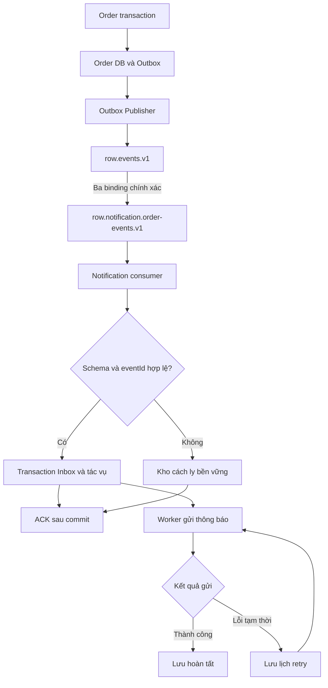

# 16. Thiết kế RabbitMQ – Exchange, Queue và Routing Key

## 1. Phạm vi và quyết định giao tiếp

Thực hiện Issue #24; chỉ thiết kế, chưa khai báo topology hoặc triển khai Java. Nền đối chiếu: dev tại 2203b89; API/Event Contract của PR #41 tại 28473fb; DB Design của PR #34 tại d628fdf. Các PR thiết kế vẫn cần nhóm review, chưa coi là đã merge hoặc nghiệm thu runtime.

RabbitMQ chuyên chở kết quả nghiệp vụ đã commit sang Notification. Saga do Order điều phối qua HTTP; không đồng thời tạo command queue cho cùng Reserve/Capture để tránh hai đường thực thi. Notification là vai trò logic đã có trong tài liệu; việc đóng gói thành module riêng hay chạy trong một tiến trình là quyết định triển khai sau, không thêm microservice bắt buộc trong issue này.

| Giao tiếp | Bên gửi → nhận | Kênh | Cách nhận kết quả |
|---|---|---|---|
| Create/Get Order | Client → Order | HTTP public | 202 khi tạo; GET trạng thái |
| Reserve/Get Reservation/Release/Cancel/Get Operation | Order → Inventory | HTTP nội bộ theo API Contract | Response đã xác minh; mất response thì query/retry cùng key |
| Capture/Get Payment/Refund/Get Refund | Order → Payment | HTTP nội bộ theo API Contract | Response hoặc query theo transaction ID/key |
| OrderConfirmed/OrderFailed/OrderExpired | Order Outbox → Notification | RabbitMQ | Consumer tiếp nhận bền vững, ACK broker |
| Callback hoặc message trả kết quả Inventory/Payment | Không có trong phiên bản này | Không khai báo reply queue | Không dùng broker ACK làm kết quả Saga |

Timeout HTTP vẫn là UNKNOWN ở caller; broker không quyết định Capture thành công hay Order hết hạn. Không service nào đọc database của service khác. Publisher là thành phần thuộc Order nên được đọc Outbox của chính Order; Notification chỉ đọc kho dữ liệu do nó sở hữu.

## 2. Danh mục event và routing

| Producer | Event | Routing key | Consumer logic | Điều kiện phát |
|---|---|---|---|---|
| order-service / Outbox Publisher | OrderConfirmed | order.confirmed.v1 | notification.order-events.v1 | PENDING → CONFIRMED hợp lệ, Order + Outbox commit |
| order-service / Outbox Publisher | OrderFailed | order.failed.v1 | notification.order-events.v1 | Compensation bắt buộc hoàn tất, Order → FAILED và Outbox commit |
| order-service / Outbox Publisher | OrderExpired | order.expired.v1 | notification.order-events.v1 | Nhánh hết hạn đủ điều kiện, Order → EXPIRED và Outbox commit |

Không phát OrderCreated, InventoryReserved, PaymentSucceeded, PaymentUnknown hoặc event mới cho mỗi retry. Routing key được chọn từ bảng cố định theo eventType/schemaVersion, không ghép từ dữ liệu tùy ý của client. Thay đổi breaking schema phải có version mới và kế hoạch consumer tương ứng.

## 3. Topology và quy ước tên

Dùng một exchange topic và một queue cho một consumer logic. Các replica Notification cùng đọc một queue theo competing consumers; không tạo queue theo instance, Order hoặc eventId. Consumer độc lập trong tương lai phải có queue riêng và thay đổi bảng thiết kế trước khi triển khai.

| Thành phần | Tên | Cấu hình thiết kế |
|---|---|---|
| Vhost demo | / | Giữ tương thích Compose hiện tại; môi trường khác tách vhost và credentials |
| Exchange | row.events.v1 | topic, durable=true, autoDelete=false, internal=false |
| Queue | row.notification.order-events.v1 | durable=true, exclusive=false, autoDelete=false; quorum |
| Consumer name trong Inbox | notification.order-events.v1 | Ổn định giữa replica/restart; không dùng tên pod |
| Retry queue / delay exchange | Không khai báo | Delay lưu ở next_attempt_at trong DB do Notification sở hữu |
| DLX / DLQ | Không khai báo trong demo | D-03 không dừng notification bằng DEAD_LETTER; dữ liệu độc hại được cách ly bền vững ở consumer |

| Exchange nguồn | Routing key binding chính xác | Queue đích |
|---|---|---|
| row.events.v1 | order.confirmed.v1 | row.notification.order-events.v1 |
| row.events.v1 | order.failed.v1 | row.notification.order-events.v1 |
| row.events.v1 | order.expired.v1 | row.notification.order-events.v1 |

Không bind dấu # hoặc order.*.* trong bản này: event chưa hỗ trợ phải bị phát hiện thay vì được tiêu thụ ngầm. Không dùng alternate exchange che khuất lỗi routing. Tên viết thường, phân đoạn bằng dấu chấm, prefix row, version ở cuối. Queue mang tên consumer, routing key mang nghĩa sự kiện.

## 4. Sơ đồ trách nhiệm và điểm chuyển giao



Đường từ Inbox tới worker là công việc trong DB, không phải queue bổ sung. Publisher confirm xác nhận chuyển giao tới broker; ACK consumer xác nhận chuyển giao sang dữ liệu bền vững của Notification. Hai xác nhận độc lập, không chứng minh bên ngoài đã nhận thông báo [R1]. Sơ đồ Saga hiện có rút gọn Publisher → Notification; tài liệu này làm rõ broker ở giữa, không thay đổi trạng thái Order.

## 5. Độ bền và envelope

Exchange/queue phải được provision và kiểm tra binding trước khi cho Publisher chạy. Queue quorum dùng volume bền vững. Compose hiện có rabbitmq:4-management và một node: demo chịu restart nếu volume còn, không chịu mất vĩnh viễn node/volume; muốn HA phải triển khai tối thiểu ba node và quorum ba thành viên rồi kiểm thử failover [R2]. Issue này không sửa Compose.

| Thuộc tính AMQP | Giá trị/quy tắc |
|---|---|
| content_type | application/json |
| content_encoding | UTF-8 |
| delivery_mode | 2 (persistent) |
| message_id | Bằng eventId trong JSON |
| correlation_id | Bằng correlationId trong JSON |
| type | Bằng eventType trong JSON |
| expiration | Không đặt; TTL Order không phải TTL event |
| mandatory | true cho publish |
| Publisher confirms | Bật trên channel; theo dõi từng lần publish |
| Header schemaVersion | Nếu gửi phải bằng schemaVersion trong JSON; body là nguồn schema chính |

Envelope giữ nguyên API Contract: eventId, commandId (có thể null), correlationId, schemaVersion=1, eventType, occurredAt UTC, producer=order-service và payload. Chỉ commandId nullable; validate event/status/timestamp và reasonCode của OrderFailed theo contract.

```json
{
  "eventId": "evt-confirmed-001",
  "commandId": "cmd-capture-001",
  "correlationId": "corr-ord-001",
  "schemaVersion": 1,
  "eventType": "OrderConfirmed",
  "occurredAt": "2026-11-04T10:00:06Z",
  "producer": "order-service",
  "payload": {
    "orderId": "ORD-001",
    "status": "CONFIRMED",
    "confirmedAt": "2026-11-04T10:00:06Z"
  }
}
```

Queue không có message TTL, queue expiry, auto-delete hoặc chính sách drop-head. Nếu giới hạn dung lượng bằng max-length-bytes, dùng overflow=reject-publish và kiểm thử confirm/nack để Outbox giữ event bị từ chối. Ngưỡng dung lượng theo môi trường; cảnh báo disk/memory trước khi cạn.

Đối với queue quorum demo không có DLX, khai báo x-delivery-limit=-1 ngay khi tạo để tránh giới hạn redelivery mặc định loại bỏ message. Đây là đánh đổi có chủ đích, không dùng cho vòng lặp requeue liên tục: consumer phải pause/backoff khi DB hỏng, cách ly lỗi xác định, giám sát redelivery [R2]. Không dựa vào số redelivery của broker làm bộ đếm retry nghiệp vụ. Tag 4-management chưa pin phiên bản; issue triển khai phải pin minor/digest và kiểm tra các argument thực tế, không phụ thuộc tính năng delayed-retry mới.

## 6. Outbox Publisher

1. Transaction Order ghi trạng thái cuối cùng eventId/envelope/routing key bền vững. Rollback thì không có event để publish.
2. Publisher claim batch nhỏ các event NEW đến lịch bằng token/lease trong transaction ngắn; lưu attempt_count và thời điểm thử trước khi gửi. Không giữ DB transaction trong lúc chờ broker.
3. Publish đúng exchange/key, persistent, mandatory và confirms. Lưu tương quan giữa channel epoch + publish sequence với eventId/claim token; khi reconnect không nhầm callback cũ sang lần mới.
4. Chỉ đánh dấu PUBLISHED khi đã nhận confirm ACK và message không bị basic.return. Message không route vẫn có thể được broker confirm ACK nên chỉ ACK của publisher là chưa đủ [R1].
5. Timeout confirm, nack, basic.return, mất connection hoặc exchange không tồn tại: giữ NEW, ghi lỗi và next_attempt_at. Không sinh eventId/payload mới.
6. Cập nhật PUBLISHED có điều kiện token/lease còn hợp lệ. Worker mất lease bỏ quyền cập nhật; worker mới có thể phát lại cùng eventId. Consumer chịu duplicate.
7. Crash sau confirm trước mark: phát lại. Mark PUBLISHED trước confirm bị cấm. PUBLISHED nghĩa broker đã nhận, không có nghĩa notification SENT.

Bộ xử lý return/confirm phải bảo toàn thứ tự trên channel và tương quan theo messageId, không xử lý confirm độc lập làm mất cờ returned. Mandatory chỉ phát hiện không có queue nào nhận; kiểm tra đúng queue/binding và quyền thay đổi topology để tránh route nhầm queue khác.

Dữ liệu Publisher cần có: eventId, envelope bất biến, payload_hash, exchange/routing key hoặc mapping version bất biến, status, attempt_count, next_attempt_at, claim_token, lease_until, last_error, created_at, published_at. Các trường bổ sung thuộc issue triển khai; không khẳng định migration hiện tại đã có đủ.

## 7. Consumer, ACK và chống trùng

Dùng manual ACK, prefetch demo=10 mỗi consumer (cấu hình được), transaction tiếp nhận ngắn. ACK từng delivery trên đúng channel; không ACK hàng loạt khi các transaction chưa cùng hoàn tất [R1].

| Tình huống | Xử lý dữ liệu | Hành động broker |
|---|---|---|
| Event mới hợp lệ | Một transaction insert Inbox và tạo tác vụ notification bền vững | ACK sau commit |
| Cùng consumerName/eventId, cùng hash | Xác minh Inbox đã commit cùng tác vụ; không tạo lại công việc | ACK |
| Cùng eventId, khác nội dung | Lưu bản xung đột và lý do vào kho cách ly; giữ nguyên bản đúng | ACK chỉ sau commit cách ly |
| JSON/schema sai, version chưa hỗ trợ, metadata lệch body | Cách ly raw bytes và thuộc tính cùng lỗi, không gọi bên ngoài | ACK sau commit cách ly |
| DB không khả dụng/commit chưa xác định | Không giả định đã lưu; pause listener, để redelivery | Không ACK; đóng channel hoặc nack requeue=true có backoff |
| Crash trước commit | DB rollback | Broker giao lại |
| Crash sau commit trước ACK | Inbox/tác vụ đã tồn tại | Giao lại và dedupe |

Inbox unique (consumer_name, event_id); lưu canonical hash của toàn envelope, không tính header giao nhận như redelivered. Canonicalization phải xác định thứ tự key JSON, bảo toàn giá trị/mảng và thống nhất implementation; không so hash raw JSON chỉ vì khác whitespace. Cạnh tranh hai replica phân xử bằng unique constraint; bên thua đọc lại record đã commit rồi so hash.

Notification task unique (event_id, notification_type, channel), key notification:{eventId}:{notificationType}:{channel}. Inbox tiếp nhận và mọi task dự kiến phải cùng commit. Inbox processed_at biểu thị hoàn tất tiếp nhận/tạo task, không biểu thị đã gửi ra ngoài. Replica không dùng consumerName riêng để né dedupe.

Kho cách ly do Notification sở hữu, không phải DLQ RabbitMQ hay trạng thái DEAD_LETTER của notification. Lưu raw body (giới hạn theo chính sách kích thước), thuộc tính cần thiết, fingerprint, eventId nếu parse được, lỗi và timestamp; không chỉ ghi log rồi ACK. Raw body vượt giới hạn phải được lưu đủ vào kho bền vững có tham chiếu trước ACK hoặc dừng nhận, không cắt mất bản gốc rồi báo đã lưu. Khi kho này cũng lỗi, giữ delivery chưa ACK và pause. Sửa consumer rồi replay dữ liệu hợp lệ qua cùng đường validate/dedupe với eventId cũ; event xung đột không tự ghi đè hoặc phát lại mù.

## 8. Retry và phân loại lỗi

Chọn lịch retry trong DB thay vì TTL/DLX hoặc delayed-message plugin. Consumer chỉ tiếp nhận bền vững rồi ACK; worker riêng gửi notification. Vì vậy service ngoài chậm không giữ delivery unacked lâu. Quyết định này thực hiện D-03, không tạo thông báo lần hai chỉ vì Publisher gửi lại event.

| Công việc | Lịch demo (cấu hình được) | Sau ngưỡng |
|---|---|---|
| Publish Outbox | 8 lần chính tính cả lần đầu; chờ 1, 2, 4, 8, 16, 32, 60 giây | Giữ NEW; cảnh báo, thử nền mỗi 60 giây |
| Gửi notification với lỗi tạm thời | 8 lần chính tính cả lần đầu; cùng backoff | Giữ chờ gửi lại; mỗi 60 giây, không đổi Order, không DEAD_LETTER |
| Tiếp nhận khi DB consumer hỏng | Pause, reconnect/backoff có trần 60 giây | Tiếp tục khi DB khỏe; không tính là lần gửi notification |
| Schema/identity/payload không hợp lệ | Không retry tác dụng nghiệp vụ | Cách ly, cảnh báo và can thiệp |
| Lỗi bên ngoài xác định không retry được | Lưu lỗi và chờ can thiệp | Không bỏ task; không tạo khóa mới |
| Timeout gửi ra ngoài | Lưu kết quả chưa xác định | Query theo key nếu bên nhận hỗ trợ, hoặc retry cùng key; công bố khả năng gửi lặp nếu không hỗ trợ |

Task lưu tối thiểu: eventId, type/channel/key, payload snapshot, status, attempt_count, next_attempt_at, started_at, last_error, provider_reference nếu có, claim_token, lease_until, completed_at. Tên trạng thái cụ thể ánh xạ State Machine khi triển khai; không đưa trạng thái delivery vào Order.status.

Worker claim bằng conditional update/lease; tăng attempt trước gọi mạng, ghi kết quả sau gọi bằng token hợp lệ. Crash khi đang gửi không được coi là chưa gửi: đối soát hoặc retry cùng key. Lưu next_attempt_at theo DB UTC, restart tiếp tục từ lịch đã lưu, không reset bộ đếm hoặc phát dồn toàn bộ lượt bị lỡ. Worker mất lease không được ghi đè kết quả worker mới.

Inbox unique chỉ bảo đảm một tác vụ logic nội bộ. Nếu bên nhận không hỗ trợ idempotency/tra cứu, crash sau gửi trước ghi SENT vẫn có thể tạo thông báo trùng; không tuyên bố exactly-once. Retry notification không rollback Order đã CONFIRMED/FAILED/EXPIRED.

## 9. Phục hồi và vận hành

| Điểm lỗi | Bản ghi còn bền vững | Cách phục hồi |
|---|---|---|
| Order crash trước commit | Không có thay đổi/event | Retry yêu cầu theo idempotency API |
| Order commit, Publisher chưa chạy | Outbox NEW | Quét lại và publish |
| Broker đã nhận, confirm mất | Queue có thể đã có event; Outbox NEW | Publish lại cùng eventId, Inbox dedupe |
| Consumer ngừng | Queue giữ message | Consumer phục hồi rồi nhận |
| Consumer commit, ACK mất | Inbox và task | Redelivery, ACK duplicate |
| Worker gửi crash | Task có trạng thái/lần thử đã lưu | Claim hết lease, đối soát/retry cùng key |
| Broker restart, volume còn | Queue durable/persistent | Kết nối lại, kiểm tra topology, xử lý unacked |
| Broker mất vĩnh viễn volume duy nhất | Có thể mất event PUBLISHED chưa tới Inbox | Sự cố vượt bảo đảm single-node; phục hồi backup hoặc replay Outbox còn giữ và dedupe |
| Dữ liệu malformed | Kho cách ly | Sửa nguyên nhân, audit rồi replay phù hợp |

Không tự purge/delete queue, reset volume hoặc đổi queue type tại chỗ. Sai topology phải fail readiness và cảnh báo; tạo phiên bản mới/migrate có kiểm soát, không xóa hàng đợi đang chứa dữ liệu.

Outbox chưa publish, Inbox còn bảo vệ replay, task chưa hoàn tất và bản cách ly chưa xử lý không được cleanup. Retention cấu hình theo môi trường và cửa sổ replay; chưa chốt giới hạn replay thì tiếp tục giữ dedupe records. Replay thủ công chỉ cho event đã commit, giữ ID/envelope/routing gốc, ghi người thực hiện/phạm vi/lý do; không sửa payload cùng eventId. Backup/restore của các kho phải bảo toàn khoảng dedupe tương ứng, không chỉ khôi phục broker riêng rồi replay ngoài retention.

Metrics: số/tuổi Outbox NEW, confirm timeout/nack/return, queue ready/unacked, redelivery, consumer count, task pending/retry/unknown, tuổi task, số bản cách ly, disk/memory alarms. Cảnh báo khi không có consumer mà queue tăng, background retry phát sinh hoặc lỗi schema/identity. Giá trị ngưỡng theo môi trường, không tự gán tham số bài cá nhân.

Provision topology bằng identity riêng. Runtime Order chỉ publish exchange đã cho phép, Notification consume queue đã cho phép; không cấp quyền đọc DB xuyên service. TLS và secret ngoài repo khi triển khai ngoài local. Readiness kiểm tra đúng queue type, arguments và ba binding; ping broker khỏe không chứng minh routing đúng.

## 10. Ma trận kiểm chứng cho issue triển khai

| ID | Kịch bản | Kết quả bắt buộc |
|---|---|---|
| MQ-01 | Phát từng event hợp lệ | Đúng routing key/queue; đủ một tác vụ logic/event/channel |
| MQ-02 | Routing key không có binding | basic.return dù có confirm; Outbox không PUBLISHED |
| MQ-03 | Broker nack hoặc confirm timeout | Event còn NEW, ID/payload giữ nguyên |
| MQ-04 | Crash sau publish trước mark | Duplicate xuất hiện; không tạo task logic thứ hai |
| MQ-05 | Crash trước/sau commit Inbox | Trước: redelivery xử lý; sau: dedupe và ACK |
| MQ-06 | Hai replica cùng eventId | Unique phân xử, một bộ task; không mất event |
| MQ-07 | Cùng ID khác payload | Cách ly, không ghi đè hoặc gửi tác dụng thứ hai |
| MQ-08 | DB consumer ngừng lâu, nhiều lần restart | Không ACK sớm, không hot loop, không tự drop do delivery-limit |
| MQ-09 | Notification endpoint ngừng qua 8 lần | Retry nền 60 giây, restart không reset; Order không đổi |
| MQ-10 | Schema sai/version chưa hỗ trợ, kho cách ly lỗi | Không mất raw event; chỉ ACK sau lưu bền vững |
| MQ-11 | Broker restart với volume còn | Event chưa ACK được xử lý lại an toàn |
| MQ-12 | Queue đạt giới hạn cấu hình | Reject publish/confirm nack; Outbox giữ event, không drop-head |
| MQ-13 | Callback muộn/capture UNKNOWN | Không suy kết quả Saga từ broker ACK; không tạo event kết thúc giả |
| MQ-14 | Worker crash sau gửi trước ghi kết quả | Dùng key cũ, đối soát; ghi rõ giới hạn chống trùng bên ngoài |
| MQ-15 | Replay event cũ trong cửa sổ retention | Inbox/task dedupe còn hiệu lực |
| MQ-16 | Đọc ba payload event | eventType/status/occurredAt và reasonCode khớp API Contract |

Kiểm chứng tài liệu: bảng tên và binding nhất quán; JSON mẫu parse được; sơ đồ thể hiện điểm commit/ACK; rà soát từng MQ-01–16 bằng lập luận lỗi. Kiểm chứng runtime phải dùng RabbitMQ/PostgreSQL thật trong issue triển khai; CI Maven hiện tại không chứng minh các kịch bản này.

## 11. Quyết định bàn giao và review còn lại

| Chủ đề | Quyết định của bản thiết kế | Việc cần người phụ trách xác nhận |
|---|---|---|
| HTTP hay broker | Saga HTTP; broker chỉ ba event kết thúc | Order/Inventory/Payment đối chiếu PR #41 |
| Delay/retry | DB scheduler; 8 lần rồi retry nền | Owner Notification xác nhận dữ liệu task/worker |
| Delivery limit | Vô hạn ở broker demo, pause/backoff và cách ly tại app | Người triển khai pin RabbitMQ và kiểm thử MQ-08 |
| Notification storage | Kho do Notification sở hữu, Inbox/task/cách ly | Chốt module/deployment và migration ở issue phát triển |
| HA | Demo một node không bảo đảm mất volume | Nếu cần HA, triển khai cluster và fault test riêng |
| Review | Tài liệu sẵn sàng review | Chưa thay thế approve của thành viên nhóm |

Giữ đúng tên bàn giao 16-rabbitmq-design.md theo Issue #24. File 16-saga-persistence-and-recovery.md ở PR #40 là tài liệu khác; không ghi đè hoặc đổi tên phần việc của Issue #22.

## 12. Tài liệu tham chiếu

- [Issue #24](https://github.com/nguyenthihuyenlinh236/SE2026-T02-Resilient-Order-Workflow/issues/24).
- [Design Decisions – D-02, D-03](../requirements/06-design-decisions.md).
- [State Machine](09-state-machine.md), [Saga Workflow](10-saga-workflow-and-compensation.md), [Sequence Diagrams](11-sequence-diagrams.md).
- [API/Event Contract – bản đối chiếu 28473fb](https://github.com/nguyenthihuyenlinh236/SE2026-T02-Resilient-Order-Workflow/blob/28473fbceeb41b1c171323426cf2c5684b218c9d/docs/architecture/14-api-event-contract.md) – PR #41 chưa merge tại thời điểm soạn.
- [Database Design – bản đối chiếu d628fdf](https://github.com/nguyenthihuyenlinh236/SE2026-T02-Resilient-Order-Workflow/blob/d628fdf55aa25f391cdb397b1a643d1dbb378201/docs/architecture/15-database-design.md).
- [R1 – RabbitMQ: Consumer Acknowledgements and Publisher Confirms](https://www.rabbitmq.com/docs/confirms).
- [R2 – RabbitMQ: Quorum Queues, data safety và delivery limit](https://www.rabbitmq.com/docs/quorum-queues).

Nguồn RabbitMQ được kiểm tra ngày 2026-11-04; tài liệu online có thể hiển thị phiên bản mới hơn image demo. Trước triển khai phải xác minh trên phiên bản broker đã pin. Các lịch retry, tên topology, schema task và ma trận kiểm chứng là quyết định thiết kế của dự án.
