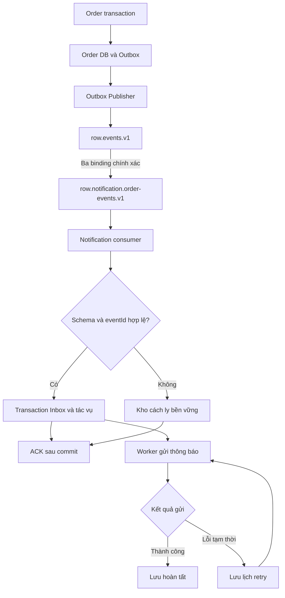

# 16. Thiết kế RabbitMQ – Exchange, Queue và Routing Key

## 1. Phạm vi và quyết định giao tiếp

Thực hiện Issue #24; chỉ thiết kế, chưa khai báo topology hoặc triển khai Java. Nền đối chiếu: dev tại 2203b89; API/Event Contract của PR #41 tại 28473fb; DB Design của PR #34 tại d628fdf. Các PR thiết kế vẫn cần nhóm review, chưa coi là đã merge hoặc nghiệm thu runtime.

RabbitMQ chuyên chở kết quả nghiệp vụ đã commit sang Notification. Saga do Order điều phối qua HTTP; không đồng thời tạo command queue cho cùng Reserve/Capture để tránh hai đường thực thi. Notification là vai trò logic đã có trong tài liệu; việc đóng gói thành module riêng hay chạy trong một tiến trình là quyết định triển khai sau, không thêm microservice bắt buộc trong issue này.

| Giao tiếp | Bên gửi → nhận | Kênh | Cách nhận kết quả |
|---|---|---|---|
| Create/Get Order | Client → Order | HTTP public | 202 khi tạo; GET trạng thái |
| Reserve/Get Reservation/Release/Cancel/Get Operation | Order → Inventory | HTTP nội bộ theo API Contract | Response đã xác minh; mất response thì query/retry cùng key |
| Capture/Get Payment/Refund/Get Refund | Order → Payment | HTTP nội bộ theo API Contract | Response hoặc query theo transaction ID/key |
| OrderConfirmed/OrderFailed/OrderExpired | Order Outbox → Notification | RabbitMQ | Consumer tiếp nhận bền vững, ACK broker |
| Callback hoặc message trả kết quả Inventory/Payment | Không có trong phiên bản này | Không khai báo reply queue | Không dùng broker ACK làm kết quả Saga |

Timeout HTTP vẫn là UNKNOWN ở caller; broker không quyết định Capture thành công hay Order hết hạn. Không service nào đọc database của service khác. Publisher là thành phần thuộc Order nên được đọc Outbox của chính Order; Notification chỉ đọc kho dữ liệu do nó sở hữu.

## 2. Danh mục event và routing

| Producer | Event | Routing key | Consumer logic | Điều kiện phát |
|---|---|---|---|---|
| order-service / Outbox Publisher | OrderConfirmed | order.confirmed.v1 | notification.order-events.v1 | PENDING → CONFIRMED hợp lệ, Order + Outbox commit |
| order-service / Outbox Publisher | OrderFailed | order.failed.v1 | notification.order-events.v1 | Compensation bắt buộc hoàn tất, Order → FAILED và Outbox commit |
| order-service / Outbox Publisher | OrderExpired | order.expired.v1 | notification.order-events.v1 | Nhánh hết hạn đủ điều kiện, Order → EXPIRED và Outbox commit |

Không phát OrderCreated, InventoryReserved, PaymentSucceeded, PaymentUnknown hoặc event mới cho mỗi retry. Routing key được chọn từ bảng cố định theo eventType/schemaVersion, không ghép từ dữ liệu tùy ý của client. Thay đổi breaking schema phải có version mới và kế hoạch consumer tương ứng.

## 3. Topology và quy ước tên

Dùng một exchange topic và một queue cho một consumer logic. Các replica Notification cùng đọc một queue theo competing consumers; không tạo queue theo instance, Order hoặc eventId. Consumer độc lập trong tương lai phải có queue riêng và thay đổi bảng thiết kế trước khi triển khai.

| Thành phần | Tên | Cấu hình thiết kế |
|---|---|---|
| Vhost demo | / | Giữ tương thích Compose hiện tại; môi trường khác tách vhost và credentials |
| Exchange | row.events.v1 | topic, durable=true, autoDelete=false, internal=false |
| Queue | row.notification.order-events.v1 | durable=true, exclusive=false, autoDelete=false; quorum |
| Consumer name trong Inbox | notification.order-events.v1 | Ổn định giữa replica/restart; không dùng tên pod |
| Retry queue / delay exchange | Không khai báo | Delay lưu ở next_attempt_at trong DB do Notification sở hữu |
| DLX / DLQ | Không khai báo trong demo | D-03 không dừng notification bằng DEAD_LETTER; dữ liệu độc hại được cách ly bền vững ở consumer |

| Exchange nguồn | Routing key binding chính xác | Queue đích |
|---|---|---|
| row.events.v1 | order.confirmed.v1 | row.notification.order-events.v1 |
| row.events.v1 | order.failed.v1 | row.notification.order-events.v1 |
| row.events.v1 | order.expired.v1 | row.notification.order-events.v1 |

Không bind dấu # hoặc order.*.* trong bản này: event chưa hỗ trợ phải bị phát hiện thay vì được tiêu thụ ngầm. Không dùng alternate exchange che khuất lỗi routing. Tên viết thường, phân đoạn bằng dấu chấm, prefix row, version ở cuối. Queue mang tên consumer, routing key mang nghĩa sự kiện.

## 4. Sơ đồ trách nhiệm và điểm chuyển giao



Đường từ Inbox tới worker là công việc trong DB, không phải queue bổ sung. Publisher confirm xác nhận chuyển giao tới broker; ACK consumer xác nhận chuyển giao sang dữ liệu bền vững của Notification. Hai xác nhận độc lập, không chứng minh bên ngoài đã nhận thông báo [R1]. Sơ đồ Saga hiện có rút gọn Publisher → Notification; tài liệu này làm rõ broker ở giữa, không thay đổi trạng thái Order.

## 5. Độ bền và envelope

Exchange/queue phải được provision và kiểm tra binding trước khi cho Publisher chạy. Queue quorum dùng volume bền vững. Compose hiện có rabbitmq:4-management và một node: demo chịu restart nếu volume còn, không chịu mất vĩnh viễn node/volume; muốn HA phải triển khai tối thiểu ba node và quorum ba thành viên rồi kiểm thử failover [R2]. Issue này không sửa Compose.

| Thuộc tính AMQP | Giá trị/quy tắc |
|---|---|
| content_type | application/json |
| content_encoding | UTF-8 |
| delivery_mode | 2 (persistent) |
| message_id | Bằng eventId trong JSON |
| correlation_id | Bằng correlationId trong JSON |
| type | Bằng eventType trong JSON |
| expiration | Không đặt; TTL Order không phải TTL event |
| mandatory | true cho publish |
| Publisher confirms | Bật trên channel; theo dõi từng lần publish |
| Header schemaVersion | Nếu gửi phải bằng schemaVersion trong JSON; body là nguồn schema chính |

Envelope giữ nguyên API Contract: eventId, commandId (có thể null), correlationId, schemaVersion=1, eventType, occurredAt UTC, producer=order-service và payload. Chỉ commandId nullable; validate event/status/timestamp và reasonCode của OrderFailed theo contract.

```json
{
  "eventId": "evt-confirmed-001",
  "commandId": "cmd-capture-001",
  "correlationId": "corr-ord-001",
  "schemaVersion": 1,
  "eventType": "OrderConfirmed",
  "occurredAt": "2026-11-04T10:00:06Z",
  "producer": "order-service",
  "payload": {
    "orderId": "ORD-001",
    "status": "CONFIRMED",
    "confirmedAt": "2026-11-04T10:00:06Z"
  }
}
```

Queue không có message TTL, queue expiry, auto-delete hoặc chính sách drop-head. Nếu giới hạn dung lượng bằng max-length-bytes, dùng overflow=reject-publish và kiểm thử confirm/nack để Outbox giữ event bị từ chối. Ngưỡng dung lượng theo môi trường; cảnh báo disk/memory trước khi cạn.

Đối với queue quorum demo không có DLX, khai báo x-delivery-limit=-1 ngay khi tạo để tránh giới hạn redelivery mặc định loại bỏ message. Đây là đánh đổi có chủ đích, không dùng cho vòng lặp requeue liên tục: consumer phải pause/backoff khi DB hỏng, cách ly lỗi xác định, giám sát redelivery [R2]. Không dựa vào số redelivery của broker làm bộ đếm retry nghiệp vụ. Tag 4-management chưa pin phiên bản; issue triển khai phải pin minor/digest và kiểm tra các argument thực tế, không phụ thuộc tính năng delayed-retry mới.
