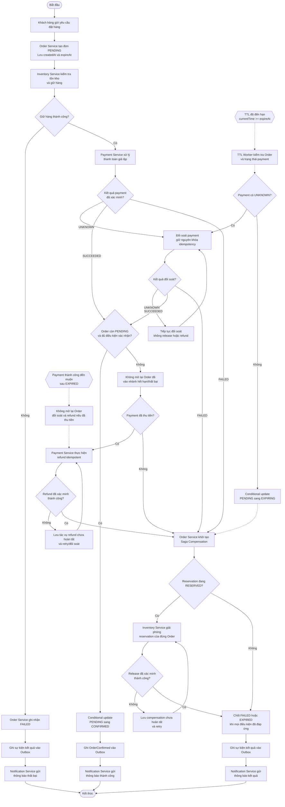

# Business Requirements – APP-08 Resilient Order Workflow

## 1. Mục đích

Xây dựng hệ thống mô phỏng quy trình đặt hàng trong môi trường phân tán. Hệ thống điều phối việc tạo đơn, giữ hàng, thanh toán giả lập, xử lý bù trừ và gửi thông báo. Hệ thống phải xử lý được timeout, service crash, message trùng và đơn hàng quá thời hạn thanh toán.

## 2. Mục tiêu nghiệp vụ

- Chỉ xác nhận đơn khi điều kiện tồn kho và thanh toán được đáp ứng.
- Không giữ hàng vượt tồn khả dụng.
- Không thu tiền hoặc giữ hàng nhiều lần do retry.
- Tự động xử lý đơn quá hạn thanh toán.
- Giải phóng reservation khi đơn thất bại hoặc hết hạn theo chính sách.
- Lưu trạng thái đủ bền vững để phục hồi sau sự cố.
- Gửi thông báo theo trạng thái nghiệp vụ đã được xác nhận.

## 3. Phạm vi hệ thống

### Trong phạm vi

- Tạo và theo dõi đơn hàng.
- Kiểm tra tồn kho, giữ hàng và giải phóng hàng.
- Thanh toán giả lập và hoàn tiền giả lập khi cần.
- Điều phối Saga và compensation.
- Lưu/phát sự kiện theo Outbox Pattern.
- Retry, idempotency, phục hồi Saga.
- Hết hạn đơn hàng theo TTL và thông báo kết quả.

### Ngoài phạm vi

- Cổng thanh toán thực tế và xử lý tranh chấp ngân hàng.
- Vận chuyển thực tế.
- Hệ thống kế toán đầy đủ.
- Dịch vụ email/SMS thương mại hoàn chỉnh.

## 4. Tác nhân và thành phần

| Thành phần | Trách nhiệm |
|---|---|
| End User | Đặt hàng, thanh toán trong thời hạn và nhận kết quả |
| Order Service | Tạo đơn, lưu trạng thái, đặt `expireAt`, điều phối Saga và expiration |
| Inventory Service | Kiểm tra tồn kho, giữ và giải phóng reservation |
| Payment Service | Mô phỏng thanh toán, lưu kết quả, chống thu tiền trùng, hỗ trợ hoàn tiền |
| Notification Service | Gửi thông báo từ sự kiện nghiệp vụ |
| TTL Worker | Tìm các đơn quá hạn và kích hoạt luồng xử lý hết hạn; có thể nằm trong Order Service |

## 5. Luồng nghiệp vụ tổng quát

## 6. Ghi chú nghiệp vụ

- `PENDING`: đơn hàng đã tạo và đang được xử lý.
- `CONFIRMED`: chỉ dùng khi giữ hàng thành công, payment được xác minh thành công và Order thắng phép chuyển trạng thái có điều kiện từ `PENDING`.
- `FAILED`: đơn thất bại do nguyên nhân nghiệp vụ đã xác định.
- `EXPIRING`: trạng thái trung gian đề xuất để đánh dấu nhánh hết hạn đã claim quyền xử lý; không phải trạng thái cuối.
- `EXPIRED`: đơn đã kết thúc theo chính sách hết hạn; đây là trạng thái nghiệp vụ, không phải lệnh xóa dữ liệu.
- `COMPENSATING` và `COMPENSATION_FAILED`: thể hiện quá trình bù trừ đang diễn ra hoặc chưa hoàn tất; phải nhất quán với state machine được chốt ở W2.
- `UNKNOWN` khác `FAILED`. Timeout không chứng minh rằng payment thất bại.
- Nếu payment là `UNKNOWN`, hệ thống phải truy vấn/đối soát trước khi quyết định compensation. Không giải phóng reservation hoặc hoàn tiền khi payment còn `UNKNOWN`.
- Nếu giải phóng reservation hoặc refund thất bại, lưu trạng thái chưa hoàn tất và retry; không tuyên bố compensation thành công khi chưa có xác nhận.
- Nếu payment thành công đến muộn sau `EXPIRED`, không mở lại Order. Hệ thống đối soát và hoàn tiền nếu tiền đã được thu.
- Không được để một Order vừa `CONFIRMED` vừa `EXPIRED`. Khi payment và TTL cạnh tranh, áp dụng quy tắc conditional update được chốt tại `06-design-decisions.md`.
- Sự kiện cần phát phải được ghi vào Outbox cùng transaction cục bộ với thay đổi dữ liệu nghiệp vụ tương ứng. Consumer phải xử lý idempotent để tránh tác dụng phụ khi event được phát lại.

## 7. Order Expiration / TTL

TTL mặc định đề xuất là 15 phút kể từ khi tạo đơn thành công.

`expireAt = createdAt + TTL`

TTL Worker định kỳ tìm các đơn chưa kết thúc mà `currentTime >= expireAt`. Chu kỳ quét, cơ chế claim, lease và phục hồi worker được quy định tại `06-design-decisions.md`.

Trước khi claim nhánh hết hạn, Order Service phải kiểm tra trạng thái Order và kết quả payment. Nếu payment là `UNKNOWN`, hệ thống phải tiếp tục đối soát thay vì mặc định thất bại. Trong thời gian đó, không giải phóng reservation và không hoàn tiền.

Khi payment đã được xác minh và đơn đủ điều kiện hết hạn, TTL Worker sử dụng conditional update để chuyển Order từ `PENDING` sang `EXPIRING`. Chỉ một worker được phép claim thành công. Worker còn lại phải đọc lại trạng thái và không được ghi đè kết quả.

Nếu reservation tồn tại và cần hủy, hệ thống phải giải phóng reservation bằng lệnh idempotent. Nếu payment đã thu tiền nhưng Order không thể được xác nhận, hệ thống phải hoàn tiền bằng lệnh idempotent sau khi payment được xác minh thành công.

Chỉ chốt `EXPIRED` khi các điều kiện kết thúc nghiệp vụ đã đáp ứng. Nếu compensation hoặc refund chưa hoàn tất, tiếp tục theo dõi và retry; không xóa Order và không che giấu tác vụ còn dang dở.

## 8. Định hướng kiến trúc

- **Saga:** điều phối các giao dịch cục bộ và compensation.
- **Outbox:** ghi thay đổi dữ liệu và sự kiện cần phát trong cùng transaction cục bộ của service phát.
- **Idempotency:** bảo vệ tác dụng nghiệp vụ trước retry/message duplicate.
- **Eventual consistency:** trạng thái giữa service có thể tạm thời khác nhau nhưng phải hội tụ hoặc được đánh dấu cần can thiệp.
- **TTL Worker:** phát hiện đơn quá hạn và khởi động luồng hết hạn có khả năng phục hồi.
- **Conditional update:** phân xử cạnh tranh giữa xác nhận Order và nhánh hết hạn; không cho phép hai nhánh cùng thắng.

## 9. Giả định cần xác nhận

- TTL mặc định là 15 phút.
- Quy tắc phân xử payment và TTL được đề xuất tại `06-design-decisions.md`: dùng conditional update nguyên tử từ `PENDING`; nhánh cập nhật thành công trước thắng.
- Payment đến muộn sau khi Order đã `EXPIRED` phải được đối soát; nếu tiền đã được thu, hoàn tiền theo chính sách idempotent.
- Lịch retry, backoff, đối soát payment `UNKNOWN` và giới hạn retry được đề xuất tại `06-design-decisions.md`; cần Người 2 và Người 3 review.
- TTL Worker cần cơ chế claim nguyên tử và phục hồi sau crash.
- Các trạng thái trung gian như `EXPIRING` và `RECONCILIATION_REQUIRED` là đề xuất thiết kế W2; cần được đồng bộ trong state machine, Saga workflow, API/event contract và acceptance criteria.
