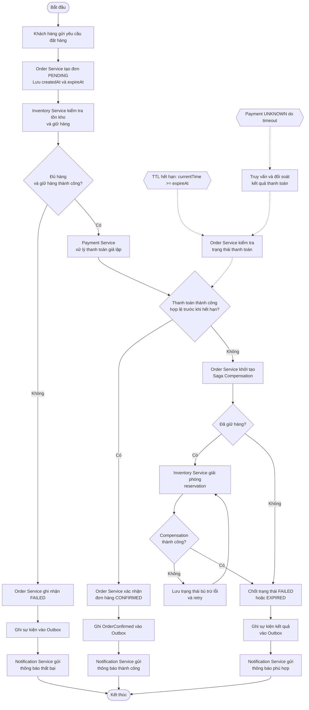

# Business Requirements – APP-08 Resilient Order Workflow

## 1. Mục đích

Xây dựng hệ thống mô phỏng quy trình đặt hàng trong môi trường phân tán. Hệ thống điều phối việc tạo đơn, giữ hàng, thanh toán giả lập, xử lý bù trừ và gửi thông báo. Hệ thống phải xử lý được timeout, service crash, message trùng và đơn hàng quá thời hạn thanh toán.

## 2. Mục tiêu nghiệp vụ

- Chỉ xác nhận đơn khi điều kiện tồn kho và thanh toán được đáp ứng.
- Không giữ hàng vượt tồn khả dụng.
- Không thu tiền hoặc giữ hàng nhiều lần do retry.
- Tự động xử lý đơn quá hạn thanh toán.
- Giải phóng reservation khi đơn thất bại hoặc hết hạn theo chính sách.
- Lưu trạng thái đủ bền vững để phục hồi sau sự cố.
- Gửi thông báo theo trạng thái nghiệp vụ đã được xác nhận.

## 3. Phạm vi hệ thống

### Trong phạm vi
- Tạo và theo dõi đơn hàng.
- Kiểm tra tồn kho, giữ hàng và giải phóng hàng.
- Thanh toán giả lập và hoàn tiền giả lập khi cần.
- Điều phối Saga và compensation.
- Lưu/phát sự kiện theo Outbox Pattern.
- Retry, idempotency, phục hồi Saga.
- Hết hạn đơn hàng theo TTL và thông báo kết quả.

### Ngoài phạm vi
- Cổng thanh toán thực tế và xử lý tranh chấp ngân hàng.
- Vận chuyển thực tế.
- Hệ thống kế toán đầy đủ.
- Dịch vụ email/SMS thương mại hoàn chỉnh.

## 4. Tác nhân và thành phần

| Thành phần | Trách nhiệm |
|---|---|
| End User | Đặt hàng, thanh toán trong thời hạn và nhận kết quả |
| Order Service | Tạo đơn, lưu trạng thái, đặt `expireAt`, điều phối Saga và expiration |
| Inventory Service | Kiểm tra tồn kho, giữ và giải phóng reservation |
| Payment Service | Mô phỏng thanh toán, lưu kết quả, chống thu tiền trùng, hỗ trợ hoàn tiền |
| Notification Service | Gửi thông báo từ sự kiện nghiệp vụ |
| TTL Worker | Tìm các đơn quá hạn và kích hoạt luồng xử lý hết hạn; có thể nằm trong Order Service |

## 5. Luồng nghiệp vụ tổng quát

## Ghi chú

- `PENDING`: đơn hàng đã tạo và đang được xử lý.
- `CONFIRMED`: chỉ dùng khi giữ hàng thành công và thanh toán được xác nhận thành công trong thời hạn cho phép.
- `FAILED` / `EXPIRED`: kết quả cuối khi quy trình thất bại hoặc đơn hết hạn theo quy tắc nghiệp vụ.
- Nếu thanh toán ở trạng thái `UNKNOWN`, cần truy vấn/đối soát trước khi quyết định compensation; không được mặc định timeout là thanh toán thất bại.
- Nếu giải phóng reservation thất bại, lưu trạng thái compensation chưa hoàn tất và retry.
- Sự kiện cần phát được ghi vào Outbox; consumer vẫn cần xử lý idempotent để tránh tác dụng phụ khi sự kiện được phát lại.
## 6. Order Expiration / TTL

TTL mặc định đề xuất là 15 phút kể từ khi tạo đơn thành công.

`expireAt = createdAt + TTL`

TTL Worker định kỳ tìm đơn chưa kết thúc mà `currentTime >= expireAt`. Trước khi chốt hết hạn, Order Service phải kiểm tra trạng thái đơn và kết quả thanh toán. Nếu kết quả thanh toán là `UNKNOWN`, hệ thống phải xác minh/đối soát thay vì mặc định thất bại. Nếu reservation tồn tại và đơn đủ điều kiện hết hạn, hệ thống phải giải phóng reservation.

`EXPIRED` là trạng thái nghiệp vụ, không phải lệnh xóa dữ liệu. Chỉ ghi nhận trạng thái cuối cùng theo điều kiện kết thúc đã thống nhất; nếu compensation chưa hoàn tất, tiếp tục theo dõi/retry.

## 7. Định hướng kiến trúc

- Saga: điều phối các giao dịch cục bộ và compensation.
- Outbox: ghi thay đổi dữ liệu và sự kiện cần phát trong cùng transaction của service phát.
- Idempotency: bảo vệ tác dụng nghiệp vụ trước retry/message duplicate.
- Eventual consistency: trạng thái giữa service có thể tạm thời khác nhau nhưng phải hội tụ.
- TTL Worker: phát hiện đơn quá hạn và khởi động luồng hết hạn có khả năng phục hồi.

## 8. Giả định cần xác nhận

- TTL mặc định là 15 phút.
- Chính sách thời điểm chấp nhận thanh toán: chỉ thanh toán được xác nhận hợp lệ trước khi nhánh hết hạn được chốt mới đủ điều kiện xác nhận đơn.
- Kết quả thanh toán đến muộn sau khi đơn hết hạn phải được đối soát; nếu tiền đã bị thu, hoàn tiền theo chính sách.
- Độ trễ TTL Worker và giới hạn retry sẽ được xác định ở giai đoạn thiết kế.
