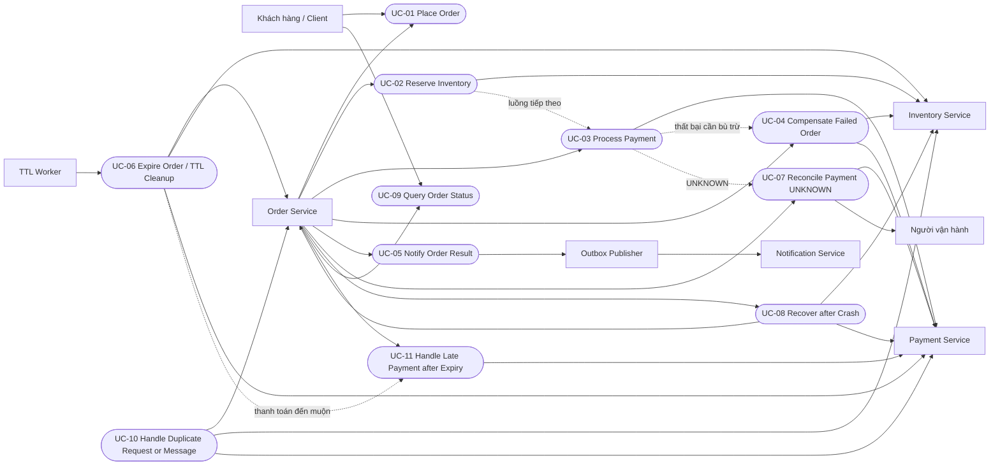

# Detailed Use Cases — APP-08 Resilient Order Workflow

## 1. Mục đích và quy ước

Tài liệu mô tả luồng xử lý, điều kiện chuyển trạng thái, các nhánh ngoại lệ, dữ liệu cần ghi và sự kiện cần phát để Người 2 triển khai và Người 3 xây dựng test case.

Tài liệu liên quan:

- `01-business-requirements.md`
- `02-functional-requirements.md`
- `03-business-rules.md`
- `04-failure-scenarios.md`
- `05-use-cases.md`
- `06-design-decisions.md`
- `07-non-functional-requirements.md`

Tên trạng thái và sự kiện trong tài liệu là đề xuất, sẽ được chốt tại `09-state-machine.md` và `14-api-event-contract-draft.md`.

### 1.1. Quy ước trạng thái

**Order:** `PENDING`, `EXPIRING`, `COMPENSATING`, `CONFIRMED`, `FAILED`, `EXPIRED`.

**Saga:** `RUNNING`, `RECONCILING`, `RECONCILIATION_REQUIRED`, `COMPENSATING`, `COMPENSATION_FAILED`, `COMPLETED`. `COMPENSATION_FAILED` là trạng thái của Saga, không phải trạng thái Order.

**Saga:** `đang chạy`, `COMPENSATION_FAILED`, `RECONCILING`, `RECONCILIATION_REQUIRED`, `hoàn tất`.

**Payment:** `chưa có giao dịch`, `SUCCEEDED`, `FAILED`, `UNKNOWN`. Trạng thái refund phải được lưu riêng, không thay đổi kết quả capture đã xác minh.

**Reservation:** `RESERVED`, `RELEASED`, `REJECTED`, `chưa xác minh`.

Quy tắc chung:

1. Ba nhánh cạnh tranh duy nhất từ `PENDING` là `PENDING → CONFIRMED`, `PENDING → COMPENSATING` và `PENDING → EXPIRING`. Các nhánh đều phải dùng conditional update; chỉ nhánh claim thành công được tiếp tục.
2. Nhánh thất bại phải claim `PENDING → COMPENSATING` trước khi kết thúc `FAILED`, kể cả trường hợp không cần release hoặc refund.
3. `RECONCILING` nghĩa là đang tự động đối soát theo lịch D-04. `RECONCILIATION_REQUIRED` chỉ dùng khi lịch đối soát đã cạn; tiến trình tiếp tục truy vấn nền mỗi 5 phút và cần theo dõi thủ công.
4. Release/refund thất bại hoặc vượt ngưỡng retry dùng `COMPENSATION_FAILED`, không dùng trạng thái đối soát Payment.
5. Mọi thời điểm được so sánh theo đồng hồ cơ sở dữ liệu UTC. Điều kiện `now() < expireAt` phải được kiểm tra trong cùng câu lệnh conditional update xác nhận đơn theo D-01.1.
6. Khi Order chuyển trạng thái kết thúc và cần phát domain event, cập nhật Order và ghi Outbox trong cùng transaction.
7. Timeout không chứng minh rằng một lệnh chưa được thực hiện. Các lệnh retry phải sử dụng cùng khóa idempotency theo D-02.
8. `UNKNOWN` không phải trạng thái Order và không đồng nghĩa với Payment `FAILED`.
9. `expireAt` không được gia hạn khi retry, đối soát hoặc phục hồi.
10. Các bảng dưới đây ghi trạng thái trước → sau. `—` nghĩa là không đổi hoặc không áp dụng.

### 1.2. Phân loại sự kiện

- **Domain event:** biểu diễn kết quả nghiệp vụ đã được ghi bền vững, ví dụ `OrderConfirmed`, `OrderFailed`, `OrderExpired`.
- **Cảnh báo vận hành:** phục vụ giám sát, không phải domain event, ví dụ lỗi retry, message trùng, khóa idempotency xung đột hoặc công việc cần can thiệp.
- **Outbox:** domain event cần bảo đảm phát phải được ghi cùng transaction với thay đổi Order tương ứng.
- **At-least-once:** một event có thể được gửi nhiều lần. Consumer phải chống xử lý trùng; không cam kết exactly-once xuyên qua các hệ thống bên ngoài.

## 2. Sơ đồ use case tổng quát

## 3. Danh sách Use Case

| ID | Tên | Kết quả chính |
|---|---|---|
| UC-01 | Place Order | Tiếp nhận và lưu đơn |
| UC-02 | Reserve Inventory | Đặt trước tồn kho |
| UC-03 | Process Payment | Xử lý thanh toán |
| UC-04 | Compensate Failed Order | Bù trừ nhánh thất bại |
| UC-05 | Notify Order Result | Phát Outbox và gửi thông báo |
| UC-06 | Expire Order / TTL Cleanup | Xử lý hết hạn |
| UC-07 | Reconcile Payment UNKNOWN | Đối soát thanh toán |
| UC-08 | Recover after Crash | Khôi phục tiến trình |
| UC-09 | Query Order Status | Tra cứu trạng thái |
| UC-10 | Handle Duplicate Request or Message | Xử lý yêu cầu/message trùng |
| UC-11 | Handle Late Payment after Expiry | Xử lý thanh toán đến muộn |

---

## 4. UC-01 — Place Order

### 4.1. Tác nhân và thành phần

- **Tác nhân chính:** Khách hàng / Client.
- **Thành phần phối hợp:** API, Order Service, cơ sở dữ liệu Order/Saga/Outbox.

### 4.2. Tiền điều kiện và trigger

Client gửi `POST /api/v1/orders` với header `Idempotency-Key`. Trigger là yêu cầu đặt hàng mới hoặc retry do không nhận được phản hồi.

### 4.3. Luồng chính

1. API kiểm tra `Idempotency-Key` và payload.
2. Order Service tra cứu khóa idempotency theo D-02.
3. Lấy `createdAt` từ đồng hồ DB UTC; tính `expireAt = createdAt + 15 phút`.
4. Trong một transaction, ghi Order `PENDING`, Saga `đang chạy`, bản ghi idempotency và Outbox `OrderCreated`.
5. Commit transaction.
6. Trả `202 Accepted` cùng `orderId`, `status`, `createdAt`, `expireAt`, `statusUrl`.
7. Saga tiếp tục UC-02.

`202 Accepted` chỉ xác nhận hệ thống đã tiếp nhận và lưu bền vững yêu cầu.

### 4.4. Luồng thay thế và ngoại lệ

- **UC-01-A — Thiếu khóa:** trả `400 Bad Request`; không tạo Order/Saga/Outbox.
- **UC-01-B — Payload không hợp lệ:** trả `400 Bad Request`; không tạo Order/Saga/Outbox.
- **UC-01-C — Cùng khóa, cùng payload:** trả `202` với cùng `orderId` và kết quả đã lưu; không tạo đơn mới, không gia hạn TTL.
- **UC-01-D — Cùng khóa, payload khác:** trả `409 IDEMPOTENCY_KEY_CONFLICT`; không thay đổi đơn đã lưu.
- **UC-01-E — Crash trước commit:** không có transaction tạo đơn được commit; Client retry cùng khóa theo EC-06.
- **UC-01-F — Crash sau commit, trước response:** retry cùng khóa và payload trả lại `202` cùng `orderId`; không tạo đơn mới.

### 4.5. Hậu điều kiện

Thành công tạo đúng một Order `PENDING`, Saga và Outbox record được lưu bền vững. Validation lỗi hoặc xung đột khóa không tạo đơn mới.

### 4.6. Trạng thái trước → sau

| Kịch bản | Order | Saga | Payment | Reservation |
|---|---|---|---|---|
| Thành công | chưa có → PENDING | chưa có → đang chạy | chưa có giao dịch → chưa có giao dịch | chưa xác minh → chưa xác minh |
| UC-01-A | — → — | — → — | — → — | — → — |
| UC-01-B | — → — | — → — | — → — | — → — |
| UC-01-C | PENDING → PENDING | đang chạy → đang chạy | — → — | — → — |
| UC-01-D | PENDING → PENDING | đang chạy → đang chạy | — → — | — → — |
| UC-01-E | chưa có → chưa có | chưa có → chưa có | chưa có giao dịch → chưa có giao dịch | chưa xác minh → chưa xác minh |
| UC-01-F | PENDING → PENDING | đang chạy → đang chạy | — → — | — → — |

### 4.7. Sự kiện

- **Domain event:** `OrderCreated` — đề xuất, ghi cùng transaction tạo Order.
- **Cảnh báo vận hành:** ghi nhận lỗi validation, xung đột khóa hoặc crash nếu cần.
- Không tạo event `OrderCreated` mới khi retry thành công.

### 4.8. Tham chiếu

FR-01, FR-02, FR-11, FR-14; BR-11; EC-06, EC-07; D-02, D-06, D-07; NFR-03, NFR-04, NFR-07.

---

## 5. UC-02 — Reserve Inventory

### 5.1. Tác nhân và thành phần

- **Tác nhân chính:** Order Service.
- **Thành phần phối hợp:** Inventory Service, cơ sở dữ liệu Reservation.

### 5.2. Tiền điều kiện và trigger

Order `PENDING`, Saga đang chạy. Trigger là Saga bắt đầu bước đặt trước tồn kho.

**Khóa idempotency:** `reserve:{orderId}:v1`.

### 5.3. Luồng chính

1. Order Service kiểm tra Order còn `PENDING` theo D-01.5.
2. Gửi lệnh reserve bằng khóa idempotency trên.
3. Inventory Service kiểm tra và cập nhật tồn kho nguyên tử theo BR-02.
4. Nếu đủ hàng, ghi Reservation `RESERVED`.
5. Order Service lưu kết quả vào Saga.
6. Chuyển sang UC-03.

### 5.4. Luồng thay thế và ngoại lệ

- **UC-02-A — Không đủ hàng (EC-01):** Inventory ghi `REJECTED`. Order Service claim `PENDING → COMPENSATING` bằng conditional update; vì không có Reservation được giữ nên không cần release. Khi xác nhận không còn tác động phải bù trừ, ghi `FAILED`, Saga `hoàn tất` và `OrderFailed` trong cùng transaction. Nếu claim không thắng, đọc lại Order.
- **UC-02-B — Timeout (EC-04):** retry cùng khóa tối đa 5 lần với backoff 1s, 2s, 4s, 8s theo D-03. Sau đó tra cứu Reservation bằng khóa reserve. Nếu `RESERVED`, tiếp tục UC-03 khi Order còn `PENDING`; nếu `REJECTED`, xử lý như UC-02-A; nếu chưa rõ, giữ Saga `đang chạy` và tiếp tục truy vấn nền. Không capture trước khi xác minh `RESERVED`.
- **UC-02-C — Hai đơn tranh chấp lượng hàng cuối:** Inventory cập nhật nguyên tử; không được giữ vượt tồn kho. Đơn thắng nhận `RESERVED`; đơn thua nhận `REJECTED` và đi UC-02-A.
- **UC-02-D — Order rời PENDING khi reserve đang xử lý:** không gửi lệnh mới. Nếu reserve đã hoàn tất muộn, không tiếp tục UC-03. Tra cứu Reservation; nếu `RESERVED`, yêu cầu release bằng khóa đúng D-02 và xác minh kết quả theo D-01.5/A-13.

### 5.5. Hậu điều kiện

Reservation được xác minh là `RESERVED`, `REJECTED` hoặc còn chưa xác minh và tiếp tục được tra cứu. Không capture khi chưa xác minh `RESERVED`.

### 5.6. Trạng thái trước → sau

| Kịch bản | Order | Saga | Payment | Reservation |
|---|---|---|---|---|
| Thành công | PENDING → PENDING | đang chạy → đang chạy | chưa có giao dịch → chưa có giao dịch | chưa xác minh → RESERVED |
| UC-02-A | PENDING → COMPENSATING → FAILED | đang chạy → hoàn tất | chưa có giao dịch → chưa có giao dịch | chưa xác minh → REJECTED |
| UC-02-B, RESERVED | PENDING → PENDING | đang chạy → đang chạy | chưa có giao dịch → chưa có giao dịch | chưa xác minh → RESERVED |
| UC-02-B, REJECTED | PENDING → COMPENSATING → FAILED | đang chạy → hoàn tất | chưa có giao dịch → chưa có giao dịch | chưa xác minh → REJECTED |
| UC-02-B, chưa rõ | PENDING → PENDING | đang chạy → đang chạy | chưa có giao dịch → chưa có giao dịch | chưa xác minh → chưa xác minh |
| UC-02-C, đơn thắng | PENDING → PENDING | đang chạy → đang chạy | chưa có giao dịch → chưa có giao dịch | chưa xác minh → RESERVED |
| UC-02-C, đơn thua | PENDING → COMPENSATING → FAILED | đang chạy → hoàn tất | chưa có giao dịch → chưa có giao dịch | chưa xác minh → REJECTED |
| UC-02-D, reserve đến muộn | trạng thái đã thắng → không đổi | trạng thái hiện tại → tiếp tục xử lý | — → — | chưa xác minh → RELEASED nếu đã RESERVED và release thành công |

### 5.7. Sự kiện

- **Domain event:** `OrderFailed` chỉ khi nhánh thất bại kết thúc và transaction commit.
- **Cảnh báo vận hành:** phát hiện reserve đến muộn hoặc kết quả reserve chưa xác minh.
- Không phát `OrderFailed` chỉ vì timeout.

### 5.8. Tham chiếu

FR-03, FR-04, FR-11; BR-02, BR-05, BR-06; EC-01, EC-04; D-01.5, D-02, D-03; NFR-01, NFR-03, NFR-09a.

---

## 6. UC-03 — Process Payment

### 6.1. Tác nhân và thành phần

- **Tác nhân chính:** Order Service.
- **Thành phần phối hợp:** Payment Service, Inventory Service, cơ sở dữ liệu Order/Saga/Outbox.

### 6.2. Tiền điều kiện và trigger

Reservation `RESERVED` đã được xác minh; Order còn `PENDING`.

**Khóa idempotency:** `payment:capture:{orderId}:v1`.

### 6.3. Luồng chính

1. Order Service kiểm tra Order `PENDING` và Reservation `RESERVED`.
2. Gửi capture bằng khóa idempotency ổn định.
3. Payment Service trả kết quả.
4. Nếu Payment `SUCCEEDED`, Order Service conditional update `PENDING → CONFIRMED`. Cùng câu lệnh phải thỏa đủ bốn điều kiện D-01.1:
   - Reservation đã xác minh `RESERVED`.
   - Payment đã xác minh `SUCCEEDED`, không phải `UNKNOWN`.
   - Order còn `PENDING`.
   - `now() < expireAt` theo DB UTC.
5. Nếu update thành công, ghi `OrderConfirmed` trong Outbox cùng transaction.
6. Nếu update trả 0 dòng, đọc lại trạng thái và xử lý theo nhánh đã thắng.

### 6.4. Luồng thay thế và ngoại lệ

- **UC-03-A — Payment FAILED đã xác minh (EC-02):** claim `PENDING → COMPENSATING`; nếu thắng, chuyển UC-04. Nếu không thắng, đọc lại trạng thái.
- **UC-03-B — Timeout/UNKNOWN (EC-03, EC-05):** retry cùng khóa tối đa 5 lần theo D-03. Nếu vẫn chưa rõ, đặt Payment `UNKNOWN`, Saga `RECONCILING` và chuyển UC-07. Không release hoặc refund.
- **UC-03-C — Capture thành công nhưng Order đã rời PENDING:** không xác nhận lại Order. Nếu Order `EXPIRING` hoặc `EXPIRED`, chuyển UC-11.
- **UC-03-D — Capture thành công trước expireAt nhưng chỉ xác minh sau expireAt:** theo D-01.4, Order không được `CONFIRMED` bằng phản hồi đến muộn. TTL Worker claim `PENDING → EXPIRING` nếu điều kiện hết hạn thỏa; nếu khoản tiền đã thu, xử lý refund qua UC-11 theo D-05. Đây là hành vi đề xuất, cần Người 2 xác nhận với Q-01 trước khi chốt state machine.

### 6.5. Hậu điều kiện

- Thành công hợp lệ: Order `CONFIRMED`, Outbox có `OrderConfirmed`.
- Thất bại đã xác minh: Order vào `COMPENSATING` nếu claim thắng.
- Kết quả chưa rõ: Payment `UNKNOWN`, Saga `RECONCILING`.
- Không chuyển Order từ `EXPIRING` hoặc `EXPIRED` về `CONFIRMED`.

### 6.6. Trạng thái trước → sau

| Kịch bản | Order | Saga | Payment | Reservation |
|---|---|---|---|---|
| Thành công | PENDING → CONFIRMED | đang chạy → hoàn tất | chưa có giao dịch → SUCCEEDED | RESERVED → RESERVED |
| UC-03-A | PENDING → COMPENSATING | đang chạy → đang chạy | chưa có giao dịch → FAILED | RESERVED → RESERVED |
| UC-03-B | PENDING → PENDING | đang chạy → RECONCILING | chưa có giao dịch → UNKNOWN | RESERVED → RESERVED |
| UC-03-C | EXPIRING/EXPIRED → không đổi | trạng thái hiện tại → xử lý UC-11 | UNKNOWN → SUCCEEDED nếu xác minh | RESERVED/RELEASED → xác minh lại |
| UC-03-D | PENDING → EXPIRING nếu TTL claim thắng | đang chạy → tiếp tục xử lý | UNKNOWN → SUCCEEDED | RESERVED → RESERVED, sau đó release nếu cần |

### 6.7. Sự kiện

- **Domain event:** `OrderConfirmed` chỉ ghi khi conditional update thành công.
- **Cảnh báo vận hành:** `PaymentReconciliationStarted` hoặc cảnh báo tương đương khi bắt đầu đối soát.
- Không phát `OrderConfirmed` nếu update trả 0 dòng.

### 6.8. Tham chiếu

FR-05, FR-06, FR-09, FR-11; BR-01, BR-03, BR-06, BR-07, BR-11; EC-02, EC-03, EC-05; D-01, D-02, D-03, D-04, D-05; NFR-01, NFR-02, NFR-03, NFR-05, NFR-06.

---

## 7. UC-04 — Compensate Failed Order

### 7.1. Tác nhân và thành phần

- **Tác nhân chính:** Order Service.
- **Thành phần phối hợp:** Inventory Service, Payment Service.

### 7.2. Tiền điều kiện và trigger

Order đã claim nhánh thất bại `PENDING → COMPENSATING`, do Reservation bị từ chối hoặc Payment `FAILED` đã xác minh.

### 7.3. Luồng chính

1. Đọc trạng thái Order, Saga, Reservation và Payment đã lưu.
2. Nếu Reservation `RESERVED`, gửi release bằng khóa `inventory:release:{orderId}:{reservationId}:v1`.
3. Nếu khoản tiền đã được thu, gửi refund bằng khóa `payment:refund:{orderId}:{paymentId}:v1`.
4. Xác minh riêng kết quả release và refund.
5. Khi tất cả hành động bắt buộc đã hoàn tất, ghi Order `FAILED`, Saga `hoàn tất` và Outbox `OrderFailed` trong cùng transaction.

### 7.4. Luồng thay thế và ngoại lệ

- **UC-04-A — Không có Reservation hoặc khoản thu:** không gọi release/refund cho tác động không tồn tại; khi xác minh không còn việc bù trừ, ghi `FAILED`.
- **UC-04-B — Release thất bại hoặc quá 5 lần gửi:** giữ Order `COMPENSATING`, ghi Saga `COMPENSATION_FAILED`, retry nền mỗi 60 giây theo D-03.2; không dùng `RECONCILING` hoặc `RECONCILIATION_REQUIRED`.
- **UC-04-C — Refund thất bại hoặc quá 5 lần gửi:** capture vẫn giữ trạng thái `SUCCEEDED`; trạng thái refund được lưu riêng. Ghi Saga `COMPENSATION_FAILED` và retry nền mỗi 60 giây theo D-03.2.
- **UC-04-D — Crash giữa các bước:** khi khởi động lại, xác minh tác động tại Inventory/Payment trước khi gửi lại cùng khóa.
- **UC-04-E — Capture cần xác minh trước refund:** nếu chưa biết chắc khoản tiền đã thu, truy vấn Payment trước khi refund. Nếu capture `UNKNOWN`, không kết luận Order thất bại đã được bù trừ hoàn tất; xử lý qua UC-07.

### 7.5. Hậu điều kiện

Bù trừ thành công đưa Order về `FAILED` và Saga `hoàn tất`. Bù trừ thất bại giữ Order ở `COMPENSATING` và Saga ở `COMPENSATION_FAILED` để retry nền.

### 7.6. Trạng thái trước → sau

| Kịch bản | Order | Saga | Payment | Reservation |
|---|---|---|---|---|
| Bù trừ thành công | COMPENSATING → FAILED | đang chạy → hoàn tất | FAILED hoặc SUCCEEDED → kết quả capture không đổi | RESERVED → RELEASED |
| UC-04-A không có tác động | COMPENSATING → FAILED | đang chạy → hoàn tất | chưa có giao dịch → chưa có giao dịch | REJECTED → REJECTED |
| UC-04-B release lỗi | COMPENSATING → COMPENSATING | đang chạy → COMPENSATION_FAILED | — → — | RESERVED → chưa xác minh |
| UC-04-C refund lỗi | COMPENSATING → COMPENSATING | đang chạy → COMPENSATION_FAILED | SUCCEEDED (refund chưa rõ/FAILED) → SUCCEEDED (refund FAILED/chưa rõ) | RELEASED → RELEASED |
| UC-04-D crash | COMPENSATING → tiếp tục xử lý | trạng thái lưu/COMPENSATION_FAILED → tiếp tục xử lý | trạng thái capture lưu → xác minh lại | trạng thái lưu → xác minh lại |
| UC-04-E capture chưa rõ | COMPENSATING → COMPENSATING | đang chạy → RECONCILING | UNKNOWN → UNKNOWN | RESERVED → RESERVED |

### 7.7. Sự kiện

- **Domain event:** `OrderFailed` chỉ sau khi các hành động bắt buộc đã được xác minh.
- **Cảnh báo vận hành:** release/refund retry vượt ngưỡng; capture cần xác minh trước refund.
- Không phát `OrderFailed` chỉ vì một lệnh release/refund timeout.

### 7.8. Tham chiếu

FR-07, FR-08, FR-12; BR-04, BR-05, BR-08, BR-10; EC-02, EC-09; D-02, D-03, D-05; NFR-01, NFR-03, NFR-04, NFR-08.

---

## 8. UC-05 — Notify Order Result

### 8.1. Tác nhân và thành phần

- **Tác nhân chính:** Outbox Publisher.
- **Thành phần phối hợp:** Order Service, Notification Service, consumer nhận event.

### 8.2. Tiền điều kiện và trigger

Outbox record đã được commit cùng transaction nghiệp vụ. Publisher tìm thấy record chưa được đánh dấu đã phát.

### 8.3. Luồng chính

1. Publisher đọc Outbox record chưa phát.
2. Publisher gửi event cùng `eventId` ổn định.
3. Consumer chống xử lý trùng bằng `UNIQUE(consumerName, eventId)`.
4. Publisher đánh dấu event đã phát sau khi gửi.
5. Notification Service chỉ tạo thông báo từ trạng thái Order đã lưu bền vững.
6. Nếu gửi thất bại, retry theo D-03.

Khóa notification đề xuất theo D-02: `notification:{eventId}:{notificationType}:{channel}`.

### 8.4. Luồng thay thế và ngoại lệ

- **UC-05-A — Crash trước publish (EC-07):** Outbox record còn chưa phát; Publisher tiếp tục sau restart.
- **UC-05-B — Crash sau publish nhưng trước đánh dấu (EC-08):** event có thể được gửi lại; consumer chống trùng bằng cặp `(consumerName, eventId)`.
- **UC-05-C — Notification Service lỗi:** retry nền; khi vượt ngưỡng, retry mỗi 60 giây theo D-03 và phát cảnh báo vận hành.
- **UC-05-D — Event trùng:** không tạo thông báo trùng khi cùng `eventId`, loại thông báo và channel.
- **UC-05-E — Payload không hợp lệ (EC-10):** không gửi thông báo sai; ghi lỗi và cảnh báo để xử lý.

### 8.5. Hậu điều kiện

Outbox đảm bảo khả năng phát lại event; truyền tải là at-least-once. Không cam kết exactly-once xuyên hệ thống bên ngoài.

### 8.6. Trạng thái trước → sau

| Kịch bản | Order | Saga | Payment | Reservation |
|---|---|---|---|---|
| Thành công | trạng thái kết thúc → không đổi | hoàn tất → hoàn tất | — → — | — → — |
| UC-05-A | — → — | — → — | — → — | — → — |
| UC-05-B | — → — | — → — | — → — | — → — |
| UC-05-C | — → — | — → — | — → — | — → — |
| UC-05-D | — → — | — → — | — → — | — → — |
| UC-05-E | — → — | — → — | — → — | — → — |

### 8.7. Sự kiện

- **Domain event:** `OrderConfirmed`, `OrderFailed`, `OrderExpired` được phát theo trạng thái đã lưu.
- **Cảnh báo vận hành:** retry notification vượt ngưỡng, event payload lỗi hoặc consumer xử lý lỗi.
- Không tạo domain event mới chỉ vì publish/retry.

### 8.8. Tham chiếu

FR-10; BR-09, BR-12; EC-07, EC-08, EC-10; D-02, D-03; NFR-06, NFR-08, NFR-12.

---

## 9. UC-06 — Expire Order / TTL Cleanup

### 9.1. Tác nhân và thành phần

- **Tác nhân chính:** TTL Worker.
- **Thành phần phối hợp:** Order Service, Inventory Service, Payment Service, cơ sở dữ liệu Order/Saga/Outbox.

### 9.2. Tiền điều kiện và trigger

TTL Worker quét định kỳ theo D-06. Worker phải tìm cả:
- Order `PENDING` có `expireAt <= now()`.
- Order `EXPIRING` có `leaseUntil < now()` để tiếp tục công việc bị bỏ dở.

### 9.3. Luồng chính

1. TTL Worker đọc ứng viên hết hạn và các Order `EXPIRING` đã hết lease.
2. Với Order `PENDING`, kiểm tra trạng thái Payment. Nếu Payment `UNKNOWN`, không claim hết hạn; chuyển UC-07.
3. Nếu đủ điều kiện hết hạn, thực hiện một conditional update kiểm tra Order còn `PENDING`, `expireAt <= now()` theo DB UTC, đồng thời ghi `claimToken`, `claimedAt`, `leaseUntil`. Update này thực hiện claim và chuyển `PENDING → EXPIRING` trong cùng thao tác.
4. Với Order `EXPIRING` hết lease, worker mới claim tiếp bằng token/lease mới sau khi kiểm tra trạng thái hiện tại.
5. Nếu Reservation đã xác minh `RESERVED`, gửi release bằng khóa `inventory:release:{orderId}:{reservationId}:v1`.
6. Nếu Reservation chưa xác minh, tra cứu bằng khóa reserve trước khi quyết định release; không giả định Reservation chưa tồn tại.
7. Nếu Payment đã được xác minh là đã thu, gửi refund bằng khóa `payment:refund:{orderId}:{paymentId}:v1`.
8. Gia hạn lease khi vẫn đang xử lý để ngăn worker khác đồng thời thực hiện cùng công việc.
9. Chỉ chốt `EXPIRED` khi thỏa đủ các điều kiện D-06.2:
   - Order vẫn thuộc nhánh `EXPIRING` và claim hợp lệ.
   - Không có capture chưa xác minh; kết quả thanh toán đã được xác minh.
   - Reservation đã được xác minh không tồn tại hoặc đã `RELEASED`.
   - Nếu có khoản tiền đã thu, refund đã được xác minh hoàn tất.
   - Cập nhật Order `EXPIRED`, Saga `hoàn tất` và ghi Outbox `OrderExpired` trong cùng transaction.

### 9.4. Luồng thay thế và ngoại lệ

- **UC-06-A — Order đã CONFIRMED:** bỏ qua; không chuyển sang `EXPIRED`.
- **UC-06-B — Nhánh thất bại đã claim:** không ghi đè `COMPENSATING`.
- **UC-06-C — Payment UNKNOWN trước khi claim:** không claim `EXPIRING`, không release/refund; chuyển UC-07.
- **UC-06-D — Release thất bại/quá 5 lần gửi:** Order giữ `EXPIRING`, Saga `COMPENSATION_FAILED`; retry nền mỗi 60 giây theo D-03.2.
- **UC-06-E — Refund thất bại/quá 5 lần gửi:** Order giữ `EXPIRING`, Saga `COMPENSATION_FAILED`; capture vẫn `SUCCEEDED`, trạng thái refund riêng; retry nền mỗi 60 giây.
- **UC-06-F — Worker crash sau claim:** sau khi lease hết hạn, worker khác tiếp quản; đọc lại Order, Reservation và Payment trước khi tiếp tục. Điều kiện chốt `EXPIRED` ở bước 9 vẫn phải được kiểm tra đầy đủ.
- **UC-06-G — Payment chuyển UNKNOWN sau khi Order đã EXPIRING (D-01.3):** dừng release/refund và không chốt `EXPIRED`. Giữ Order `EXPIRING`, Saga `RECONCILING`; chuyển UC-07 để xác minh.
- **UC-06-H — Không có Reservation hoặc khoản tiền:** nếu Reservation chưa xác minh thì phải tra cứu bằng khóa reserve trước. Chỉ khi xác minh không có Reservation và không có capture cần refund mới được chốt `EXPIRED`.

### 9.5. Hậu điều kiện

Order chỉ `EXPIRED` khi đủ năm điều kiện tại bước 9. Không có Order vừa `CONFIRMED` vừa `EXPIRED`; Order `EXPIRED` không quay lại `CONFIRMED`.

### 9.6. Trạng thái trước → sau

| Kịch bản | Order | Saga | Payment | Reservation |
|---|---|---|---|---|
| Thành công | PENDING → EXPIRING → EXPIRED | đang chạy → hoàn tất | kết quả đã xác minh → không đổi | RESERVED → RELEASED |
| UC-06-A | CONFIRMED → CONFIRMED | hoàn tất → hoàn tất | SUCCEEDED → SUCCEEDED | RESERVED → RESERVED |
| UC-06-B | COMPENSATING → không đổi | đang chạy → không đổi | — → — | — → — |
| UC-06-C | PENDING → PENDING | đang chạy → RECONCILING | UNKNOWN → UNKNOWN | RESERVED → RESERVED |
| UC-06-D | EXPIRING → EXPIRING | đang chạy → COMPENSATION_FAILED | — → — | RESERVED → chưa xác minh |
| UC-06-E | EXPIRING → EXPIRING | đang chạy → COMPENSATION_FAILED | SUCCEEDED (refund chưa rõ/FAILED) → SUCCEEDED (refund chưa rõ/FAILED) | RELEASED → RELEASED |
| UC-06-F | EXPIRING → EXPIRING hoặc EXPIRED sau khi đủ điều kiện | trạng thái đã lưu → tiếp tục xử lý | trạng thái đã lưu → xác minh lại | trạng thái đã lưu → xác minh lại |
| UC-06-G | EXPIRING → EXPIRING | đang chạy → RECONCILING | UNKNOWN → UNKNOWN | RESERVED → RESERVED |
| UC-06-H | PENDING → EXPIRING → EXPIRED | đang chạy → hoàn tất | chưa có giao dịch → chưa có giao dịch | chưa xác minh → xác minh không tồn tại |

### 9.7. Sự kiện

- **Domain event:** `OrderExpired`, chỉ ghi khi năm điều kiện chốt đã thỏa.
- **Cảnh báo vận hành:** Payment UNKNOWN sau claim, release/refund thất bại, lease liên tục hết hạn.
- Không phát `OrderExpired` khi release/refund chưa được xác minh.

### 9.8. Tham chiếu

FR-12, FR-13, FR-15; BR-01, BR-07, BR-10, BR-13; EC-04, EC-06, EC-11; D-01, D-04, D-05, D-06; NFR-02, NFR-04, NFR-07.

---

## 10. UC-07 — Reconcile Payment UNKNOWN

### 10.1. Tác nhân và thành phần

- **Tác nhân chính:** Tiến trình đối soát.
- **Thành phần phối hợp:** Order Service, Payment Service, Inventory Service, Người vận hành.

### 10.2. Tiền điều kiện và trigger

Payment `UNKNOWN`, hoặc có chênh lệch cần xác minh giữa Order, Reservation và Payment.

### 10.3. Luồng chính

1. Ghi nhận yêu cầu đối soát.
2. Đặt Saga `RECONCILING` khi lịch tự động D-04 còn lượt truy vấn.
3. Truy vấn Payment bằng `paymentId`/khóa capture ổn định: mỗi 5 giây trong 60 giây đầu; sau đó mỗi 30 giây đến mốc 10 phút, tối đa 30 lần.
4. Nếu Payment `SUCCEEDED`, xử lý theo trạng thái Order:
   - `PENDING`: đánh giá điều kiện xác nhận UC-03.
   - `EXPIRING` hoặc `EXPIRED`: chuyển UC-11.
   - `COMPENSATING`: xác minh capture trước khi quyết định refund.
5. Nếu Payment `FAILED` đã xác minh và Order còn `PENDING`, claim `PENDING → COMPENSATING`.
6. Nếu đã dùng hết lịch 30 lần/10 phút mà vẫn UNKNOWN, đặt Saga `RECONCILIATION_REQUIRED`, cần can thiệp thủ công theo Q-02 và tiếp tục truy vấn nền mỗi 5 phút.
7. Khi chưa xác minh được Payment, không chuyển Payment thành `FAILED`, không release, không refund, không chốt `EXPIRED` và không gia hạn `expireAt`.

### 10.4. Luồng thay thế và ngoại lệ

- **UC-07-A — Payment SUCCEEDED:** ghi kết quả capture đã xác minh; xử lý theo trạng thái Order hiện tại, không tự xác nhận nếu điều kiện D-01.1 không còn đúng.
- **UC-07-B — Payment FAILED:** nếu Order còn `PENDING`, claim nhánh thất bại; nếu Order đã quá hạn, nhánh nào claim trước giữa xác nhận, thất bại và hết hạn sẽ thắng theo D-04.3.
- **UC-07-C — Cạn lịch đối soát:** Saga `RECONCILIATION_REQUIRED`; tiếp tục truy vấn nền mỗi 5 phút, phát cảnh báo và không tự kết thúc đơn.
- **UC-07-D — Payment Service không truy cập được:** ghi lỗi truy vấn, tiếp tục lịch retry; không suy diễn kết quả.
- **UC-07-E — Reservation chưa rõ:** truy vấn bằng khóa reserve; không tạo reservation mới hoặc release trước khi biết kết quả.
- **UC-07-F — Không thống nhất được tác động:** giữ dữ liệu và cảnh báo Người vận hành. Đánh đổi giữ Reservation trong lúc Payment UNKNOWN xử lý theo D-04/Q-03.

### 10.5. Hậu điều kiện

Kết quả Payment được xác minh hoặc Saga chuyển `RECONCILIATION_REQUIRED`. Trạng thái này chỉ có sau khi lịch tự động cạn; việc truy vấn nền vẫn tiếp tục mỗi 5 phút.

### 10.6. Trạng thái trước → sau

| Kịch bản | Order | Saga | Payment | Reservation |
|---|---|---|---|---|
| UC-07-A thành công, Order PENDING | PENDING → PENDING, chuyển UC-03 | RECONCILING → đang chạy | UNKNOWN → SUCCEEDED | RESERVED → RESERVED |
| UC-07-B FAILED, claim thắng | PENDING → COMPENSATING | RECONCILING → đang chạy | UNKNOWN → FAILED | RESERVED → RESERVED |
| UC-07-C cạn lịch | PENDING/EXPIRING → không đổi | RECONCILING → RECONCILIATION_REQUIRED | UNKNOWN → UNKNOWN | trạng thái đã xác minh → không đổi |
| UC-07-D Payment Service lỗi | — → không đổi | RECONCILING → RECONCILING | UNKNOWN → UNKNOWN | — → — |
| UC-07-E Reservation chưa rõ | — → không đổi | RECONCILING → RECONCILING | UNKNOWN → UNKNOWN | chưa xác minh → chưa xác minh |
| UC-07-F cần can thiệp | — → không đổi | RECONCILIATION_REQUIRED → RECONCILIATION_REQUIRED | UNKNOWN → UNKNOWN | trạng thái đã xác minh → không đổi |

### 10.7. Sự kiện

- **Domain event:** chỉ phát nếu kết quả xác minh dẫn đến một chuyển trạng thái nghiệp vụ đã commit.
- **Cảnh báo vận hành:** bắt đầu đối soát, cạn lịch, cần can thiệp thủ công hoặc phát hiện không nhất quán.
- Không phát `OrderFailed`/`OrderExpired` chỉ vì Payment UNKNOWN.

### 10.8. Tham chiếu

FR-05, FR-11, FR-14; BR-07, BR-10; EC-03, EC-05; D-04, D-05; Q-02, Q-03; NFR-05, NFR-08.

---

## 11. UC-08 — Recover after Crash

### 11.1. Tác nhân và thành phần

- **Tác nhân chính:** Order Service, Outbox Publisher, TTL Worker và tiến trình phục hồi.
- **Thành phần phối hợp:** cơ sở dữ liệu, Inventory Service, Payment Service.

### 11.2. Tiền điều kiện và trigger

Một service/worker khởi động lại sau crash hoặc phát hiện công việc dang dở.

### 11.3. Luồng chính

1. Khôi phục từ các nguồn công việc:
   - Saga chưa hoàn tất.
   - Outbox chưa phát.
   - Order quá hạn chưa xử lý.
   - Order `EXPIRING` đã hết lease.
   - Lịch đối soát Payment.
   - Retry nền cho release/refund/notification.
2. Đọc trạng thái bền vững và xác định bước cuối đã commit.
3. Truy vấn Inventory/Payment nếu tác động trước crash chưa rõ.
4. Tiếp tục bằng cùng khóa idempotency.
5. Sau restart, service/worker phải phục hồi công việc trong tối đa 30 giây theo NFR-04.
6. Worker khác tiếp quản công việc hết lease trong tối đa 45 giây theo NFR-04 và D-06.
7. Ghi nhận kết quả và tiếp tục cho đến khi hoàn tất hoặc chuyển sang trạng thái cần xử lý.

### 11.4. Luồng thay thế và ngoại lệ

- **UC-08-A — Crash trước commit:** dữ liệu transaction chưa commit không được coi là tồn tại; retry bằng cùng khóa.
- **UC-08-B — Crash sau commit, trước response:** trả lại kết quả đã lưu; không tạo Order hoặc giao dịch mới.
- **UC-08-C — Crash sau publish, trước đánh dấu Outbox (EC-08):** publish lại cùng eventId; consumer chống trùng.
- **UC-08-D — Crash sau claim, trước release:** sau lease hết hạn, worker khác kiểm tra Reservation rồi tiếp tục release nếu cần.
- **UC-08-E — Không xác minh được tác động:** giữ công việc dở dang. Payment còn trong lịch thì `RECONCILING`; hết lịch thì `RECONCILIATION_REQUIRED`; release/refund vượt ngưỡng thì `COMPENSATION_FAILED`.
- **UC-08-F — Retry nền thất bại:** compensation vượt ngưỡng chuyển `COMPENSATION_FAILED` và retry mỗi 60 giây; Payment cạn lịch chuyển `RECONCILIATION_REQUIRED` và tiếp tục truy vấn nền mỗi 5 phút.

### 11.5. Hậu điều kiện

Công việc được khôi phục từ dữ liệu bền vững trong giới hạn NFR-04; không tạo trùng tác động do retry.

### 11.6. Trạng thái trước → sau

| Kịch bản | Order | Saga | Payment | Reservation |
|---|---|---|---|---|
| UC-08-A | dữ liệu đã commit → không đổi | dữ liệu đã commit → không đổi | — → — | — → — |
| UC-08-B | PENDING → PENDING | đang chạy → đang chạy | — → — | — → — |
| UC-08-C | trạng thái kết thúc → không đổi | hoàn tất → hoàn tất | — → — | — → — |
| UC-08-D | EXPIRING → tiếp tục xử lý | đang chạy → tiếp tục xử lý | — → — | RESERVED → xác minh, RELEASED nếu cần |
| UC-08-E, còn lịch | — → không đổi | đang chạy → RECONCILING | UNKNOWN → UNKNOWN | chưa xác minh → chưa xác minh |
| UC-08-F, compensation vượt ngưỡng | COMPENSATING/EXPIRING → giữ nguyên Order status | đang chạy → COMPENSATION_FAILED | trạng thái capture → không đổi | trạng thái đã xác minh → không đổi |
| UC-08-F, Payment cạn lịch | Order hiện tại → không đổi | RECONCILING → RECONCILIATION_REQUIRED | UNKNOWN → UNKNOWN | trạng thái đã xác minh → không đổi |

### 11.7. Sự kiện

- **Domain event:** không tạo event kết thúc mới chỉ vì restart.
- **Cảnh báo vận hành:** phục hồi vượt SLA, retry nền lỗi, lease liên tục hết hạn hoặc cần can thiệp.

### 11.8. Tham chiếu

FR-13, FR-14; BR-08, BR-10; EC-06, EC-08; D-02, D-03, D-06, D-08; NFR-04, NFR-13.

---

## 12. UC-09 — Query Order Status

### 12.1. Tác nhân và thành phần

- **Tác nhân chính:** Khách hàng / Client.
- **Thành phần phối hợp:** API, Order Service, cơ sở dữ liệu Order.

### 12.2. Tiền điều kiện và trigger

Client có `orderId` hoặc `statusUrl`. Trigger là `GET /api/v1/orders/{orderId}`.

### 12.3. Luồng chính

1. API nhận yêu cầu tra cứu.
2. Order Service đọc Order bằng `orderId`.
3. Trả trạng thái đã lưu, thời điểm liên quan và thông điệp cho người dùng theo NFR-12 nếu API hỗ trợ.
4. Truy vấn không thay đổi Order, Saga, Payment hoặc Reservation.

### 12.4. Luồng thay thế và ngoại lệ

- **UC-09-A — Order không tồn tại:** trả `404 Not Found`.
- **UC-09-B — Order PENDING:** hiển thị đang xử lý.
- **UC-09-C — Payment UNKNOWN:** hiển thị đang xác minh thanh toán; không báo thất bại chỉ vì timeout.
- **UC-09-D — Order EXPIRING:** hiển thị đang xử lý hết hạn, chưa thông báo đã hết hạn cho đến khi trạng thái `EXPIRED` được commit.
- **UC-09-E — Order `COMPENSATING`, Saga `COMPENSATION_FAILED`:** hiển thị đang xử lý sự cố; không báo bù trừ hoàn tất khi chưa xác minh.
- **UC-09-F — Order FAILED:** trả thông điệp thất bại theo NFR-12.
- **UC-09-G — Order EXPIRED:** trả trạng thái hết hạn.
- **UC-09-H — Order CONFIRMED:** trả trạng thái xác nhận chỉ khi đã lưu bền vững.

Cơ chế xác thực/quyền truy cập chưa được định nghĩa trong D-07; không giả định API đã có phân quyền nếu chưa được Người 2 xác nhận.

### 12.5. Hậu điều kiện

Chỉ đọc dữ liệu; không thay đổi trạng thái nghiệp vụ.

### 12.6. Trạng thái trước → sau

| Kịch bản | Order | Saga | Payment | Reservation |
|---|---|---|---|---|
| Thành công | trạng thái hiện tại → không đổi | — → — | — → — | — → — |
| UC-09-A | chưa có → chưa có | — → — | — → — | — → — |
| UC-09-B | PENDING → PENDING | đang chạy → đang chạy | — → — | — → — |
| UC-09-C | PENDING → PENDING | RECONCILING/RECONCILIATION_REQUIRED → không đổi | UNKNOWN → UNKNOWN | RESERVED → RESERVED |
| UC-09-D | EXPIRING → EXPIRING | đang chạy/COMPENSATION_FAILED → không đổi | trạng thái đã xác minh → không đổi | trạng thái đã xác minh → không đổi |
| UC-09-E | COMPENSATING → không đổi | đang chạy/COMPENSATION_FAILED → không đổi | — → — | — → — |
| UC-09-F | FAILED → FAILED | hoàn tất → hoàn tất | — → — | — → — |
| UC-09-G | EXPIRED → EXPIRED | hoàn tất → hoàn tất | — → — | RELEASED → RELEASED |
| UC-09-H | CONFIRMED → CONFIRMED | hoàn tất → hoàn tất | SUCCEEDED → SUCCEEDED | RESERVED → RESERVED |

### 12.7. Sự kiện

Không phát domain event khi chỉ tra cứu trạng thái. Có thể ghi access log/metric theo NFR-08.

### 12.8. Tham chiếu

FR-14; BR-09, BR-12; EC-06; D-07; NFR-08, NFR-09b, NFR-12.

---

## 13. UC-10 — Handle Duplicate Request or Message

### 13.1. Tác nhân và thành phần

- **Tác nhân chính:** API hoặc consumer.
- **Thành phần phối hợp:** Order Service, Inventory Service, Payment Service, Outbox Publisher, cơ sở dữ liệu idempotency/inbox.

### 13.2. Tiền điều kiện và trigger

Request hoặc message được gửi lại do retry, timeout, crash hoặc truyền tải at-least-once.

### 13.3. Luồng chính

1. Xác định idempotency key hoặc `eventId`.
2. Tra cứu idempotency/inbox theo D-02.
3. Nếu cùng khóa và payload, trả kết quả đã lưu hoặc bỏ qua tác động trùng.
4. Nếu chưa xử lý, thực hiện nghiệp vụ và lưu kết quả bền vững.
5. Consumer chống trùng bằng ràng buộc `UNIQUE(consumerName, eventId)`.

Các khóa chính xác theo D-02:

- **Reserve:** `reserve:{orderId}:v1`
- **Capture:** `payment:capture:{orderId}:v1`
- **Release:** `inventory:release:{orderId}:{reservationId}:v1`
- **Refund:** `payment:refund:{orderId}:{paymentId}:v1`
- **Consumer:** `UNIQUE(consumerName, eventId)`
- **Notification:** `notification:{eventId}:{notificationType}:{channel}`

### 13.4. Luồng thay thế và ngoại lệ

- **UC-10-A — Cùng khóa, cùng payload:** trả kết quả đã lưu; không tạo tác động nghiệp vụ mới.
- **UC-10-B — Cùng khóa, payload khác:** API tạo đơn trả `409 IDEMPOTENCY_KEY_CONFLICT`; lệnh nội bộ ghi cảnh báo và không thực hiện tác động mới.
- **UC-10-C — Message trùng:** không lặp tác động nghiệp vụ; ghi nhận consumer/eventId.
- **UC-10-D — Crash trước khi ghi kết quả:** truy vấn dịch vụ đích để xác minh tác động trước khi retry.
- **UC-10-E — Crash sau khi ghi kết quả:** retry trả kết quả đã lưu, không tạo tác động mới.
- **UC-10-F — Cùng eventId, payload khác:** từ chối xử lý như event mới và phát cảnh báo vận hành.
- **UC-10-G — Kiểm tra NFR-03:** gửi lại cùng request/command/event tối thiểu 10 lần cho từng loại; xác nhận chỉ một tác động logic. Ví dụ, sau ít nhất 10 lần gửi capture cùng khóa, số giao dịch thu tiền phải bằng 1.
- **UC-10-H — Hết thời hạn lưu khóa:** không xóa idempotency record trước cửa sổ retry/replay tối đa theo D-02 và NFR-10.

### 13.5. Hậu điều kiện

Request/message có thể được truyền tải nhiều lần nhưng không lặp tác động nghiệp vụ trong phạm vi khóa idempotency. Consumer phải chống xử lý trùng.

### 13.6. Trạng thái trước → sau

| Kịch bản | Order | Saga | Payment | Reservation |
|---|---|---|---|---|
| UC-10-A cùng khóa/payload | trạng thái hiện tại → không đổi | — → — | — → — | — → — |
| UC-10-B payload khác | trạng thái hiện tại → không đổi | — → — | — → — | — → — |
| UC-10-C message trùng | trạng thái hiện tại → không đổi | — → — | — → — | — → — |
| UC-10-D crash trước ghi kết quả | dữ liệu đã commit → xác minh lại | dữ liệu đã commit → xác minh lại | dữ liệu đã commit → xác minh lại | dữ liệu đã commit → xác minh lại |
| UC-10-E crash sau ghi kết quả | trạng thái đã ghi → không đổi | trạng thái đã ghi → không đổi | trạng thái đã ghi → không đổi | trạng thái đã ghi → không đổi |
| UC-10-F eventId/payload xung đột | trạng thái hiện tại → không đổi | — → — | — → — | — → — |
| UC-10-G gửi lại ≥10 lần | một kết quả nghiệp vụ → một kết quả nghiệp vụ | không tạo Saga trùng | một giao dịch capture → một giao dịch capture | một Reservation logic → một Reservation logic |
| UC-10-H khóa còn trong thời hạn | trạng thái hiện tại → không đổi | — → — | — → — | — → — |

### 13.7. Sự kiện

- **Domain event:** không tạo event nghiệp vụ mới chỉ vì nhận request/message trùng.
- **Cảnh báo vận hành:** khóa idempotency xung đột, eventId cùng payload khác, consumer lỗi hoặc tác động trùng bị phát hiện.

### 13.8. Tham chiếu

FR-06, FR-11; BR-03, BR-08, BR-11; EC-07, EC-08; D-02; NFR-03, NFR-06, NFR-10.

---

## 14. UC-11 — Handle Late Payment after Expiry

### 14.1. Tác nhân và thành phần

- **Tác nhân chính:** Order Service.
- **Thành phần phối hợp:** Payment Service, Inventory Service, tiến trình đối soát.

### 14.2. Tiền điều kiện và trigger

Capture được xác minh `SUCCEEDED` sau khi Order đã vào `EXPIRING` hoặc `EXPIRED`.

### 14.3. Luồng chính

1. Nhận kết quả capture thành công đến muộn.
2. Đọc trạng thái Order, Payment và Reservation.
3. Nếu Order còn `PENDING`, áp dụng đầy đủ điều kiện D-01.1; không bỏ qua điều kiện thời gian.
4. Nếu Order `EXPIRING` hoặc `EXPIRED`, không chuyển về `CONFIRMED`.
5. Xác minh Reservation và khoản tiền đã thu.
6. Nếu khoản tiền đã thu, gửi refund bằng `payment:refund:{orderId}:{paymentId}:v1`.
7. Xác minh refund; nếu chưa rõ hoặc thất bại, ghi trạng thái refund riêng và xử lý theo UC-04/UC-07.
8. Ghi log/cảnh báo vận hành cho khoản thanh toán đến muộn.

### 14.4. Luồng thay thế và ngoại lệ

- **UC-11-A — Capture thành công khi Order EXPIRING:** giữ Order `EXPIRING`; không xác nhận lại. Xác minh release/refund và tiếp tục xử lý.
- **UC-11-B — Capture thành công sau EXPIRED:** giữ Order `EXPIRED`; refund khoản tiền đã thu và xác minh kết quả.
- **UC-11-C — Refund timeout:** capture vẫn `SUCCEEDED`, trạng thái refund chưa rõ. Retry cùng khóa; nếu vượt ngưỡng 5 lần gửi, chuyển `COMPENSATION_FAILED`, retry nền mỗi 60 giây.
- **UC-11-D — Refund thất bại:** giữ Order `EXPIRED`, ghi Saga `COMPENSATION_FAILED` để tiếp tục xử lý.
- **UC-11-E — Reservation chưa release:** truy vấn Reservation; nếu còn `RESERVED`, release bằng khóa có `reservationId`, rồi xác minh.
- **UC-11-F — Capture chưa thể xác minh:** chuyển UC-07; không kết luận đã thu hoặc đã refund.

### 14.5. Hậu điều kiện

Order `EXPIRED` không quay lại `CONFIRMED`. Capture thành công được giữ là `SUCCEEDED`; kết quả refund được quản lý riêng. Nếu refund chưa hoàn tất, hệ thống ghi rõ Saga ở `COMPENSATION_FAILED`.

### 14.6. Trạng thái trước → sau

| Kịch bản | Order | Saga | Payment | Reservation |
|---|---|---|---|---|
| UC-11-A | EXPIRING → EXPIRING | đang chạy → tiếp tục xử lý | UNKNOWN → SUCCEEDED | RESERVED → RELEASED nếu cần |
| UC-11-B refund thành công | EXPIRED → EXPIRED | hoàn tất → hoàn tất sau xử lý refund | SUCCEEDED (refund chưa thực hiện) → SUCCEEDED (refund thành công) | RELEASED → RELEASED |
| UC-11-C refund chưa rõ | EXPIRED → EXPIRED | hoàn tất → COMPENSATION_FAILED nếu vượt ngưỡng | SUCCEEDED (refund chưa rõ) → SUCCEEDED (refund chưa rõ) | RELEASED → RELEASED |
| UC-11-D refund thất bại | EXPIRED → EXPIRED | hoàn tất → COMPENSATION_FAILED | SUCCEEDED (refund FAILED) → SUCCEEDED (refund FAILED) | RELEASED → RELEASED |
| UC-11-E Reservation còn giữ | EXPIRED → EXPIRED | hoàn tất → đang chạy/COMPENSATION_FAILED | SUCCEEDED → SUCCEEDED | RESERVED → RELEASED |
| UC-11-F capture chưa rõ | EXPIRING/EXPIRED → không đổi | đang chạy/hoàn tất → RECONCILING | UNKNOWN → UNKNOWN | trạng thái đã ghi → không đổi |

### 14.7. Sự kiện

- **Domain event:** không phát `OrderConfirmed` cho Order `EXPIRING`/`EXPIRED`. `OrderExpired` vẫn phản ánh trạng thái Order; refund được theo dõi riêng.
- **Cảnh báo vận hành:** thanh toán đến muộn, refund thất bại, Reservation chưa release.
- `RefundCompleted` có thể là event miền đề xuất nếu hợp đồng event yêu cầu; không dùng thay cho `OrderExpired`.

### 14.8. Tham chiếu

FR-08, FR-12, FR-15; BR-07, BR-08, BR-13; EC-11; D-01, D-05, D-06; NFR-01, NFR-07.

---

## 15. Ma trận truy vết tổng hợp

| UC | FR | BR | EC | D | NFR |
|---|---|---|---|---|---|
| UC-01 | FR-01, FR-02, FR-11, FR-14 | BR-11 | EC-06, EC-07 | D-02, D-06, D-07 | NFR-03, NFR-04, NFR-07 |
| UC-02 | FR-03, FR-04, FR-11 | BR-02, BR-05, BR-06 | EC-01, EC-04 | D-01.5, D-02, D-03 | NFR-01, NFR-03, NFR-09a |
| UC-03 | FR-05, FR-06, FR-09, FR-11 | BR-01, BR-03, BR-06, BR-07, BR-11 | EC-02, EC-03, EC-05 | D-01, D-02, D-03, D-04, D-05 | NFR-01, NFR-02, NFR-03, NFR-05, NFR-06 |
| UC-04 | FR-07, FR-08, FR-12 | BR-04, BR-05, BR-08, BR-10 | EC-02, EC-09 | D-02, D-03, D-05 | NFR-01, NFR-03, NFR-04, NFR-08 |
| UC-05 | FR-10 | BR-09, BR-12 | EC-07, EC-08, EC-10 | D-02, D-03 | NFR-06, NFR-08, NFR-12 |
| UC-06 | FR-12, FR-13, FR-15 | BR-01, BR-07, BR-10, BR-13 | EC-04, EC-06, EC-11 | D-01, D-04, D-05, D-06 | NFR-02, NFR-04, NFR-07 |
| UC-07 | FR-05, FR-11, FR-14 | BR-07, BR-10 | EC-03, EC-05 | D-04, D-05 | NFR-05, NFR-08 |
| UC-08 | FR-13, FR-14 | BR-08, BR-10 | EC-06, EC-08 | D-02, D-03, D-06, D-08 | NFR-04, NFR-13 |
| UC-09 | FR-14 | BR-09, BR-12 | EC-06 | D-07 | NFR-08, NFR-09b, NFR-12 |
| UC-10 | FR-06, FR-11 | BR-03, BR-08, BR-11 | EC-07, EC-08 | D-02 | NFR-03, NFR-06, NFR-10 |
| UC-11 | FR-08, FR-12, FR-15 | BR-07, BR-08, BR-13 | EC-11 | D-01, D-05, D-06 | NFR-01, NFR-07 |

## 16. Nội dung cần Người 2 và Người 3 rà soát

### Người 2 — triển khai

1. Chốt state machine và hợp đồng API/event trong `09-state-machine.md` và `14-api-event-contract-draft.md`, đặc biệt `RECONCILING`, `RECONCILIATION_REQUIRED`, `COMPENSATION_FAILED`.
2. Tách trạng thái capture và refund; xác nhận các khóa idempotency đúng D-02.
3. Xác nhận UC-03-D/D-01.4 và hành vi khi capture thành công trước `expireAt` nhưng chỉ xác minh sau thời điểm đó.

### Người 3 — kiểm thử

1. Tạo test cho mọi mã UC-xx-A/B..., gồm timeout trước/sau commit, duplicate request/message, crash/restart và race giữa ba nhánh `PENDING`.
2. Kiểm tra NFR-09a: không oversell, không double payment, không vừa `CONFIRMED` vừa `EXPIRED`, không còn orphan Reservation sau fault injection.
3. Kiểm tra lịch đối soát 30 lần/10 phút, polling nền mỗi 5 phút, retry compensation/notification mỗi 60 giây và SLA phục hồi NFR-04.
